# Database drawings

Each box is an area of the database. The number on each line counts the foreign keys between the two areas.

```mermaid
---
config:
  layout: dagre
  flowchart:
    htmlLabels: false
    diagramPadding: 8
    padding: 4
    nodeSpacing: 10
    rankSpacing: 15
---
flowchart LR
  a-people["People"]
  a-relationships["Relationships"]
  a-clients["Clients"]
  a-vendors-territories["Vendors and territories"]
  a-deals["Deals"]
  a-imported-deals["Imported deals"]
  a-property["Property"]
  a-leases["Leases"]
  a-offers["Offers"]
  a-commissions["Commissions"]
  a-documents["Documents"]
  a-email["Email"]
  a-leads["Leads"]
  a-activity["Activity"]
  a-home-calendar["Home and calendar"]
  a-doc["Doc"]
  a-invoices["Invoices"]
  a-marketing-posts["Marketing posts"]
  a-marketing-categories["Marketing categories"]
  a-marketing-review["Marketing review"]
  a-social-accounts["Social accounts"]
  a-tours["Tours"]
  a-website["Client websites"]
  a-users-jobs["Users and jobs"]
  a-changes-preferences["Changes and preferences"]
  a-people ---|5| a-activity
  a-people ---|1| a-property
  a-people ---|5| a-leads
  a-people ---|1| a-changes-preferences
  a-people ---|2| a-clients
  a-people ---|1| a-commissions
  a-people ---|1| a-website
  a-people ---|2| a-deals
  a-people ---|1| a-doc
  a-people ---|1| a-home-calendar
  a-people ---|1| a-imported-deals
  a-people ---|6| a-relationships
  a-people ---|1| a-leases
  a-people ---|1| a-email
  a-people ---|1| a-documents
  a-people ---|1| a-vendors-territories
  a-people ---|3| a-offers
  a-people ---|1| a-social-accounts
  a-relationships ---|2| a-offers
  a-relationships ---|2| a-vendors-territories
  a-relationships ---|1| a-home-calendar
  a-clients ---|5| a-relationships
  a-deals ---|5| a-activity
  a-deals ---|1| a-commissions
  a-deals ---|4| a-leases
  a-deals ---|1| a-vendors-territories
  a-deals ---|1| a-website
  a-deals ---|5| a-relationships
  a-deals ---|2| a-property
  a-deals ---|1| a-doc
  a-deals ---|1| a-documents
  a-deals ---|2| a-home-calendar
  a-deals ---|9| a-imported-deals
  a-deals ---|2| a-leads
  a-deals ---|7| a-offers
  a-imported-deals ---|1| a-relationships
  a-property ---|2| a-activity
  a-property ---|1| a-home-calendar
  a-property ---|3| a-leases
  a-property ---|2| a-offers
  a-property ---|1| a-vendors-territories
  a-property ---|1| a-relationships
  a-leases ---|2| a-offers
  a-offers ---|1| a-home-calendar
  a-documents ---|2| a-leases
  a-documents ---|1| a-offers
  a-email ---|2| a-doc
  a-email ---|1| a-activity
  a-email ---|2| a-documents
  a-email ---|1| a-home-calendar
  a-email ---|1| a-leads
  a-leads ---|5| a-relationships
  a-leads ---|3| a-activity
  a-leads ---|1| a-offers
  a-activity ---|2| a-home-calendar
  a-activity ---|6| a-offers
  a-doc ---|2| a-relationships
  a-invoices ---|1| a-changes-preferences
  a-invoices ---|1| a-commissions
  a-invoices ---|3| a-deals
  a-marketing-posts ---|1| a-property
  a-marketing-posts ---|3| a-marketing-categories
  a-marketing-posts ---|1| a-social-accounts
  a-marketing-posts ---|1| a-documents
  a-marketing-posts ---|2| a-marketing-review
  a-marketing-review ---|1| a-property
  a-tours ---|2| a-activity
  a-tours ---|1| a-deals
  a-tours ---|1| a-property
  a-users-jobs ---|12| a-activity
  a-users-jobs ---|22| a-people
  a-users-jobs ---|18| a-property
  a-users-jobs ---|20| a-home-calendar
  a-users-jobs ---|15| a-leads
  a-users-jobs ---|10| a-changes-preferences
  a-users-jobs ---|26| a-relationships
  a-users-jobs ---|26| a-clients
  a-users-jobs ---|14| a-commissions
  a-users-jobs ---|17| a-leases
  a-users-jobs ---|30| a-deals
  a-users-jobs ---|4| a-website
  a-users-jobs ---|6| a-marketing-categories
  a-users-jobs ---|3| a-doc
  a-users-jobs ---|12| a-documents
  a-users-jobs ---|21| a-email
  a-users-jobs ---|15| a-imported-deals
  a-users-jobs ---|6| a-invoices
  a-users-jobs ---|30| a-vendors-territories
  a-users-jobs ---|14| a-offers
  a-users-jobs ---|6| a-marketing-posts
  a-users-jobs ---|6| a-marketing-review
  a-users-jobs ---|4| a-social-accounts
  a-users-jobs ---|6| a-tours
  a-changes-preferences ---|1| a-doc
  click a-people href "https://github.com/DoctorCRE/doctorcre-engine/blob/main/docs/database/tables/viewpoint-people.md"
  click a-relationships href "https://github.com/DoctorCRE/doctorcre-engine/blob/main/docs/database/tables/viewpoint-relationships.md"
  click a-clients href "https://github.com/DoctorCRE/doctorcre-engine/blob/main/docs/database/tables/viewpoint-clients.md"
  click a-vendors-territories href "https://github.com/DoctorCRE/doctorcre-engine/blob/main/docs/database/tables/viewpoint-vendors-territories.md"
  click a-deals href "https://github.com/DoctorCRE/doctorcre-engine/blob/main/docs/database/tables/viewpoint-deals.md"
  click a-imported-deals href "https://github.com/DoctorCRE/doctorcre-engine/blob/main/docs/database/tables/viewpoint-imported-deals.md"
  click a-property href "https://github.com/DoctorCRE/doctorcre-engine/blob/main/docs/database/tables/viewpoint-property.md"
  click a-leases href "https://github.com/DoctorCRE/doctorcre-engine/blob/main/docs/database/tables/viewpoint-leases.md"
  click a-offers href "https://github.com/DoctorCRE/doctorcre-engine/blob/main/docs/database/tables/viewpoint-offers.md"
  click a-commissions href "https://github.com/DoctorCRE/doctorcre-engine/blob/main/docs/database/tables/viewpoint-commissions.md"
  click a-documents href "https://github.com/DoctorCRE/doctorcre-engine/blob/main/docs/database/tables/viewpoint-documents.md"
  click a-email href "https://github.com/DoctorCRE/doctorcre-engine/blob/main/docs/database/tables/viewpoint-email.md"
  click a-leads href "https://github.com/DoctorCRE/doctorcre-engine/blob/main/docs/database/tables/viewpoint-leads.md"
  click a-activity href "https://github.com/DoctorCRE/doctorcre-engine/blob/main/docs/database/tables/viewpoint-activity.md"
  click a-home-calendar href "https://github.com/DoctorCRE/doctorcre-engine/blob/main/docs/database/tables/viewpoint-home-calendar.md"
  click a-doc href "https://github.com/DoctorCRE/doctorcre-engine/blob/main/docs/database/tables/viewpoint-doc.md"
  click a-invoices href "https://github.com/DoctorCRE/doctorcre-engine/blob/main/docs/database/tables/viewpoint-invoices.md"
  click a-marketing-posts href "https://github.com/DoctorCRE/doctorcre-engine/blob/main/docs/database/tables/viewpoint-marketing-posts.md"
  click a-marketing-categories href "https://github.com/DoctorCRE/doctorcre-engine/blob/main/docs/database/tables/viewpoint-marketing-categories.md"
  click a-marketing-review href "https://github.com/DoctorCRE/doctorcre-engine/blob/main/docs/database/tables/viewpoint-marketing-review.md"
  click a-social-accounts href "https://github.com/DoctorCRE/doctorcre-engine/blob/main/docs/database/tables/viewpoint-social-accounts.md"
  click a-tours href "https://github.com/DoctorCRE/doctorcre-engine/blob/main/docs/database/tables/viewpoint-tours.md"
  click a-website href "https://github.com/DoctorCRE/doctorcre-engine/blob/main/docs/database/tables/viewpoint-website.md"
  click a-users-jobs href "https://github.com/DoctorCRE/doctorcre-engine/blob/main/docs/database/tables/viewpoint-users-jobs.md"
  click a-changes-preferences href "https://github.com/DoctorCRE/doctorcre-engine/blob/main/docs/database/tables/viewpoint-changes-preferences.md"
```

<!-- Begin master drawing -->

<!-- End master drawing -->

Select a box to open its drawing on the main branch, or use the [area and table index](tables/README.md) to browse this version. Each area drawing labels its lines with the columns that link the tables. For columns, cross-area references, and constraints, open a table page or see [the schema](../../schema/next.sql).

## Regenerate

Install Node.js and Docker, start the Docker daemon, and run `npm ci`. From the repository root, run:

```sh
./docs/database/generate.sh
```

The command loads the schema into a disposable PostgreSQL 18 container. The pinned tbls image writes the table pages and exports the schema for the Mermaid drawings. The command stops the database container on exit.

Assign each new table to one area in [.tbls.yml](.tbls.yml). Rerun the command after schema changes and commit the generated pages. Split an area if its drawing becomes difficult to read.
