# Database drawings

Each overview drawing shows an area and its links to areas listed later, so every connected pair appears once. The number on each line counts foreign keys. Each area page shows connections in small drawings and lists their exact tables and columns below.

<!-- Begin master drawing -->
### People

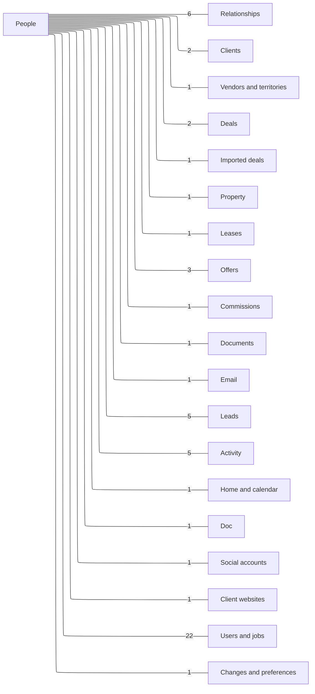

### Relationships

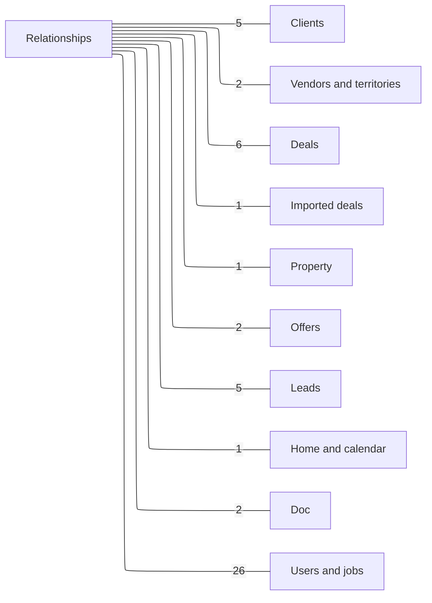

### Clients


### Vendors and territories

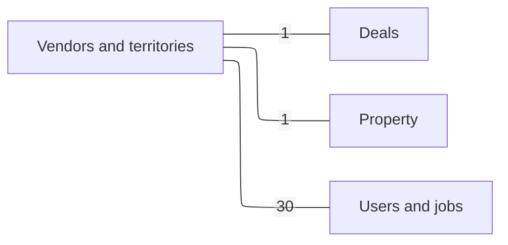

### Deals

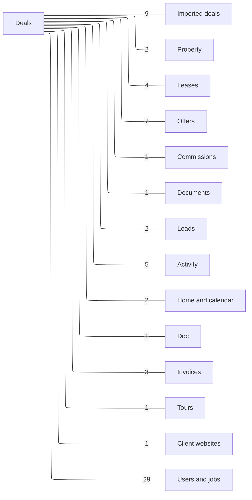

### Imported deals

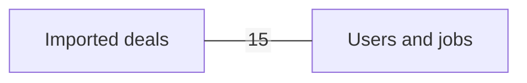

### Property

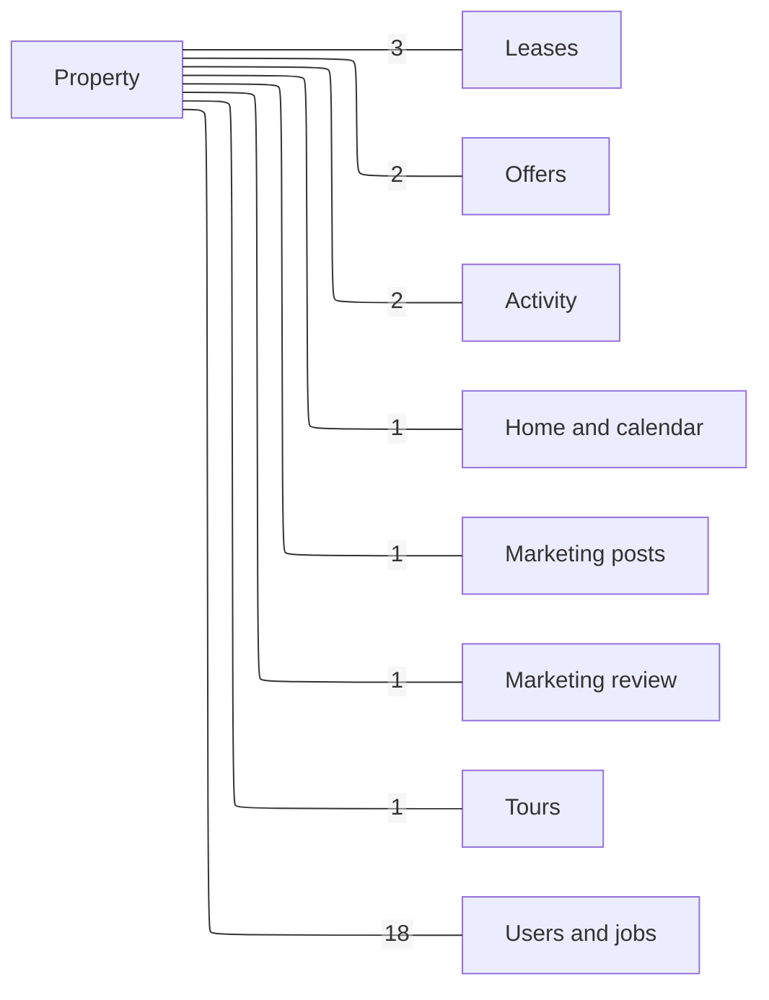

### Leases

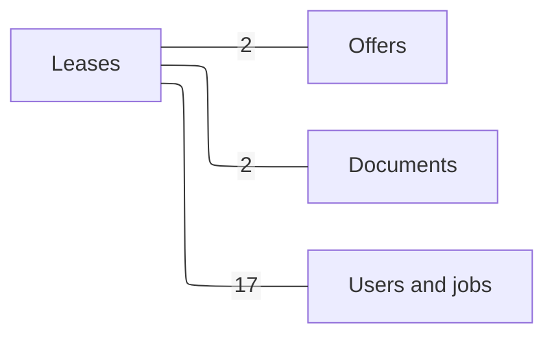

### Offers

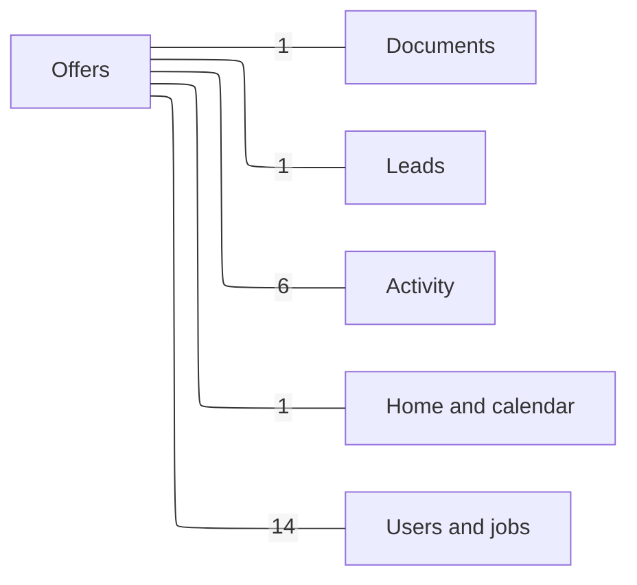

### Commissions

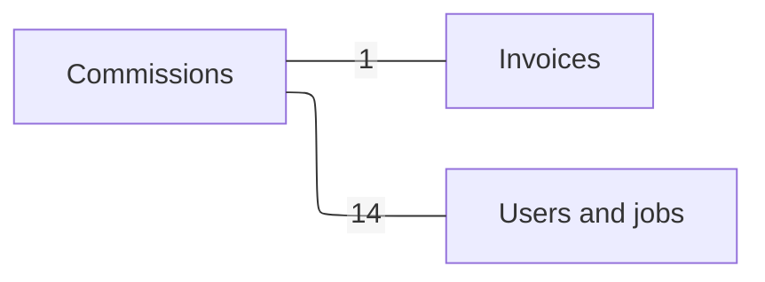

### Documents

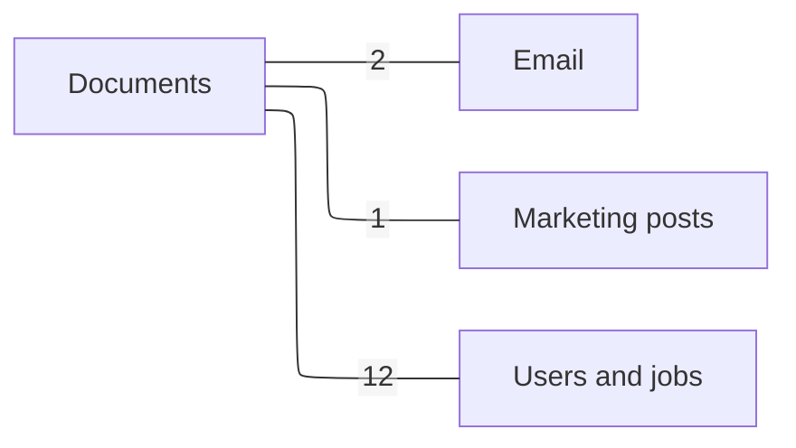

### Email

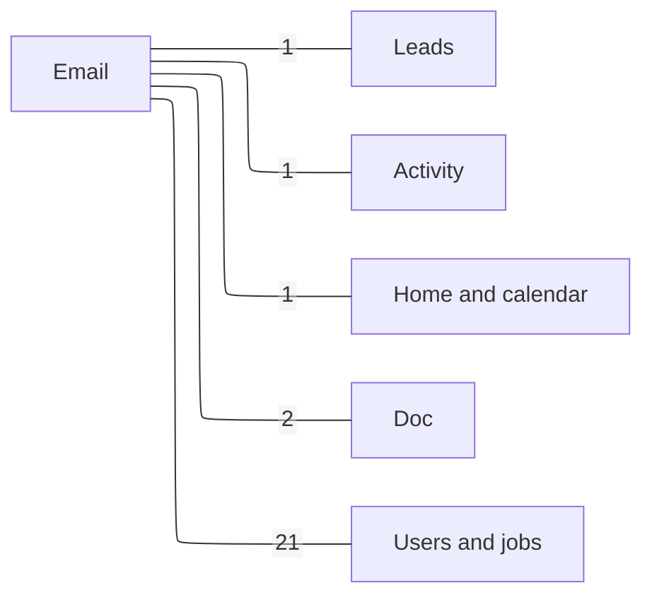

### Leads

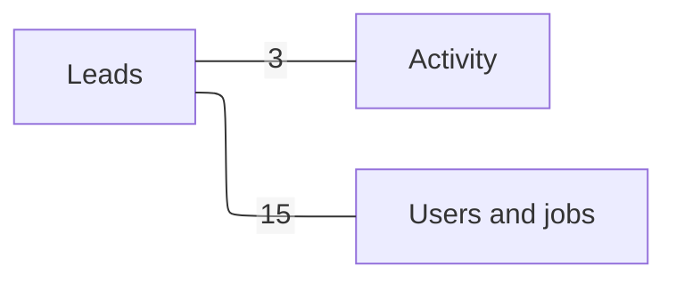

### Activity

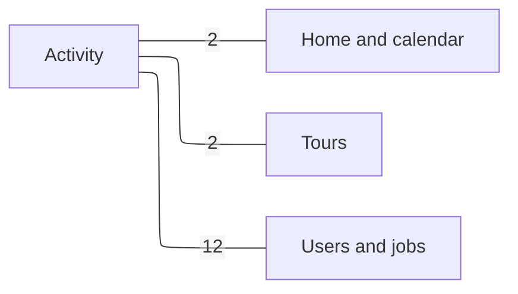

### Home and calendar


### Doc

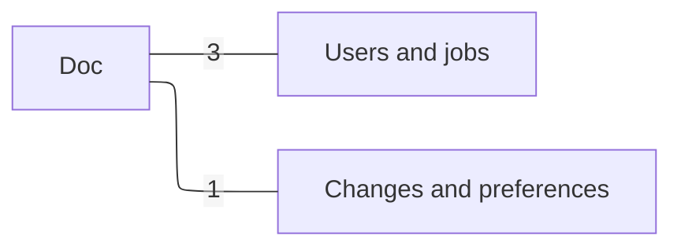

### Invoices

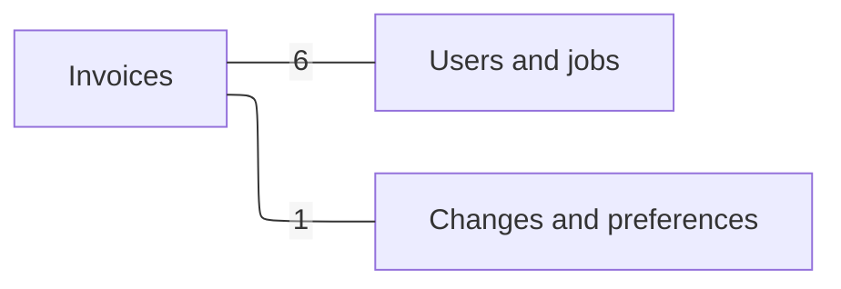

### Marketing posts

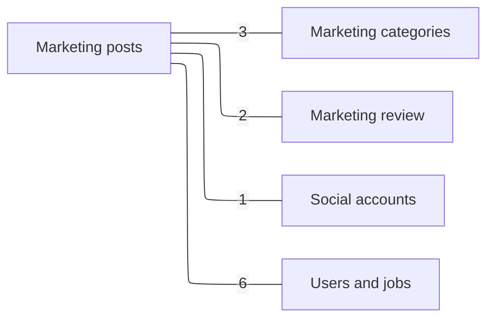

### Marketing categories


### Marketing review


### Social accounts

```mermaid
---
config:
  layout: elk
  flowchart:
    htmlLabels: false
---
flowchart LR
  a-social-accounts["Social accounts"]
  a-users-jobs["Users and jobs"]
  a-social-accounts ---|4| a-users-jobs
  click a-social-accounts href "https://github.com/DoctorCRE/doctorcre-engine/blob/main/docs/database/tables/viewpoint-social-accounts.md"
  click a-users-jobs href "https://github.com/DoctorCRE/doctorcre-engine/blob/main/docs/database/tables/viewpoint-users-jobs.md"
```

### Tours

```mermaid
---
config:
  layout: elk
  flowchart:
    htmlLabels: false
---
flowchart LR
  a-tours["Tours"]
  a-users-jobs["Users and jobs"]
  a-tours ---|6| a-users-jobs
  click a-tours href "https://github.com/DoctorCRE/doctorcre-engine/blob/main/docs/database/tables/viewpoint-tours.md"
  click a-users-jobs href "https://github.com/DoctorCRE/doctorcre-engine/blob/main/docs/database/tables/viewpoint-users-jobs.md"
```

### Client websites

```mermaid
---
config:
  layout: elk
  flowchart:
    htmlLabels: false
---
flowchart LR
  a-website["Client websites"]
  a-users-jobs["Users and jobs"]
  a-website ---|4| a-users-jobs
  click a-website href "https://github.com/DoctorCRE/doctorcre-engine/blob/main/docs/database/tables/viewpoint-website.md"
  click a-users-jobs href "https://github.com/DoctorCRE/doctorcre-engine/blob/main/docs/database/tables/viewpoint-users-jobs.md"
```

### Users and jobs

```mermaid
---
config:
  layout: elk
  flowchart:
    htmlLabels: false
---
flowchart LR
  a-users-jobs["Users and jobs"]
  a-changes-preferences["Changes and preferences"]
  a-users-jobs ---|10| a-changes-preferences
  click a-users-jobs href "https://github.com/DoctorCRE/doctorcre-engine/blob/main/docs/database/tables/viewpoint-users-jobs.md"
  click a-changes-preferences href "https://github.com/DoctorCRE/doctorcre-engine/blob/main/docs/database/tables/viewpoint-changes-preferences.md"
```

<!-- End master drawing -->

Select a box to open its drawing on the main branch, or use the [area and table index](tables/README.md) to browse this version. Each area drawing labels its lines with the columns that link the tables. For columns, cross-area references, and constraints, open a table page or see [the schema](../../schema/next.sql).

## Regenerate

Install Node.js and Docker, start the Docker daemon, and run `npm ci`. From the repository root, run:

```sh
./docs/database/generate.sh
```

The command loads the schema into a disposable PostgreSQL 18 container. The pinned tbls image writes the table pages and exports the schema for the Mermaid drawings. The command stops the database container on exit.

Assign each new table to one area in [.tbls.yml](.tbls.yml). Rerun the command after schema changes and commit the generated pages. Split an area if its drawing becomes difficult to read.
