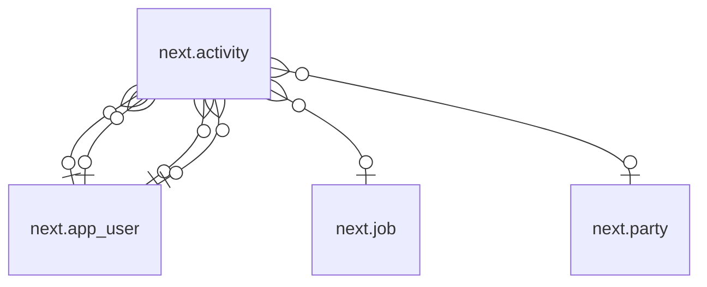
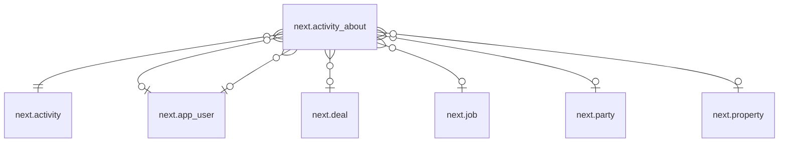
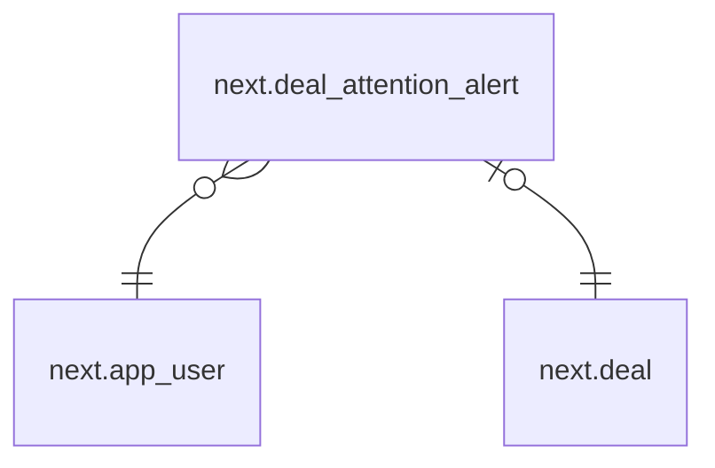
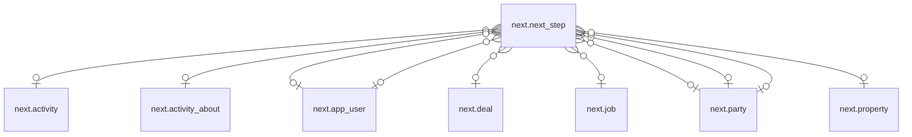

# activity

## next.activity

- `FOREIGN KEY (calendar_review_user_id) REFERENCES app_user(id)`
- `FOREIGN KEY (call_owner_user_id) REFERENCES app_user(id)`
- `FOREIGN KEY (changed_by_user_id) REFERENCES app_user(id)`
- `FOREIGN KEY (changed_for_user_id) REFERENCES app_user(id)`
- `FOREIGN KEY (changed_by_job) REFERENCES job(slug)`
- `FOREIGN KEY (from_party_id) REFERENCES party(id)`

## next.activity_about

- `FOREIGN KEY (activity_id) REFERENCES activity(id)`
- `FOREIGN KEY (changed_by_user_id) REFERENCES app_user(id)`
- `FOREIGN KEY (changed_for_user_id) REFERENCES app_user(id)`
- `FOREIGN KEY (deal_id) REFERENCES deal(id)`
- `FOREIGN KEY (changed_by_job) REFERENCES job(slug)`
- `FOREIGN KEY (party_id) REFERENCES party(id)`
- `FOREIGN KEY (property_id) REFERENCES property(id)`

## next.deal_attention_alert

- `FOREIGN KEY (owner_user_id) REFERENCES app_user(id)`
- `FOREIGN KEY (deal_id) REFERENCES deal(id) ON DELETE CASCADE`

## next.next_step

- `FOREIGN KEY (call_activity_id, call_kind) REFERENCES activity(id, kind)`
- `FOREIGN KEY (call_activity_id, deal_id) REFERENCES activity_about(activity_id, deal_id)`
- `FOREIGN KEY (changed_by_user_id) REFERENCES app_user(id)`
- `FOREIGN KEY (changed_for_user_id) REFERENCES app_user(id)`
- `FOREIGN KEY (deal_id) REFERENCES deal(id)`
- `FOREIGN KEY (changed_by_job) REFERENCES job(slug)`
- `FOREIGN KEY (call_contact_party_id) REFERENCES party(id)`
- `FOREIGN KEY (owner_party_id) REFERENCES party(id)`
- `FOREIGN KEY (party_id) REFERENCES party(id)`
- `FOREIGN KEY (property_id) REFERENCES property(id)`
