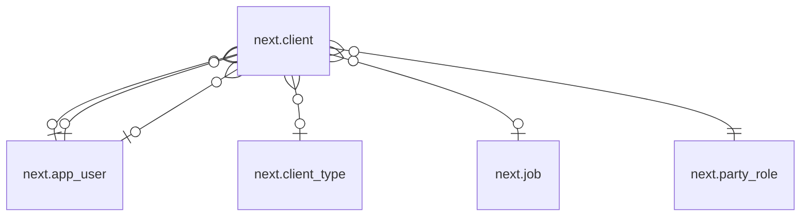
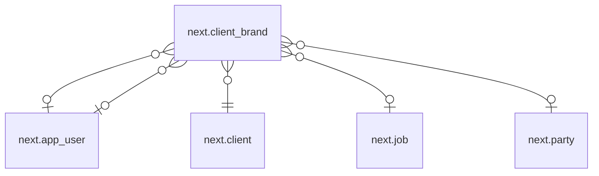
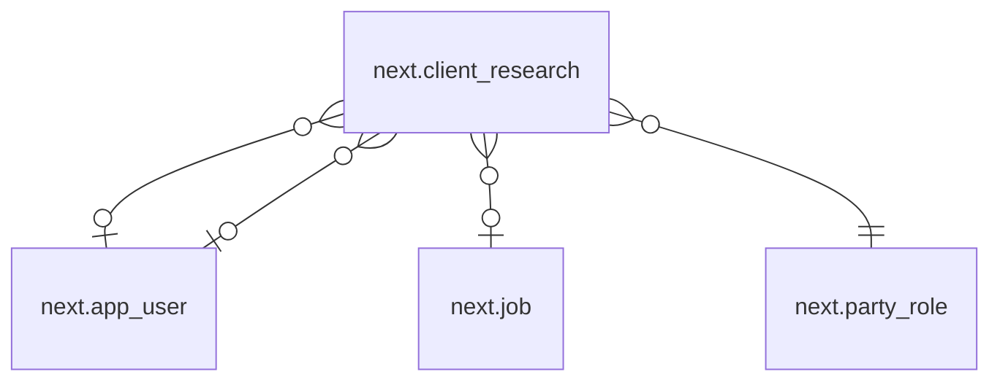
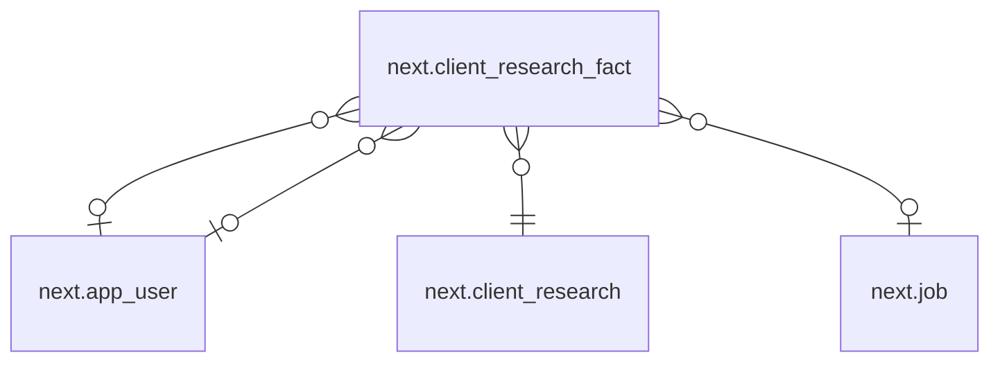
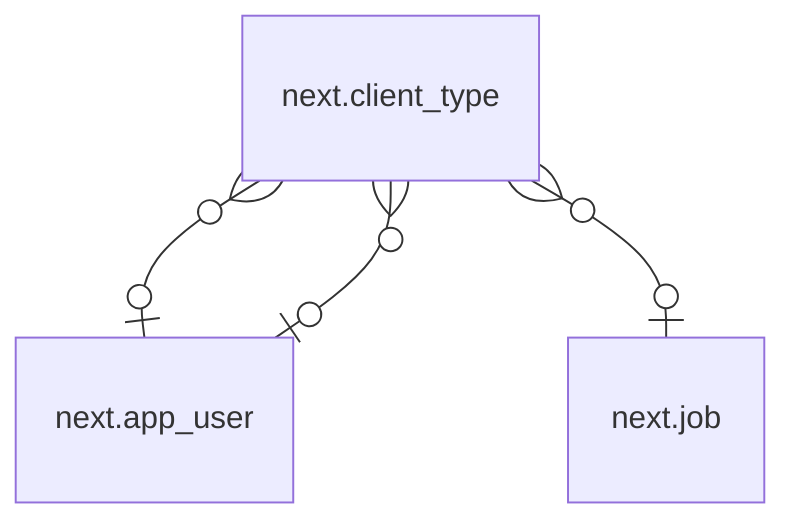
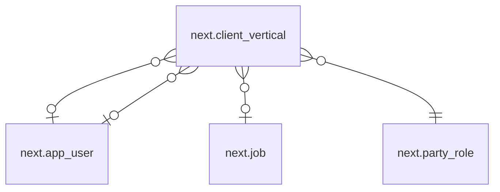
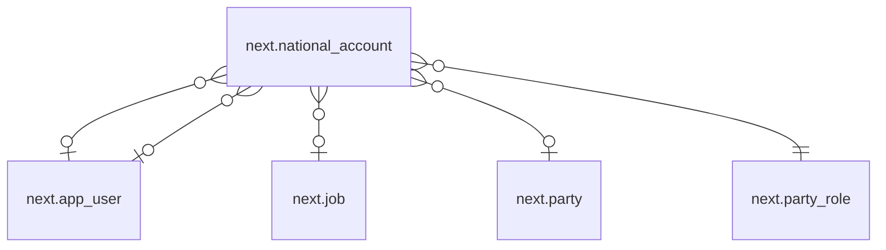
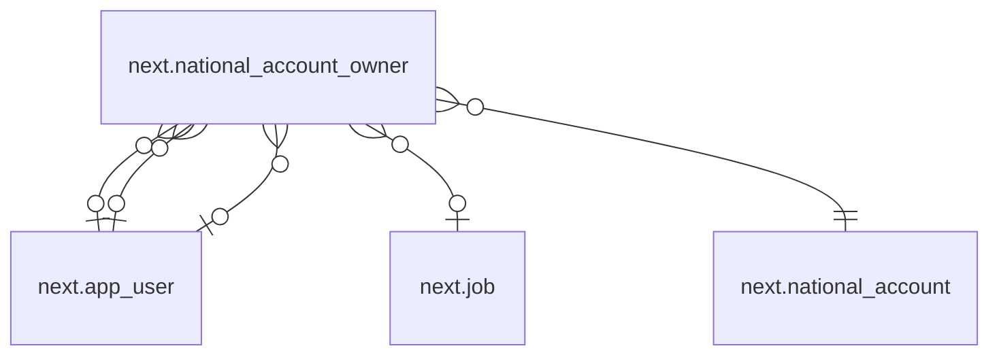

# clients

## next.client

- `FOREIGN KEY (changed_by_user_id) REFERENCES app_user(id)`
- `FOREIGN KEY (changed_for_user_id) REFERENCES app_user(id)`
- `FOREIGN KEY (owner_user_id) REFERENCES app_user(id)`
- `FOREIGN KEY (client_type) REFERENCES client_type(slug)`
- `FOREIGN KEY (changed_by_job) REFERENCES job(slug)`
- `FOREIGN KEY (party_id, role) REFERENCES party_role(party_id, role) ON UPDATE CASCADE`

## next.client_brand

- `FOREIGN KEY (changed_by_user_id) REFERENCES app_user(id)`
- `FOREIGN KEY (changed_for_user_id) REFERENCES app_user(id)`
- `FOREIGN KEY (location_id) REFERENCES client(party_id) ON UPDATE CASCADE`
- `FOREIGN KEY (changed_by_job) REFERENCES job(slug)`
- `FOREIGN KEY (brand_id, brand_kind) REFERENCES party(id, kind)`

## next.client_research

- `FOREIGN KEY (changed_by_user_id) REFERENCES app_user(id)`
- `FOREIGN KEY (changed_for_user_id) REFERENCES app_user(id)`
- `FOREIGN KEY (changed_by_job) REFERENCES job(slug)`
- `FOREIGN KEY (party_id, role) REFERENCES party_role(party_id, role) ON UPDATE CASCADE`

## next.client_research_fact

- `FOREIGN KEY (changed_by_user_id) REFERENCES app_user(id)`
- `FOREIGN KEY (changed_for_user_id) REFERENCES app_user(id)`
- `FOREIGN KEY (research_id) REFERENCES client_research(id)`
- `FOREIGN KEY (changed_by_job) REFERENCES job(slug)`

## next.client_type

- `FOREIGN KEY (changed_by_user_id) REFERENCES app_user(id)`
- `FOREIGN KEY (changed_for_user_id) REFERENCES app_user(id)`
- `FOREIGN KEY (changed_by_job) REFERENCES job(slug)`

## next.client_vertical

- `FOREIGN KEY (changed_by_user_id) REFERENCES app_user(id)`
- `FOREIGN KEY (changed_for_user_id) REFERENCES app_user(id)`
- `FOREIGN KEY (changed_by_job) REFERENCES job(slug)`
- `FOREIGN KEY (party_id, role) REFERENCES party_role(party_id, role) ON UPDATE CASCADE`

## next.national_account

- `FOREIGN KEY (changed_by_user_id) REFERENCES app_user(id)`
- `FOREIGN KEY (changed_for_user_id) REFERENCES app_user(id)`
- `FOREIGN KEY (changed_by_job) REFERENCES job(slug)`
- `FOREIGN KEY (party_id, kind) REFERENCES party(id, kind)`
- `FOREIGN KEY (party_id, role) REFERENCES party_role(party_id, role) ON UPDATE CASCADE`

## next.national_account_owner

- `FOREIGN KEY (changed_by_user_id) REFERENCES app_user(id)`
- `FOREIGN KEY (changed_for_user_id) REFERENCES app_user(id)`
- `FOREIGN KEY (owner_id, owner_is_partner) REFERENCES app_user(id, is_account_partner)`
- `FOREIGN KEY (changed_by_job) REFERENCES job(slug)`
- `FOREIGN KEY (account_id) REFERENCES national_account(party_id) ON UPDATE CASCADE`
