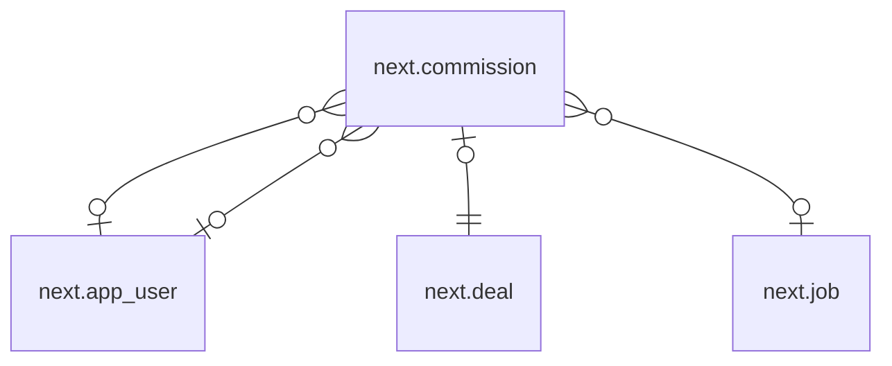
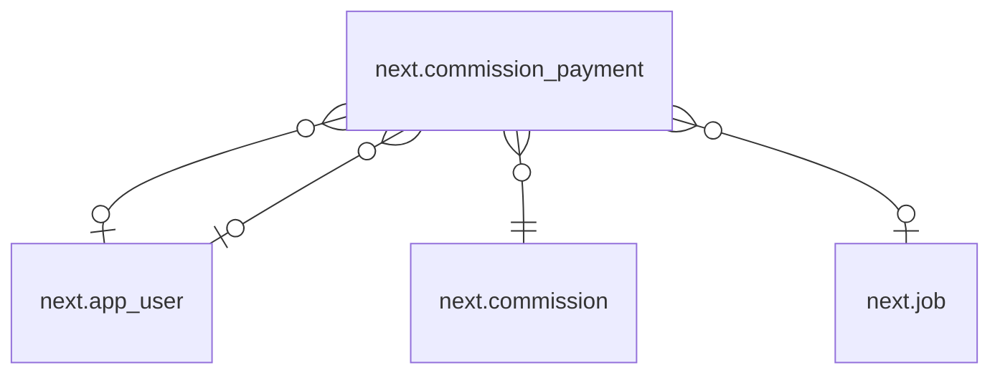
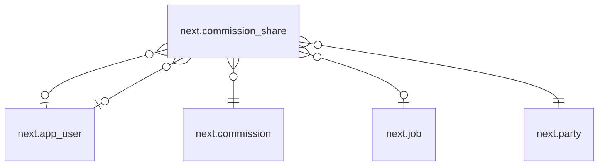
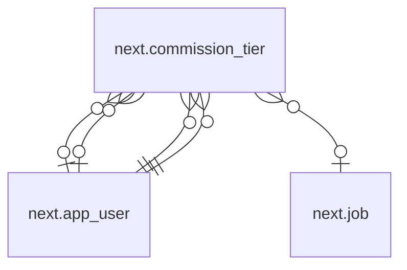

# commissions

## next.commission

- `FOREIGN KEY (changed_by_user_id) REFERENCES app_user(id)`
- `FOREIGN KEY (changed_for_user_id) REFERENCES app_user(id)`
- `FOREIGN KEY (deal_id) REFERENCES deal(id)`
- `FOREIGN KEY (changed_by_job) REFERENCES job(slug)`

## next.commission_payment

- `FOREIGN KEY (changed_by_user_id) REFERENCES app_user(id)`
- `FOREIGN KEY (changed_for_user_id) REFERENCES app_user(id)`
- `FOREIGN KEY (deal_id) REFERENCES commission(deal_id)`
- `FOREIGN KEY (changed_by_job) REFERENCES job(slug)`

## next.commission_share

- `FOREIGN KEY (changed_by_user_id) REFERENCES app_user(id)`
- `FOREIGN KEY (changed_for_user_id) REFERENCES app_user(id)`
- `FOREIGN KEY (deal_id) REFERENCES commission(deal_id)`
- `FOREIGN KEY (changed_by_job) REFERENCES job(slug)`
- `FOREIGN KEY (party_id) REFERENCES party(id)`

## next.commission_tier

- `FOREIGN KEY (changed_by_user_id) REFERENCES app_user(id)`
- `FOREIGN KEY (changed_for_user_id) REFERENCES app_user(id)`
- `FOREIGN KEY (partner_user_id) REFERENCES app_user(id)`
- `FOREIGN KEY (user_id) REFERENCES app_user(id)`
- `FOREIGN KEY (changed_by_job) REFERENCES job(slug)`
