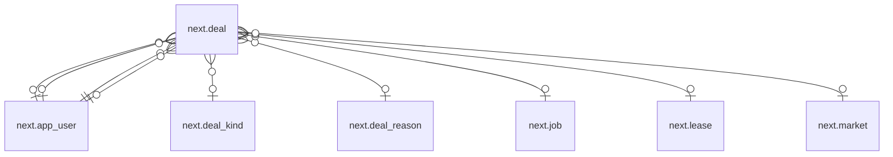
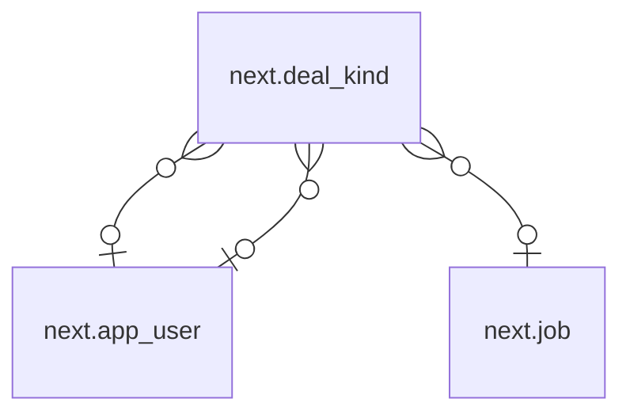
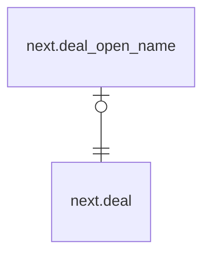
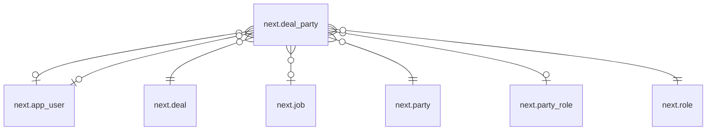
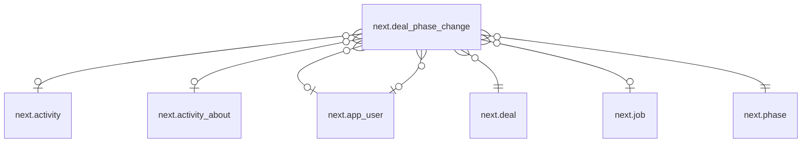
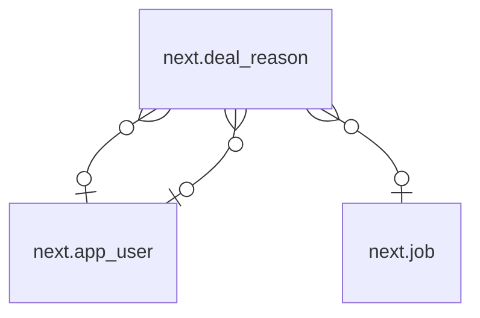
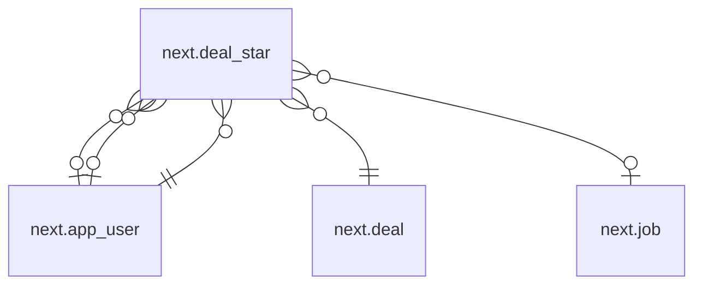
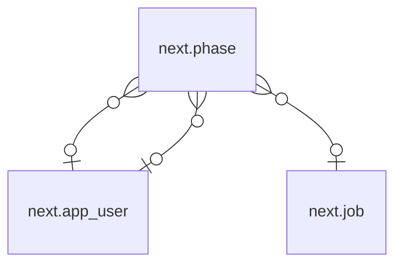
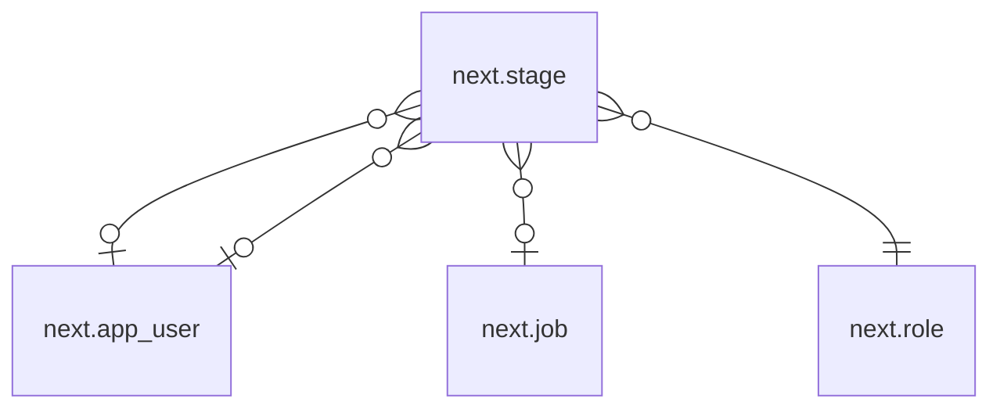
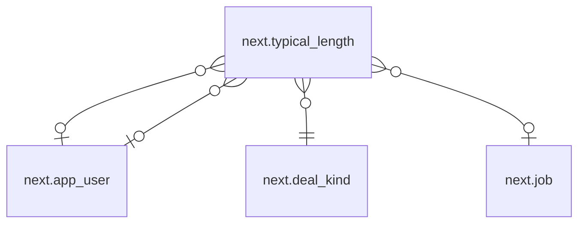

# deals

## next.deal

- `FOREIGN KEY (changed_by_user_id) REFERENCES app_user(id)`
- `FOREIGN KEY (changed_for_user_id) REFERENCES app_user(id)`
- `FOREIGN KEY (owner_user_id) REFERENCES app_user(id)`
- `FOREIGN KEY (parked_by_user_id) REFERENCES app_user(id)`
- `FOREIGN KEY (kind) REFERENCES deal_kind(slug)`
- `FOREIGN KEY (reason) REFERENCES deal_reason(slug)`
- `FOREIGN KEY (changed_by_job) REFERENCES job(slug)`
- `FOREIGN KEY (renews_lease_id) REFERENCES lease(id)`
- `FOREIGN KEY (market_id) REFERENCES market(id)`

## next.deal_kind

- `FOREIGN KEY (changed_by_user_id) REFERENCES app_user(id)`
- `FOREIGN KEY (changed_for_user_id) REFERENCES app_user(id)`
- `FOREIGN KEY (changed_by_job) REFERENCES job(slug)`

## next.deal_open_name

- `FOREIGN KEY (deal_id) REFERENCES deal(id) ON DELETE CASCADE`

## next.deal_party

- `FOREIGN KEY (changed_by_user_id) REFERENCES app_user(id)`
- `FOREIGN KEY (changed_for_user_id) REFERENCES app_user(id)`
- `FOREIGN KEY (deal_id) REFERENCES deal(id)`
- `FOREIGN KEY (changed_by_job) REFERENCES job(slug)`
- `FOREIGN KEY (party_id) REFERENCES party(id)`
- `FOREIGN KEY (party_id, client_role) REFERENCES party_role(party_id, role) DEFERRABLE INITIALLY DEFERRED`
- `FOREIGN KEY (role) REFERENCES role(slug)`

## next.deal_phase_change

- `FOREIGN KEY (call_activity_id, call_kind) REFERENCES activity(id, kind)`
- `FOREIGN KEY (call_activity_id, deal_id) REFERENCES activity_about(activity_id, deal_id)`
- `FOREIGN KEY (changed_by_user_id) REFERENCES app_user(id)`
- `FOREIGN KEY (changed_for_user_id) REFERENCES app_user(id)`
- `FOREIGN KEY (deal_id) REFERENCES deal(id)`
- `FOREIGN KEY (changed_by_job) REFERENCES job(slug)`
- `FOREIGN KEY (phase) REFERENCES phase(slug)`

## next.deal_reason

- `FOREIGN KEY (changed_by_user_id) REFERENCES app_user(id)`
- `FOREIGN KEY (changed_for_user_id) REFERENCES app_user(id)`
- `FOREIGN KEY (changed_by_job) REFERENCES job(slug)`

## next.deal_star

- `FOREIGN KEY (changed_by_user_id) REFERENCES app_user(id)`
- `FOREIGN KEY (changed_for_user_id) REFERENCES app_user(id)`
- `FOREIGN KEY (user_id) REFERENCES app_user(id)`
- `FOREIGN KEY (deal_id) REFERENCES deal(id) ON DELETE CASCADE`
- `FOREIGN KEY (changed_by_job) REFERENCES job(slug)`

## next.phase

- `FOREIGN KEY (changed_by_user_id) REFERENCES app_user(id)`
- `FOREIGN KEY (changed_for_user_id) REFERENCES app_user(id)`
- `FOREIGN KEY (changed_by_job) REFERENCES job(slug)`

## next.stage

- `FOREIGN KEY (changed_by_user_id) REFERENCES app_user(id)`
- `FOREIGN KEY (changed_for_user_id) REFERENCES app_user(id)`
- `FOREIGN KEY (changed_by_job) REFERENCES job(slug)`
- `FOREIGN KEY (role) REFERENCES role(slug)`

## next.typical_length

- `FOREIGN KEY (changed_by_user_id) REFERENCES app_user(id)`
- `FOREIGN KEY (changed_for_user_id) REFERENCES app_user(id)`
- `FOREIGN KEY (deal_kind) REFERENCES deal_kind(slug)`
- `FOREIGN KEY (changed_by_job) REFERENCES job(slug)`
