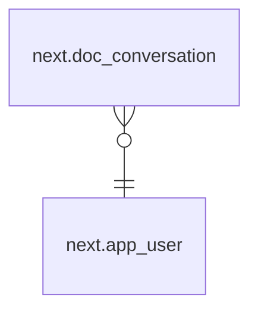
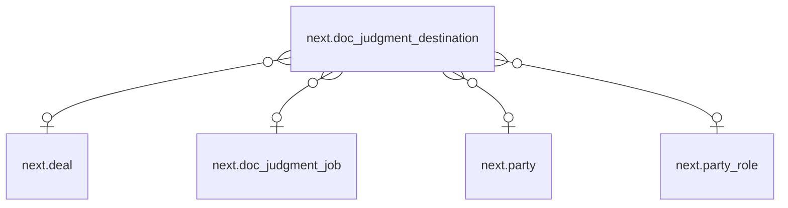
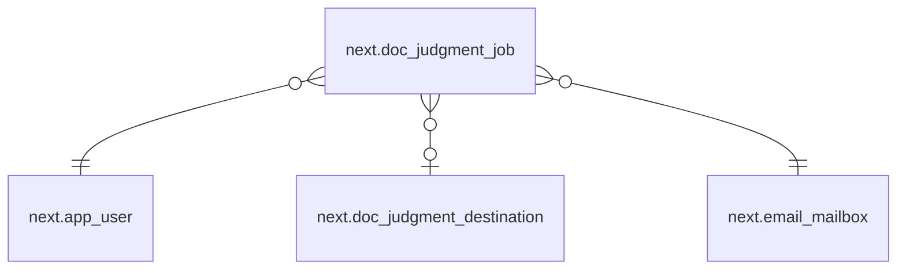
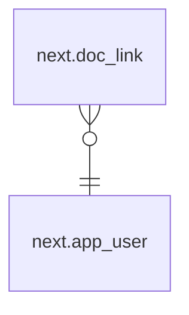
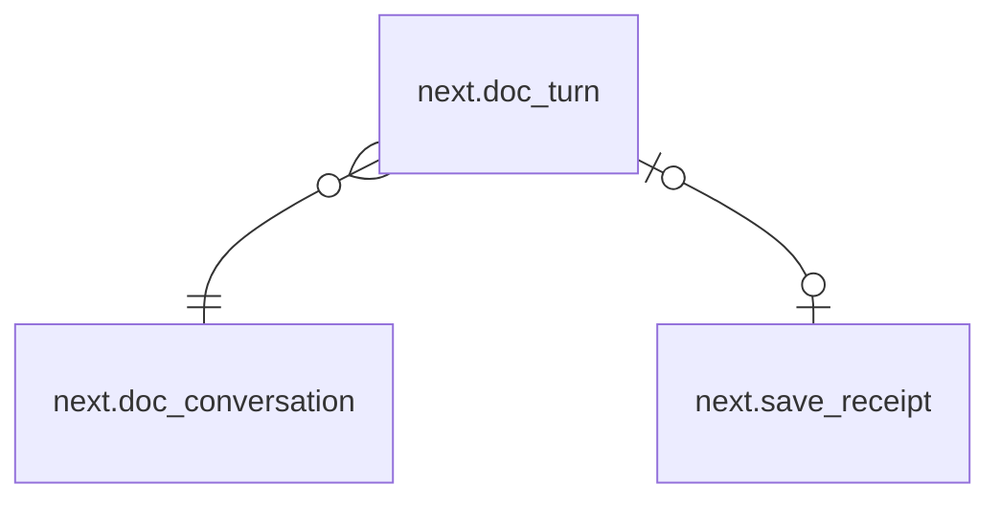

# doc

## next.doc_conversation

- `FOREIGN KEY (owner_user_id, is_account_partner) REFERENCES app_user(id, is_account_partner)`

## next.doc_judgment_destination

- `FOREIGN KEY (deal_id) REFERENCES deal(id)`
- `FOREIGN KEY (job_id, job_kind) REFERENCES doc_judgment_job(id, kind) ON DELETE CASCADE`
- `FOREIGN KEY (vendor_id) REFERENCES party(id)`
- `FOREIGN KEY (vendor_id, vendor_role) REFERENCES party_role(party_id, role) DEFERRABLE INITIALLY DEFERRED`

## next.doc_judgment_job

- `FOREIGN KEY (owner_user_id, is_account_partner) REFERENCES app_user(id, is_account_partner)`
- `FOREIGN KEY (id, first_destination) REFERENCES doc_judgment_destination(job_id, "position") DEFERRABLE INITIALLY DEFERRED`
- `FOREIGN KEY (activity_id, owner_user_id) REFERENCES email_mailbox(activity_id, user_id) ON DELETE CASCADE`

## next.doc_link

- `FOREIGN KEY (owner_user_id, is_account_partner) REFERENCES app_user(id, is_account_partner)`

## next.doc_turn

- `FOREIGN KEY (conversation_id, owner_user_id) REFERENCES doc_conversation(id, owner_user_id)`
- `FOREIGN KEY (confirmation_key) REFERENCES save_receipt(idempotency_key) DEFERRABLE INITIALLY DEFERRED`
