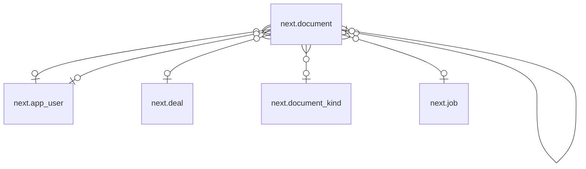
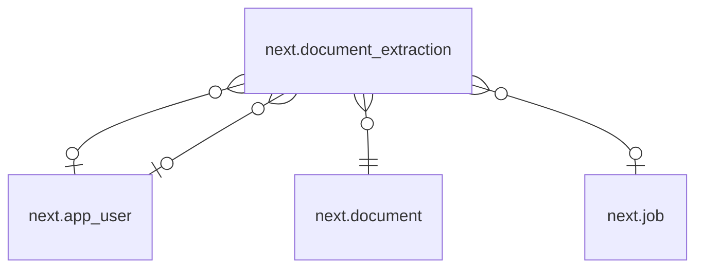
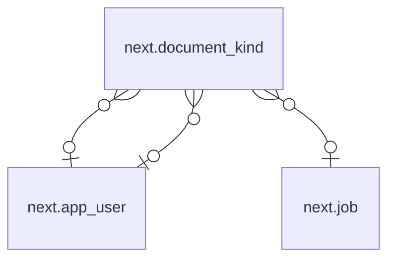
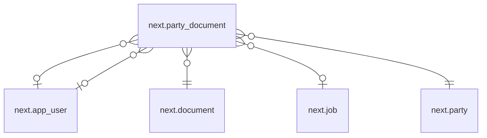

# documents

## next.document

- `FOREIGN KEY (changed_by_user_id) REFERENCES app_user(id)`
- `FOREIGN KEY (changed_for_user_id) REFERENCES app_user(id)`
- `FOREIGN KEY (deal_id) REFERENCES deal(id)`
- `FOREIGN KEY (supersedes_id, deal_id, kind, previous_version) REFERENCES document(id, deal_id, kind, version)`
- `FOREIGN KEY (kind) REFERENCES document_kind(slug)`
- `FOREIGN KEY (changed_by_job) REFERENCES job(slug)`

## next.document_extraction

- `FOREIGN KEY (changed_by_user_id) REFERENCES app_user(id)`
- `FOREIGN KEY (changed_for_user_id) REFERENCES app_user(id)`
- `FOREIGN KEY (document_id, deal_id) REFERENCES document(id, deal_id)`
- `FOREIGN KEY (changed_by_job) REFERENCES job(slug)`

## next.document_kind

- `FOREIGN KEY (changed_by_user_id) REFERENCES app_user(id)`
- `FOREIGN KEY (changed_for_user_id) REFERENCES app_user(id)`
- `FOREIGN KEY (changed_by_job) REFERENCES job(slug)`

## next.party_document

- `FOREIGN KEY (changed_by_user_id) REFERENCES app_user(id)`
- `FOREIGN KEY (changed_for_user_id) REFERENCES app_user(id)`
- `FOREIGN KEY (document_id) REFERENCES document(id)`
- `FOREIGN KEY (changed_by_job) REFERENCES job(slug)`
- `FOREIGN KEY (party_id) REFERENCES party(id)`
