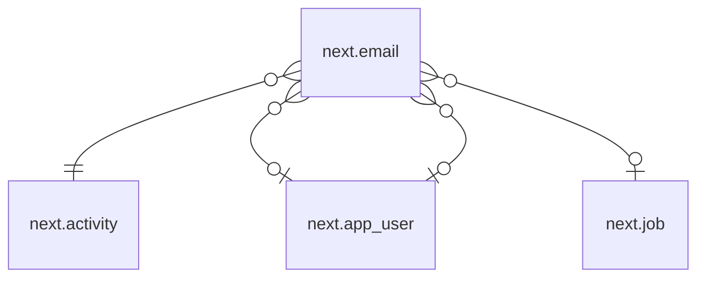
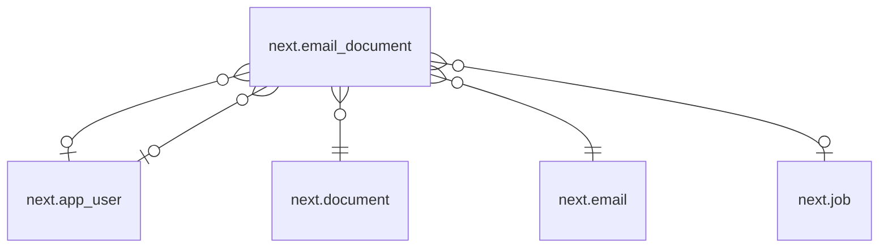
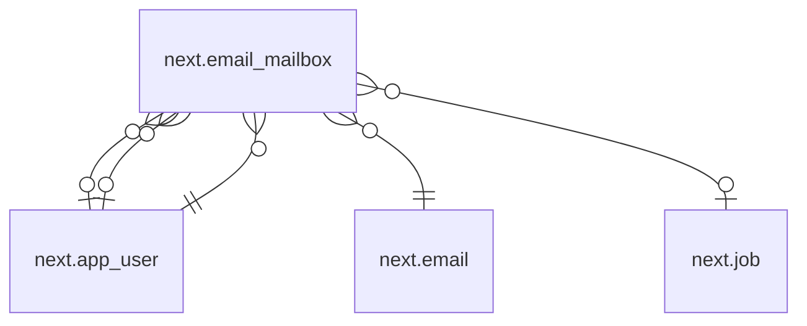
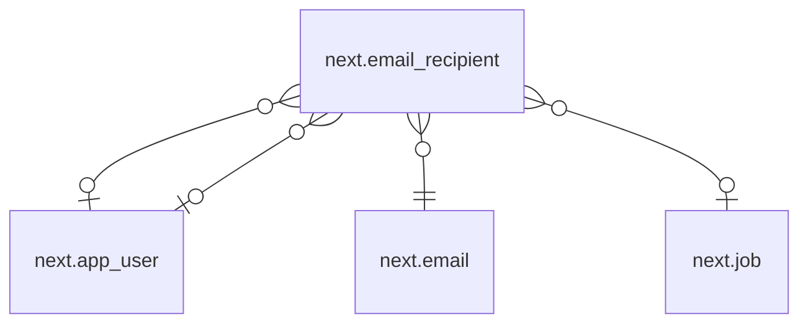
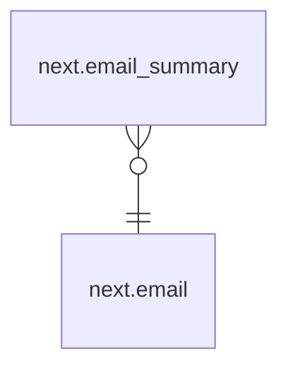
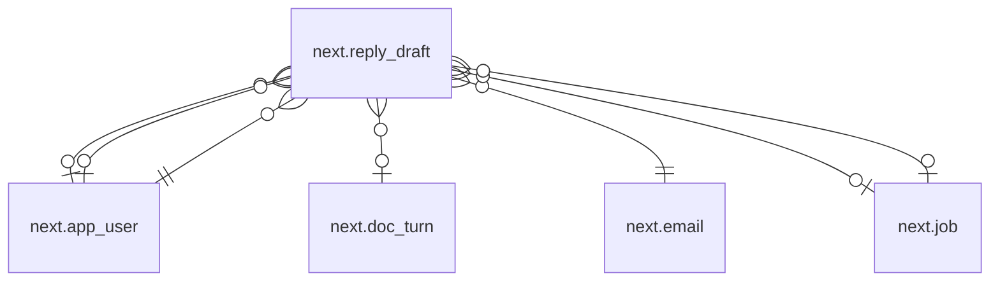
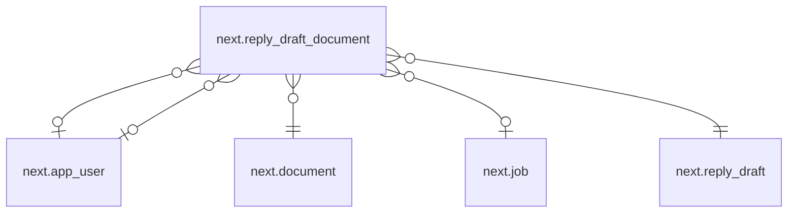

# email

## next.email

- `FOREIGN KEY (activity_id, activity_kind) REFERENCES activity(id, kind)`
- `FOREIGN KEY (changed_by_user_id) REFERENCES app_user(id)`
- `FOREIGN KEY (changed_for_user_id) REFERENCES app_user(id)`
- `FOREIGN KEY (changed_by_job) REFERENCES job(slug)`

## next.email_document

- `FOREIGN KEY (changed_by_user_id) REFERENCES app_user(id)`
- `FOREIGN KEY (changed_for_user_id) REFERENCES app_user(id)`
- `FOREIGN KEY (document_id) REFERENCES document(id)`
- `FOREIGN KEY (email_activity_id) REFERENCES email(activity_id)`
- `FOREIGN KEY (changed_by_job) REFERENCES job(slug)`

## next.email_mailbox

- `FOREIGN KEY (changed_by_user_id) REFERENCES app_user(id)`
- `FOREIGN KEY (changed_for_user_id) REFERENCES app_user(id)`
- `FOREIGN KEY (user_id) REFERENCES app_user(id)`
- `FOREIGN KEY (activity_id) REFERENCES email(activity_id)`
- `FOREIGN KEY (changed_by_job) REFERENCES job(slug)`

## next.email_recipient

- `FOREIGN KEY (changed_by_user_id) REFERENCES app_user(id)`
- `FOREIGN KEY (changed_for_user_id) REFERENCES app_user(id)`
- `FOREIGN KEY (activity_id) REFERENCES email(activity_id)`
- `FOREIGN KEY (changed_by_job) REFERENCES job(slug)`

## next.email_summary

- `FOREIGN KEY (activity_id) REFERENCES email(activity_id)`

## next.reply_draft

- `FOREIGN KEY (changed_by_user_id) REFERENCES app_user(id)`
- `FOREIGN KEY (changed_for_user_id) REFERENCES app_user(id)`
- `FOREIGN KEY (owner_user_id) REFERENCES app_user(id)`
- `FOREIGN KEY (confirmed_doc_turn_id, owner_user_id) REFERENCES doc_turn(id, owner_user_id)`
- `FOREIGN KEY (email_activity_id) REFERENCES email(activity_id)`
- `FOREIGN KEY (changed_by_job) REFERENCES job(slug)`
- `FOREIGN KEY (proposed_by_job) REFERENCES job(slug)`

## next.reply_draft_document

- `FOREIGN KEY (changed_by_user_id) REFERENCES app_user(id)`
- `FOREIGN KEY (changed_for_user_id) REFERENCES app_user(id)`
- `FOREIGN KEY (document_id) REFERENCES document(id)`
- `FOREIGN KEY (changed_by_job) REFERENCES job(slug)`
- `FOREIGN KEY (reply_draft_id) REFERENCES reply_draft(id)`
