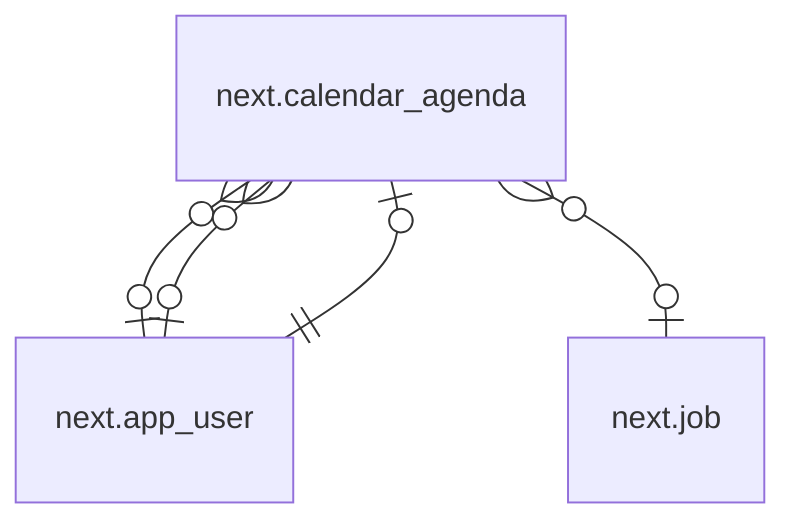
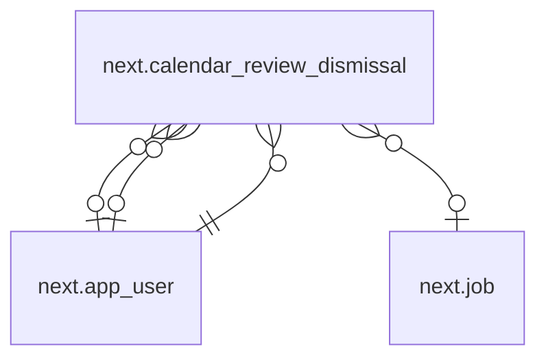
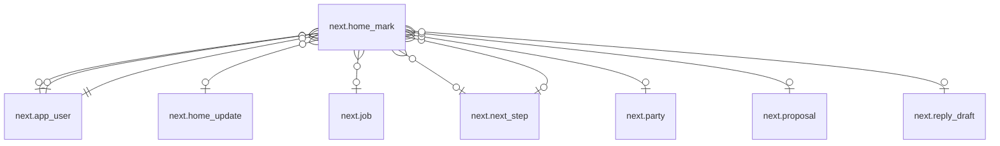
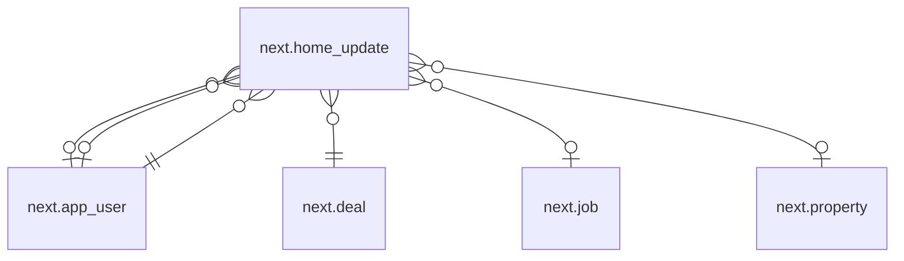
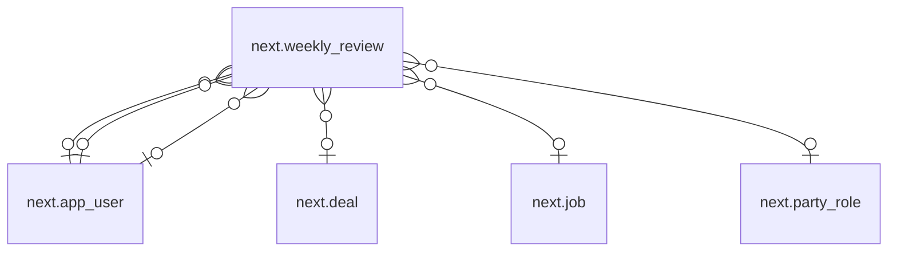

# home-calendar

## next.calendar_agenda

- `FOREIGN KEY (changed_by_user_id) REFERENCES app_user(id)`
- `FOREIGN KEY (changed_for_user_id) REFERENCES app_user(id)`
- `FOREIGN KEY (user_id) REFERENCES app_user(id)`
- `FOREIGN KEY (changed_by_job) REFERENCES job(slug)`

## next.calendar_review_dismissal

- `FOREIGN KEY (changed_by_user_id) REFERENCES app_user(id)`
- `FOREIGN KEY (changed_for_user_id) REFERENCES app_user(id)`
- `FOREIGN KEY (user_id) REFERENCES app_user(id)`
- `FOREIGN KEY (changed_by_job) REFERENCES job(slug)`

## next.home_mark

- `FOREIGN KEY (changed_by_user_id) REFERENCES app_user(id)`
- `FOREIGN KEY (changed_for_user_id) REFERENCES app_user(id)`
- `FOREIGN KEY (user_id) REFERENCES app_user(id)`
- `FOREIGN KEY (home_update_id, user_id) REFERENCES home_update(id, user_id)`
- `FOREIGN KEY (changed_by_job) REFERENCES job(slug)`
- `FOREIGN KEY (call_follow_up_id) REFERENCES next_step(home_call_follow_up_id)`
- `FOREIGN KEY (next_step_id) REFERENCES next_step(home_step_id)`
- `FOREIGN KEY (waiting_on_party_id) REFERENCES party(id)`
- `FOREIGN KEY (proposal_id) REFERENCES proposal(id) ON DELETE CASCADE`
- `FOREIGN KEY (reply_draft_id, user_id) REFERENCES reply_draft(id, owner_user_id)`

## next.home_update

- `FOREIGN KEY (changed_by_user_id) REFERENCES app_user(id)`
- `FOREIGN KEY (changed_for_user_id) REFERENCES app_user(id)`
- `FOREIGN KEY (user_id) REFERENCES app_user(id)`
- `FOREIGN KEY (deal_id) REFERENCES deal(id)`
- `FOREIGN KEY (changed_by_job) REFERENCES job(slug)`
- `FOREIGN KEY (property_id) REFERENCES property(id)`

## next.weekly_review

- `FOREIGN KEY (changed_by_user_id) REFERENCES app_user(id)`
- `FOREIGN KEY (changed_by_user_id, reviewer_is_partner) REFERENCES app_user(id, is_account_partner)`
- `FOREIGN KEY (changed_for_user_id) REFERENCES app_user(id)`
- `FOREIGN KEY (deal_id) REFERENCES deal(id)`
- `FOREIGN KEY (changed_by_job) REFERENCES job(slug)`
- `FOREIGN KEY (party_id, lead_role) REFERENCES party_role(party_id, role)`
