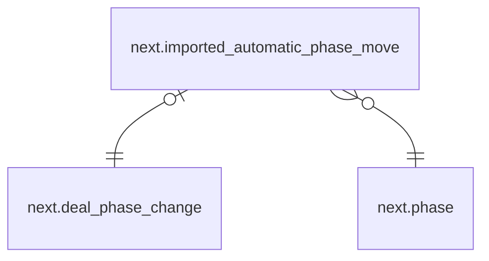
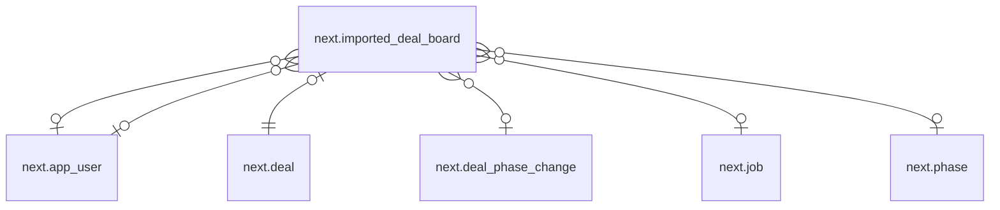
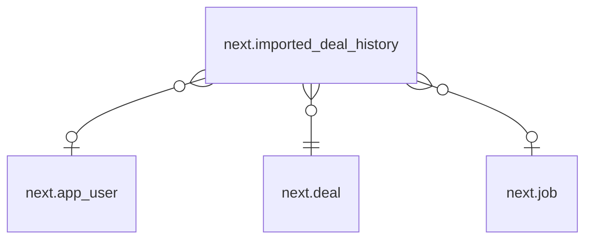
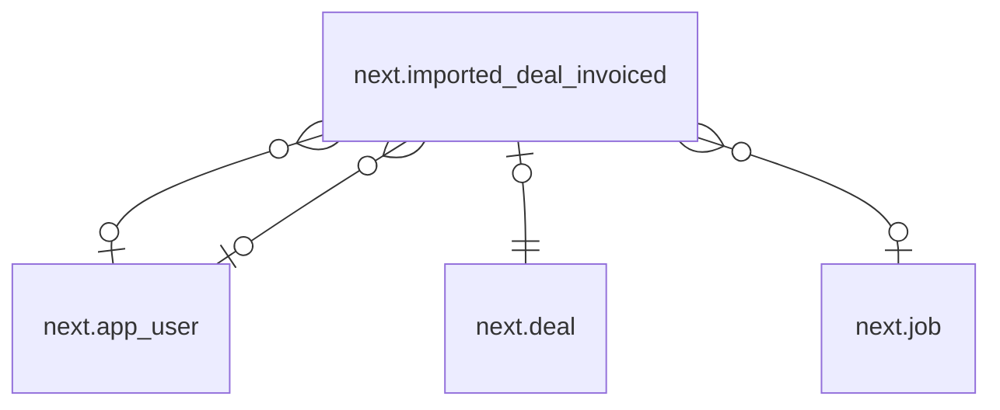
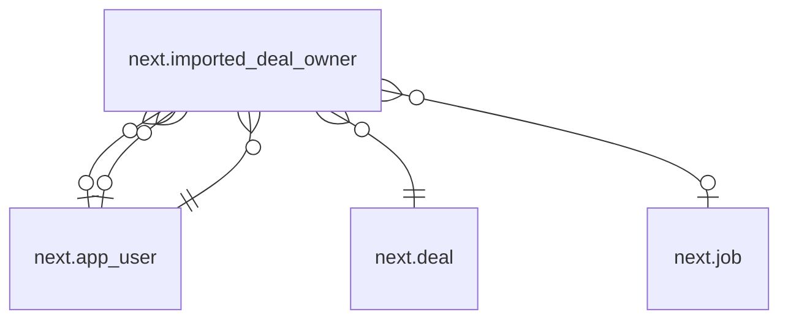
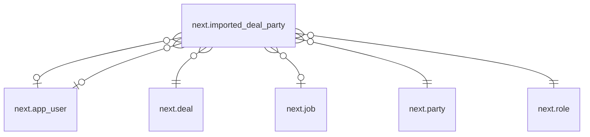

# imported-deals

## next.imported_automatic_phase_move

- `FOREIGN KEY (deal_id, happened_at) REFERENCES deal_phase_change(deal_id, happened_at)`
- `FOREIGN KEY (prior_phase) REFERENCES phase(slug)`

## next.imported_deal_board

- `FOREIGN KEY (changed_by_user_id) REFERENCES app_user(id)`
- `FOREIGN KEY (changed_for_user_id) REFERENCES app_user(id)`
- `FOREIGN KEY (deal_id) REFERENCES deal(id)`
- `FOREIGN KEY (deal_id, phase_at) REFERENCES deal_phase_change(deal_id, happened_at)`
- `FOREIGN KEY (changed_by_job) REFERENCES job(slug)`
- `FOREIGN KEY (phase) REFERENCES phase(slug)`

## next.imported_deal_history

- `FOREIGN KEY (changed_by_user_id) REFERENCES app_user(id)`
- `FOREIGN KEY (deal_id) REFERENCES deal(id)`
- `FOREIGN KEY (changed_by_job) REFERENCES job(slug)`

## next.imported_deal_invoiced

- `FOREIGN KEY (changed_by_user_id) REFERENCES app_user(id)`
- `FOREIGN KEY (changed_for_user_id) REFERENCES app_user(id)`
- `FOREIGN KEY (deal_id) REFERENCES deal(id)`
- `FOREIGN KEY (changed_by_job) REFERENCES job(slug)`

## next.imported_deal_owner

- `FOREIGN KEY (changed_by_user_id) REFERENCES app_user(id)`
- `FOREIGN KEY (changed_for_user_id) REFERENCES app_user(id)`
- `FOREIGN KEY (user_id) REFERENCES app_user(id)`
- `FOREIGN KEY (deal_id) REFERENCES deal(id)`
- `FOREIGN KEY (changed_by_job) REFERENCES job(slug)`

## next.imported_deal_party

- `FOREIGN KEY (changed_by_user_id) REFERENCES app_user(id)`
- `FOREIGN KEY (changed_for_user_id) REFERENCES app_user(id)`
- `FOREIGN KEY (deal_id) REFERENCES deal(id)`
- `FOREIGN KEY (changed_by_job) REFERENCES job(slug)`
- `FOREIGN KEY (party_id) REFERENCES party(id)`
- `FOREIGN KEY (role) REFERENCES role(slug)`
