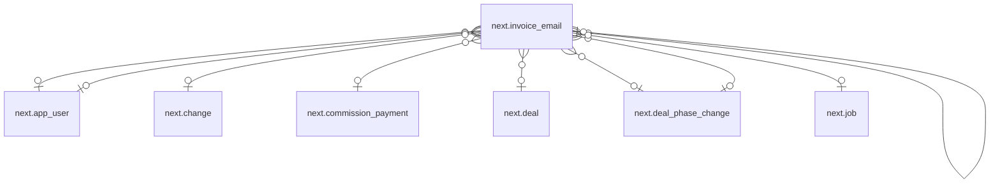
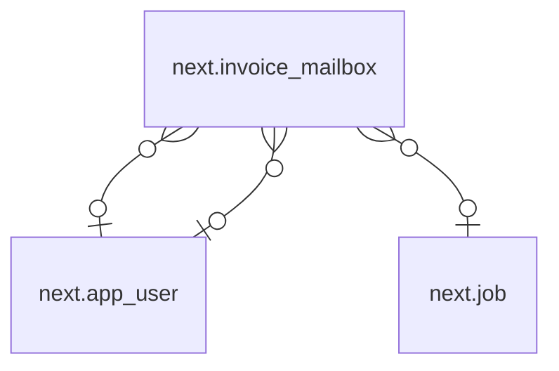

# invoices

## next.invoice_email

- `FOREIGN KEY (changed_by_user_id) REFERENCES app_user(id)`
- `FOREIGN KEY (changed_for_user_id) REFERENCES app_user(id)`
- `FOREIGN KEY (payment_change_id) REFERENCES change(id)`
- `FOREIGN KEY (payment_id, deal_id) REFERENCES commission_payment(id, deal_id)`
- `FOREIGN KEY (deal_id) REFERENCES deal(id)`
- `FOREIGN KEY (deal_id, applied_phase_at) REFERENCES deal_phase_change(deal_id, happened_at)`
- `FOREIGN KEY (deal_id, prior_phase_at) REFERENCES deal_phase_change(deal_id, happened_at)`
- `FOREIGN KEY (application_id, deal_id, payment_id, email_date) REFERENCES invoice_email(application_root_id, deal_id, payment_id, email_date)`
- `FOREIGN KEY (changed_by_job) REFERENCES job(slug)`

## next.invoice_mailbox

- `FOREIGN KEY (changed_by_user_id) REFERENCES app_user(id)`
- `FOREIGN KEY (changed_for_user_id) REFERENCES app_user(id)`
- `FOREIGN KEY (changed_by_job) REFERENCES job(slug)`
