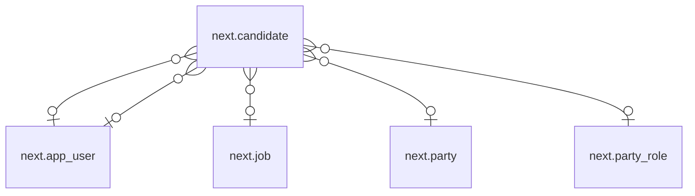
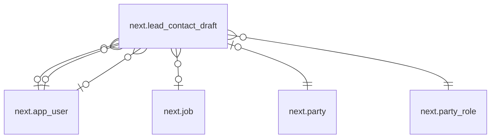
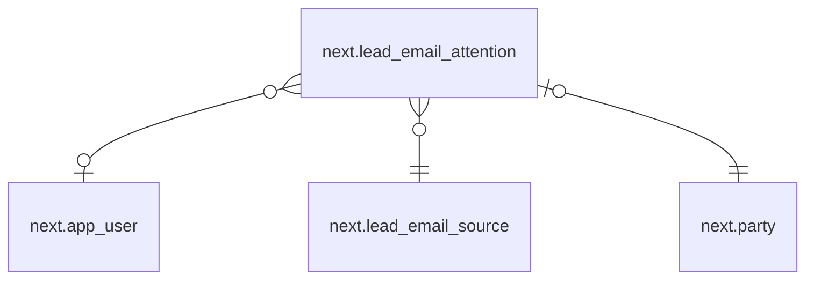
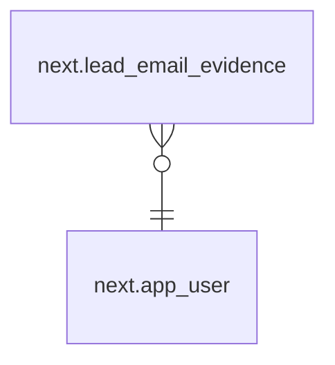
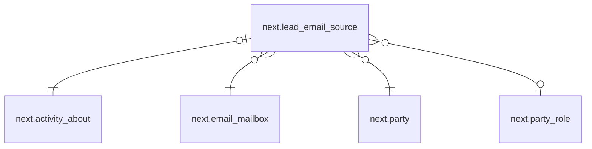
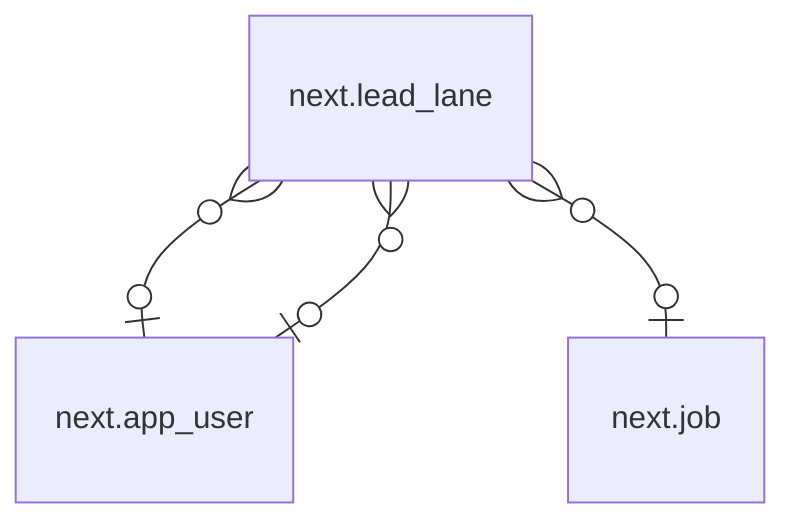
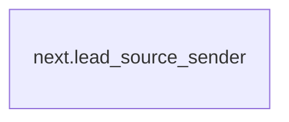
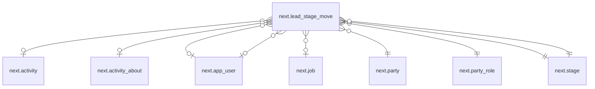

# leads

## next.candidate

- `FOREIGN KEY (changed_by_user_id) REFERENCES app_user(id)`
- `FOREIGN KEY (changed_for_user_id) REFERENCES app_user(id)`
- `FOREIGN KEY (changed_by_job) REFERENCES job(slug)`
- `FOREIGN KEY (promoted_party_id) REFERENCES party(id)`
- `FOREIGN KEY (promoted_party_id, lead_role) REFERENCES party_role(party_id, role) DEFERRABLE INITIALLY DEFERRED`

## next.lead_contact_draft

- `FOREIGN KEY (changed_by_user_id) REFERENCES app_user(id)`
- `FOREIGN KEY (changed_for_user_id) REFERENCES app_user(id)`
- `FOREIGN KEY (owner_user_id) REFERENCES app_user(id)`
- `FOREIGN KEY (changed_by_job) REFERENCES job(slug)`
- `FOREIGN KEY (party_id) REFERENCES party(id)`
- `FOREIGN KEY (party_id, role) REFERENCES party_role(party_id, role) DEFERRABLE INITIALLY DEFERRED`

## next.lead_email_attention

- `FOREIGN KEY (acknowledged_by_user_id, acknowledger_is_partner) REFERENCES app_user(id, is_account_partner)`
- `FOREIGN KEY (activity_id, party_id) REFERENCES lead_email_source(activity_id, party_id) DEFERRABLE INITIALLY DEFERRED`
- `FOREIGN KEY (party_id) REFERENCES party(id)`

## next.lead_email_evidence

- `FOREIGN KEY (mailbox_user_id) REFERENCES app_user(id)`

## next.lead_email_source

- `FOREIGN KEY (activity_id, party_id) REFERENCES activity_about(activity_id, party_id) DEFERRABLE INITIALLY DEFERRED`
- `FOREIGN KEY (activity_id, mailbox_user_id) REFERENCES email_mailbox(activity_id, user_id)`
- `FOREIGN KEY (party_id) REFERENCES party(id)`
- `FOREIGN KEY (party_id, lead_role) REFERENCES party_role(party_id, role) DEFERRABLE INITIALLY DEFERRED`

## next.lead_lane

- `FOREIGN KEY (changed_by_user_id) REFERENCES app_user(id)`
- `FOREIGN KEY (changed_for_user_id) REFERENCES app_user(id)`
- `FOREIGN KEY (changed_by_job) REFERENCES job(slug)`

## next.lead_source_sender

## next.lead_stage_move

- `FOREIGN KEY (activity_id) REFERENCES activity(id)`
- `FOREIGN KEY (activity_id, party_id) REFERENCES activity_about(activity_id, party_id) DEFERRABLE INITIALLY DEFERRED`
- `FOREIGN KEY (changed_by_user_id) REFERENCES app_user(id)`
- `FOREIGN KEY (changed_for_user_id) REFERENCES app_user(id)`
- `FOREIGN KEY (changed_by_job) REFERENCES job(slug)`
- `FOREIGN KEY (party_id) REFERENCES party(id)`
- `FOREIGN KEY (party_id, role) REFERENCES party_role(party_id, role) DEFERRABLE INITIALLY DEFERRED`
- `FOREIGN KEY (role, from_stage) REFERENCES stage(role, slug)`
- `FOREIGN KEY (role, to_stage) REFERENCES stage(role, slug)`
