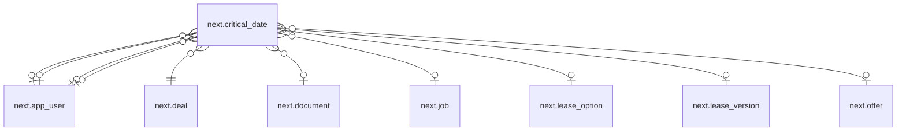
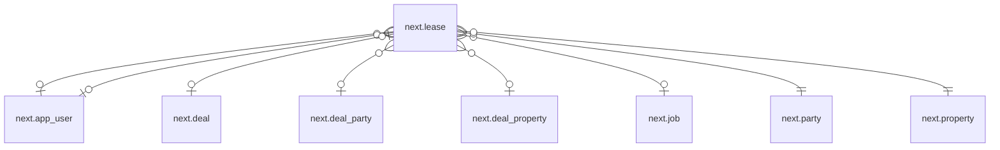
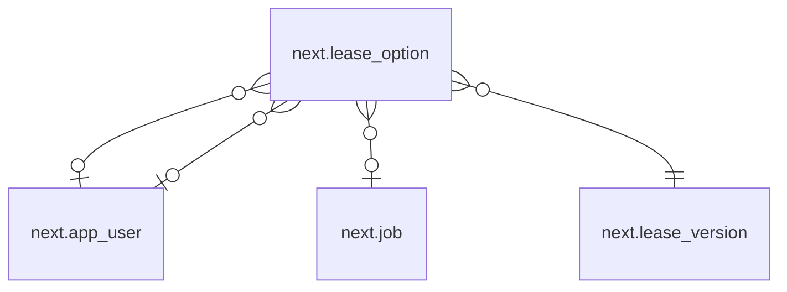
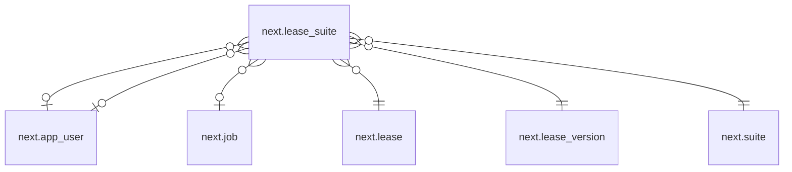
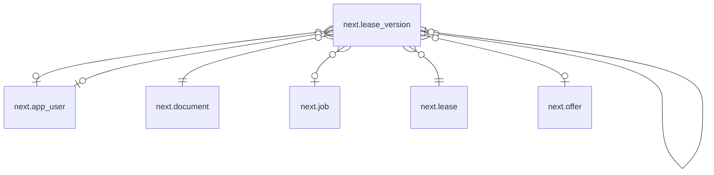

# leases

## next.critical_date

- `FOREIGN KEY (changed_by_user_id) REFERENCES app_user(id)`
- `FOREIGN KEY (changed_for_user_id) REFERENCES app_user(id)`
- `FOREIGN KEY (confirmed_by_user_id) REFERENCES app_user(id)`
- `FOREIGN KEY (resolved_by_user_id) REFERENCES app_user(id)`
- `FOREIGN KEY (deal_id) REFERENCES deal(id)`
- `FOREIGN KEY (document_id) REFERENCES document(id)`
- `FOREIGN KEY (changed_by_job) REFERENCES job(slug)`
- `FOREIGN KEY (lease_version_id, option_number) REFERENCES lease_option(lease_version_id, number)`
- `FOREIGN KEY (lease_version_id) REFERENCES lease_version(id)`
- `FOREIGN KEY (offer_id, deal_id) REFERENCES offer(id, deal_id)`

## next.lease

- `FOREIGN KEY (changed_by_user_id) REFERENCES app_user(id)`
- `FOREIGN KEY (changed_for_user_id) REFERENCES app_user(id)`
- `FOREIGN KEY (deal_id) REFERENCES deal(id)`
- `FOREIGN KEY (deal_id, party_id, client_role) REFERENCES deal_party(deal_id, party_id, role) ON UPDATE CASCADE`
- `FOREIGN KEY (deal_id, property_id) REFERENCES deal_property(deal_id, property_id)`
- `FOREIGN KEY (changed_by_job) REFERENCES job(slug)`
- `FOREIGN KEY (party_id) REFERENCES party(id)`
- `FOREIGN KEY (property_id) REFERENCES property(id)`

## next.lease_option

- `FOREIGN KEY (changed_by_user_id) REFERENCES app_user(id)`
- `FOREIGN KEY (changed_for_user_id) REFERENCES app_user(id)`
- `FOREIGN KEY (changed_by_job) REFERENCES job(slug)`
- `FOREIGN KEY (lease_version_id) REFERENCES lease_version(id)`

## next.lease_suite

- `FOREIGN KEY (changed_by_user_id) REFERENCES app_user(id)`
- `FOREIGN KEY (changed_for_user_id) REFERENCES app_user(id)`
- `FOREIGN KEY (changed_by_job) REFERENCES job(slug)`
- `FOREIGN KEY (lease_id, property_id) REFERENCES lease(id, property_id)`
- `FOREIGN KEY (lease_version_id, lease_id) REFERENCES lease_version(id, lease_id)`
- `FOREIGN KEY (suite_id, property_id) REFERENCES suite(id, property_id)`

## next.lease_version

- `FOREIGN KEY (changed_by_user_id) REFERENCES app_user(id)`
- `FOREIGN KEY (changed_for_user_id) REFERENCES app_user(id)`
- `FOREIGN KEY (document_id) REFERENCES document(id)`
- `FOREIGN KEY (changed_by_job) REFERENCES job(slug)`
- `FOREIGN KEY (lease_id) REFERENCES lease(id)`
- `FOREIGN KEY (lease_id, previous_version) REFERENCES lease_version(lease_id, version)`
- `FOREIGN KEY (offer_id) REFERENCES offer(id)`
