# marketing

## next.design_template

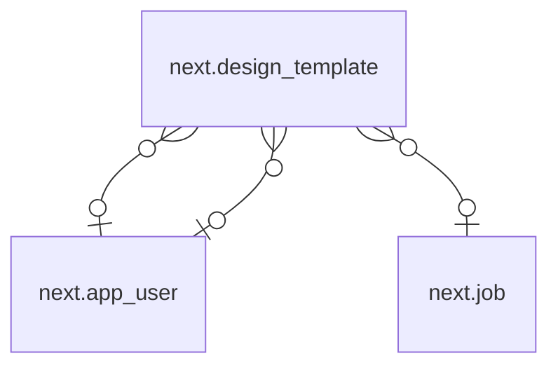

- `FOREIGN KEY (changed_by_user_id) REFERENCES app_user(id)`
- `FOREIGN KEY (changed_for_user_id) REFERENCES app_user(id)`
- `FOREIGN KEY (changed_by_job) REFERENCES job(slug)`

## next.idea

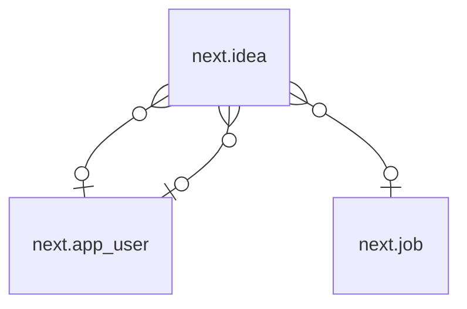

- `FOREIGN KEY (changed_by_user_id) REFERENCES app_user(id)`
- `FOREIGN KEY (changed_for_user_id) REFERENCES app_user(id)`
- `FOREIGN KEY (changed_by_job) REFERENCES job(slug)`

## next.platform_format

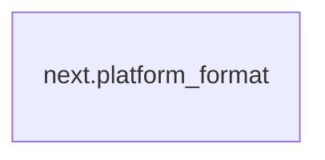

## next.platform_metric

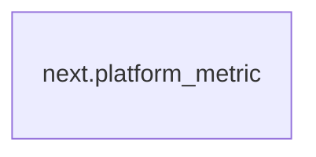

## next.post

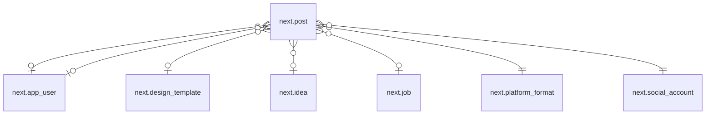

- `FOREIGN KEY (changed_by_user_id) REFERENCES app_user(id)`
- `FOREIGN KEY (changed_for_user_id) REFERENCES app_user(id)`
- `FOREIGN KEY (design_template_id) REFERENCES design_template(id)`
- `FOREIGN KEY (idea_id) REFERENCES idea(id)`
- `FOREIGN KEY (changed_by_job) REFERENCES job(slug)`
- `FOREIGN KEY (platform, format) REFERENCES platform_format(platform, format)`
- `FOREIGN KEY (social_account_id, platform) REFERENCES social_account(id, platform)`

## next.post_media

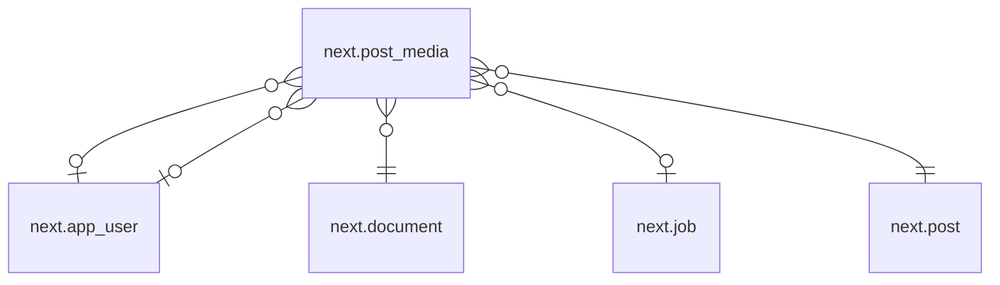

- `FOREIGN KEY (changed_by_user_id) REFERENCES app_user(id)`
- `FOREIGN KEY (changed_for_user_id) REFERENCES app_user(id)`
- `FOREIGN KEY (document_id, content_type) REFERENCES document(id, content_type)`
- `FOREIGN KEY (changed_by_job) REFERENCES job(slug)`
- `FOREIGN KEY (post_id, format) REFERENCES post(id, format)`

## next.post_review

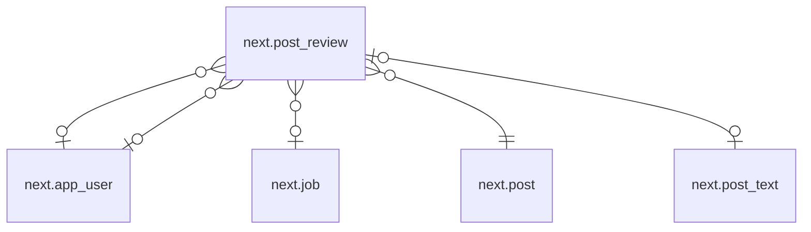

- `FOREIGN KEY (changed_by_user_id) REFERENCES app_user(id)`
- `FOREIGN KEY (changed_for_user_id) REFERENCES app_user(id)`
- `FOREIGN KEY (changed_by_job) REFERENCES job(slug)`
- `FOREIGN KEY (post_id) REFERENCES post(id)`
- `FOREIGN KEY (post_id, text_version) REFERENCES post_text(post_id, version)`

## next.post_text

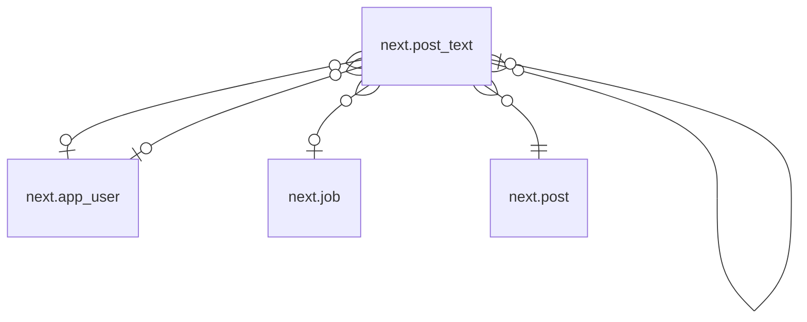

- `FOREIGN KEY (changed_by_user_id) REFERENCES app_user(id)`
- `FOREIGN KEY (changed_for_user_id) REFERENCES app_user(id)`
- `FOREIGN KEY (changed_by_job) REFERENCES job(slug)`
- `FOREIGN KEY (post_id) REFERENCES post(id)`
- `FOREIGN KEY (post_id, previous_version) REFERENCES post_text(post_id, version)`

## next.social_account

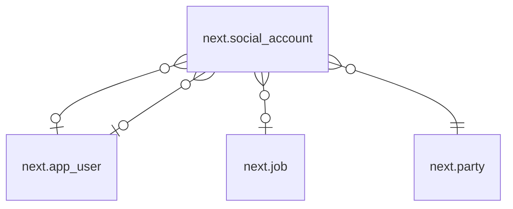

- `FOREIGN KEY (changed_by_user_id) REFERENCES app_user(id)`
- `FOREIGN KEY (changed_for_user_id) REFERENCES app_user(id)`
- `FOREIGN KEY (changed_by_job) REFERENCES job(slug)`
- `FOREIGN KEY (owner_party_id) REFERENCES party(id)`

## next.social_sign_in

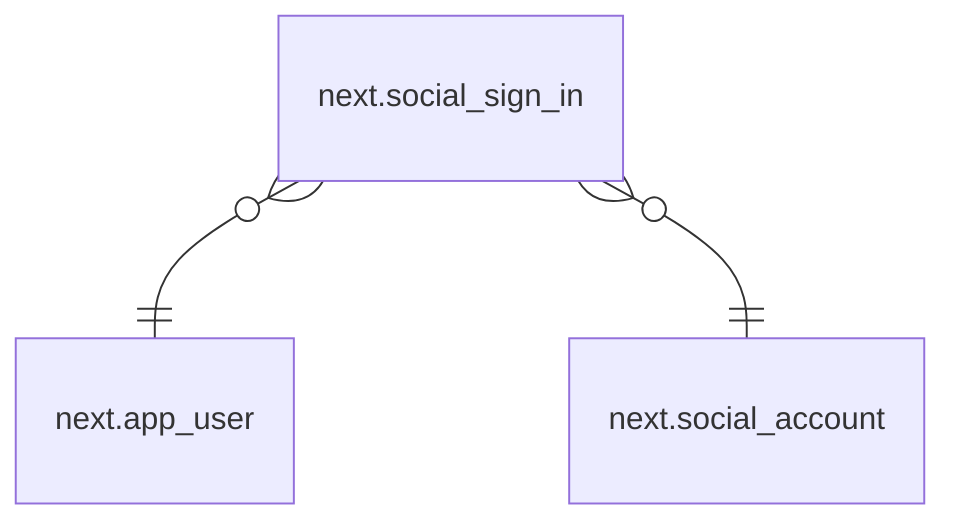

- `FOREIGN KEY (signed_in_by_user_id) REFERENCES app_user(id)`
- `FOREIGN KEY (social_account_id, platform_account_id) REFERENCES social_account(id, platform_account_id)`

## next.tour_plan

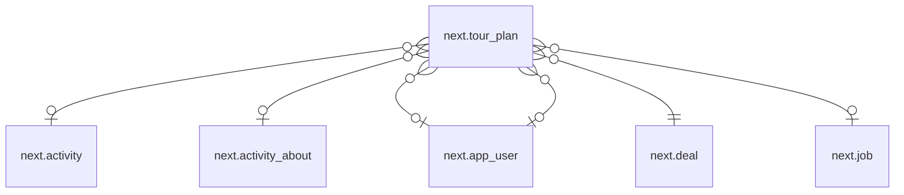

- `FOREIGN KEY (completed_activity_id, completed_activity_kind) REFERENCES activity(id, kind)`
- `FOREIGN KEY (completed_activity_id, deal_id) REFERENCES activity_about(activity_id, deal_id) DEFERRABLE INITIALLY DEFERRED`
- `FOREIGN KEY (changed_by_user_id) REFERENCES app_user(id)`
- `FOREIGN KEY (changed_for_user_id) REFERENCES app_user(id)`
- `FOREIGN KEY (deal_id) REFERENCES deal(id)`
- `FOREIGN KEY (changed_by_job) REFERENCES job(slug)`

## next.tour_stop

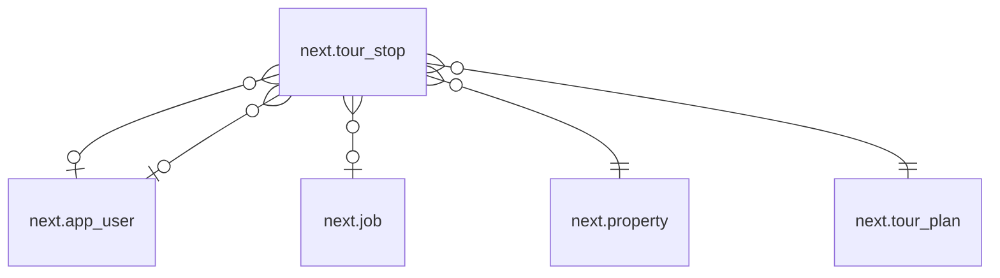

- `FOREIGN KEY (changed_by_user_id) REFERENCES app_user(id)`
- `FOREIGN KEY (changed_for_user_id) REFERENCES app_user(id)`
- `FOREIGN KEY (changed_by_job) REFERENCES job(slug)`
- `FOREIGN KEY (property_id) REFERENCES property(id)`
- `FOREIGN KEY (tour_plan_id) REFERENCES tour_plan(id)`
