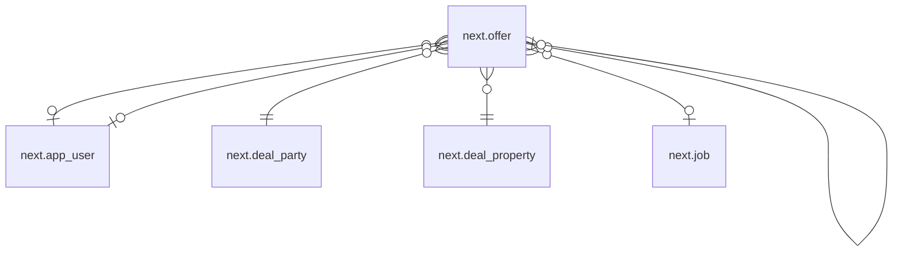
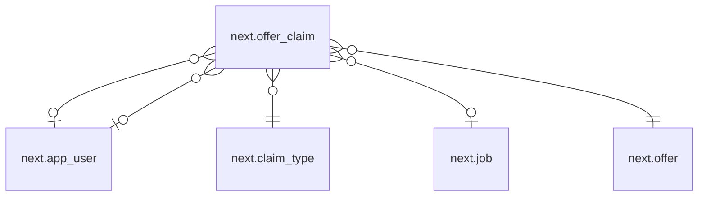

# offers

## next.offer

- `FOREIGN KEY (changed_by_user_id) REFERENCES app_user(id)`
- `FOREIGN KEY (changed_for_user_id) REFERENCES app_user(id)`
- `FOREIGN KEY (deal_id, from_party_id, from_role) REFERENCES deal_party(deal_id, party_id, role) ON UPDATE CASCADE`
- `FOREIGN KEY (deal_id, property_id) REFERENCES deal_property(deal_id, property_id)`
- `FOREIGN KEY (changed_by_job) REFERENCES job(slug)`
- `FOREIGN KEY (deal_id, answers_round) REFERENCES offer(deal_id, round)`

## next.offer_claim

- `FOREIGN KEY (changed_by_user_id) REFERENCES app_user(id)`
- `FOREIGN KEY (changed_for_user_id) REFERENCES app_user(id)`
- `FOREIGN KEY (claim_type) REFERENCES claim_type(slug)`
- `FOREIGN KEY (changed_by_job) REFERENCES job(slug)`
- `FOREIGN KEY (offer_id) REFERENCES offer(id)`

## next.offer_document

- `FOREIGN KEY (changed_by_user_id) REFERENCES app_user(id)`
- `FOREIGN KEY (changed_for_user_id) REFERENCES app_user(id)`
- `FOREIGN KEY (document_id) REFERENCES document(id)`
- `FOREIGN KEY (changed_by_job) REFERENCES job(slug)`
- `FOREIGN KEY (offer_id) REFERENCES offer(id)`

## next.proposal

```mermaid
erDiagram
"next.proposal" }o--o| "next.activity" : ""
"next.proposal" }o--o| "next.activity_about" : ""
"next.proposal" }o--o| "next.activity_about" : ""
"next.proposal" }o--o| "next.activity_about" : ""
"next.proposal" }o--o| "next.app_user" : ""
"next.proposal" }o--o| "next.app_user" : ""
"next.proposal" }o--o| "next.app_user" : ""
"next.proposal" |o--o| "next.candidate" : ""
"next.proposal" }o--o| "next.deal" : ""
"next.proposal" }o--o| "next.deal" : ""
"next.proposal" }o--o| "next.how_found" : ""
"next.proposal" }o--o| "next.job" : ""
"next.proposal" }o--|| "next.job" : ""
"next.proposal" }o--o| "next.next_step" : ""
"next.proposal" }o--o| "next.next_step" : ""
"next.proposal" }o--o| "next.party" : ""
"next.proposal" }o--o| "next.party" : ""
"next.proposal" }o--o| "next.party" : ""
"next.proposal" }o--o| "next.phase" : ""
"next.proposal" }o--o| "next.phase" : ""
"next.proposal" }o--o| "next.property" : ""
"next.proposal" }o--o| "next.stage" : ""
"next.proposal" }o--o| "next.stage" : ""
```

- `FOREIGN KEY (activity_id, activity_kind) REFERENCES activity(id, kind)`
- `FOREIGN KEY (activity_id, call_deal_id) REFERENCES activity_about(activity_id, deal_id) DEFERRABLE INITIALLY DEFERRED`
- `FOREIGN KEY (activity_id, held_deal_id) REFERENCES activity_about(activity_id, deal_id) DEFERRABLE INITIALLY DEFERRED`
- `FOREIGN KEY (activity_id, party_id) REFERENCES activity_about(activity_id, party_id) DEFERRABLE INITIALLY DEFERRED`
- `FOREIGN KEY (changed_by_user_id) REFERENCES app_user(id)`
- `FOREIGN KEY (changed_for_user_id) REFERENCES app_user(id)`
- `FOREIGN KEY (decided_by_user_id) REFERENCES app_user(id)`
- `FOREIGN KEY (candidate_id) REFERENCES candidate(id)`
- `FOREIGN KEY (deal_id) REFERENCES deal(id)`
- `FOREIGN KEY (filed_deal_id) REFERENCES deal(id)`
- `FOREIGN KEY (how_found) REFERENCES how_found(slug)`
- `FOREIGN KEY (changed_by_job) REFERENCES job(slug)`
- `FOREIGN KEY (proposed_by_job) REFERENCES job(slug)`
- `FOREIGN KEY (merged_step_id) REFERENCES next_step(id)`
- `FOREIGN KEY (next_step_id, deal_id) REFERENCES next_step(id, deal_id)`
- `FOREIGN KEY (filed_vendor_id) REFERENCES party(id)`
- `FOREIGN KEY (owner_party_id) REFERENCES party(id)`
- `FOREIGN KEY (party_id) REFERENCES party(id)`
- `FOREIGN KEY (from_phase) REFERENCES phase(slug)`
- `FOREIGN KEY (to_phase) REFERENCES phase(slug)`
- `FOREIGN KEY (property_id) REFERENCES property(id)`
- `FOREIGN KEY (lead_role, from_stage) REFERENCES stage(role, slug)`
- `FOREIGN KEY (lead_role, to_stage) REFERENCES stage(role, slug)`
