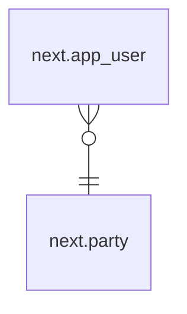
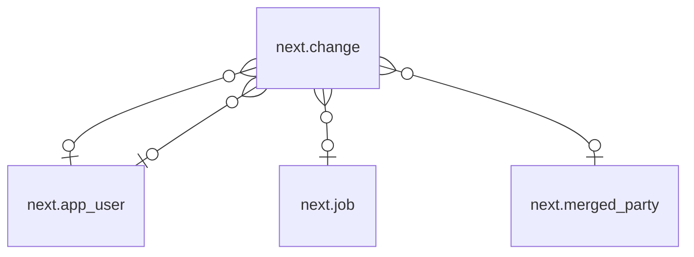
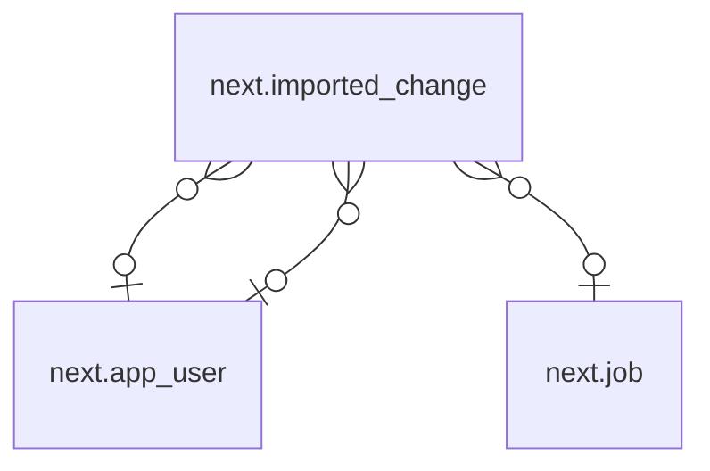
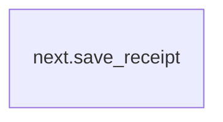
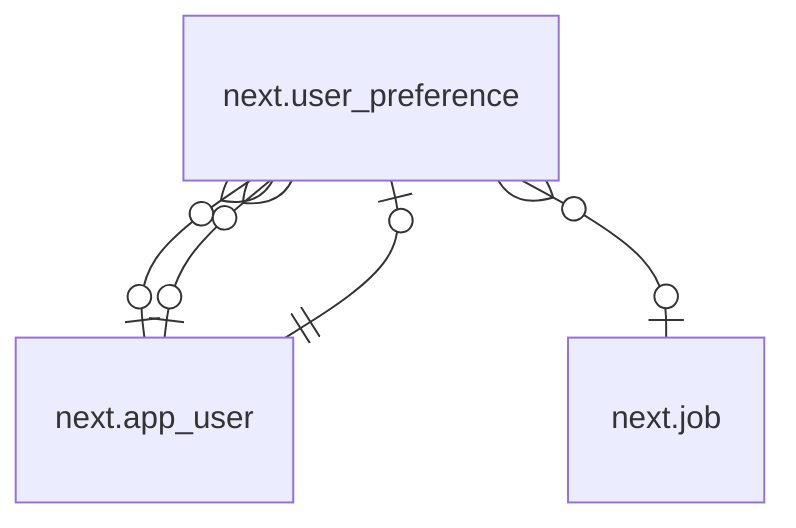

# system

## next.app_user

- `FOREIGN KEY (id, kind) REFERENCES party(id, kind)`

## next.change

- `FOREIGN KEY (changed_by_user_id) REFERENCES app_user(id) DEFERRABLE INITIALLY DEFERRED`
- `FOREIGN KEY (changed_for_user_id) REFERENCES app_user(id)`
- `FOREIGN KEY (changed_by_job) REFERENCES job(slug)`
- `FOREIGN KEY (merge_of) REFERENCES merged_party(id)`

## next.imported_change

- `FOREIGN KEY (changed_by_user_id) REFERENCES app_user(id)`
- `FOREIGN KEY (changed_for_user_id) REFERENCES app_user(id)`
- `FOREIGN KEY (changed_by_job) REFERENCES job(slug)`

## next.job

## next.save_receipt

## next.user_preference

- `FOREIGN KEY (changed_by_user_id) REFERENCES app_user(id)`
- `FOREIGN KEY (changed_for_user_id) REFERENCES app_user(id)`
- `FOREIGN KEY (user_id) REFERENCES app_user(id)`
- `FOREIGN KEY (changed_by_job) REFERENCES job(slug)`
