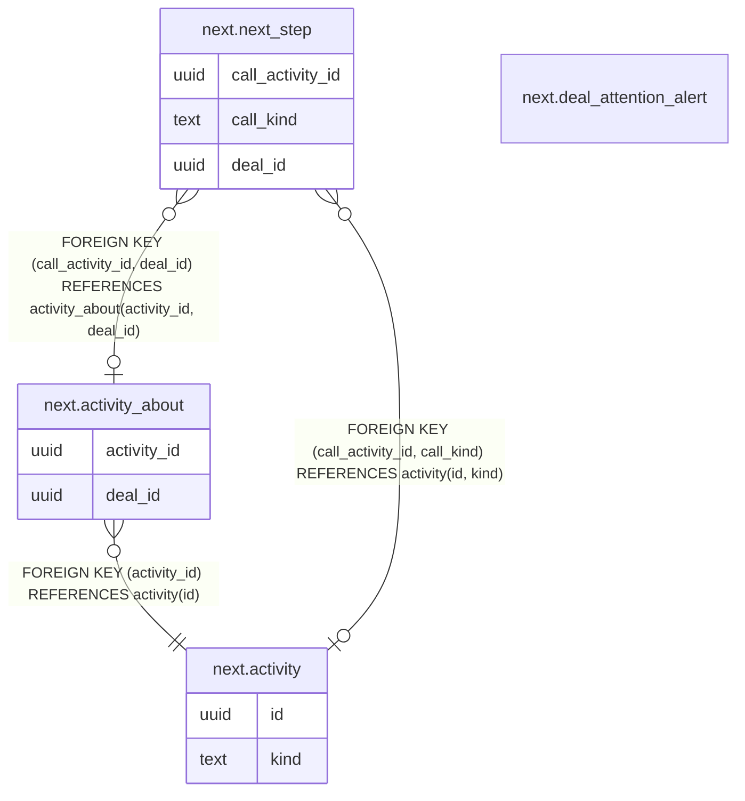

# Activity

## Description

Tables in this area and the foreign keys between them.

## Tables

| Name                                                      | Columns | Comment | Type       |
| --------------------------------------------------------- | ------- | ------- | ---------- |
| [next.activity](next.activity.md)                         | 13      |         | BASE TABLE |
| [next.activity_about](next.activity_about.md)             | 9       |         | BASE TABLE |
| [next.deal_attention_alert](next.deal_attention_alert.md) | 4       |         | BASE TABLE |
| [next.next_step](next.next_step.md)                       | 28      |         | BASE TABLE |

## Relations

---

> Generated by [tbls](https://github.com/k1LoW/tbls)
