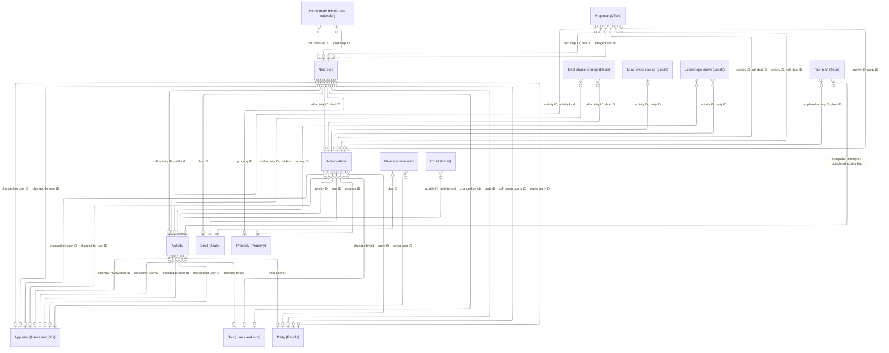

# Activity

## Connects to

Numbers count foreign keys between the two areas.

[Deals](viewpoint-deals.md) (5) · [Email](viewpoint-email.md) (1) · [Home and calendar](viewpoint-home-calendar.md) (2) · [Leads](viewpoint-leads.md) (3) · [Offers](viewpoint-offers.md) (6) · [People](viewpoint-people.md) (5) · [Property](viewpoint-property.md) (2) · [Tours](viewpoint-tours.md) (2) · [Users and jobs](viewpoint-users-jobs.md) (12)

## Tables

- [Activity](next.activity.md)
- [Activity about](next.activity_about.md)
- [Deal attention alert](next.deal_attention_alert.md)
- [Next step](next.next_step.md)

See each table for its columns and links to other areas.
