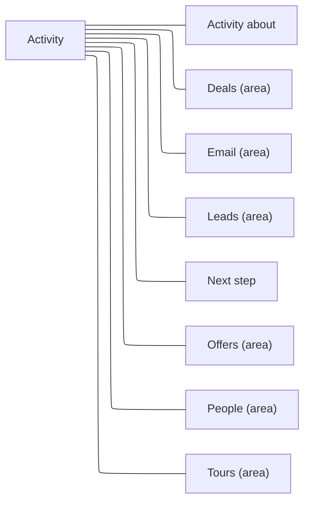
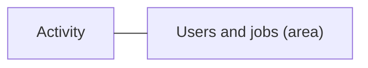
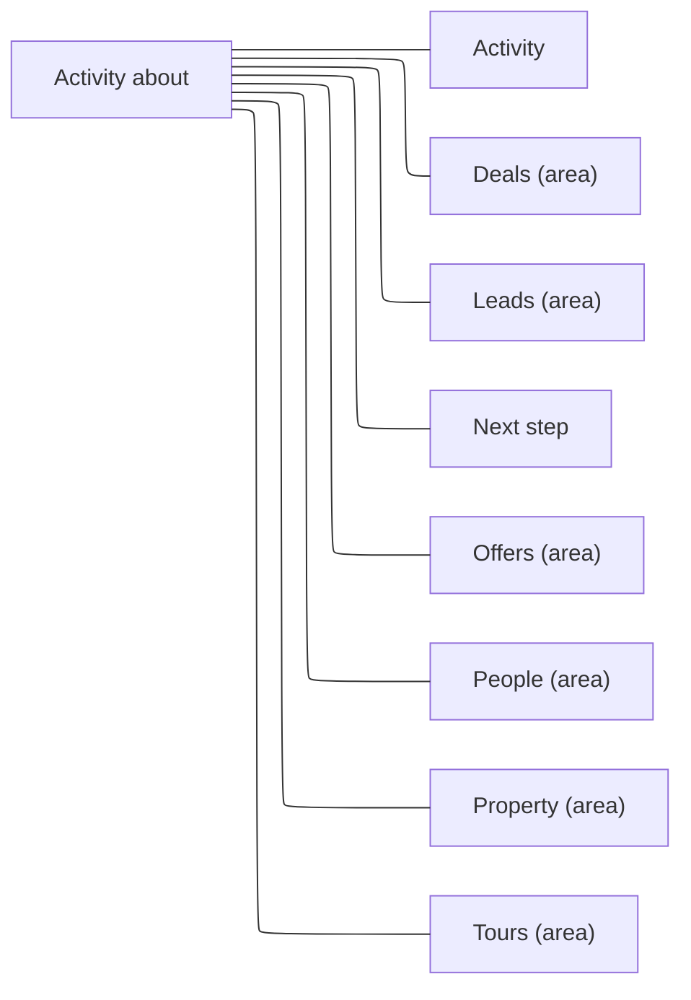
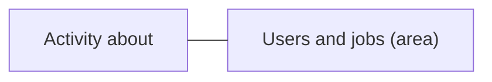
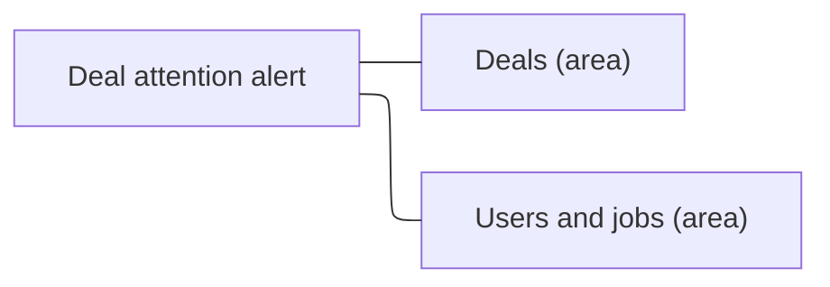
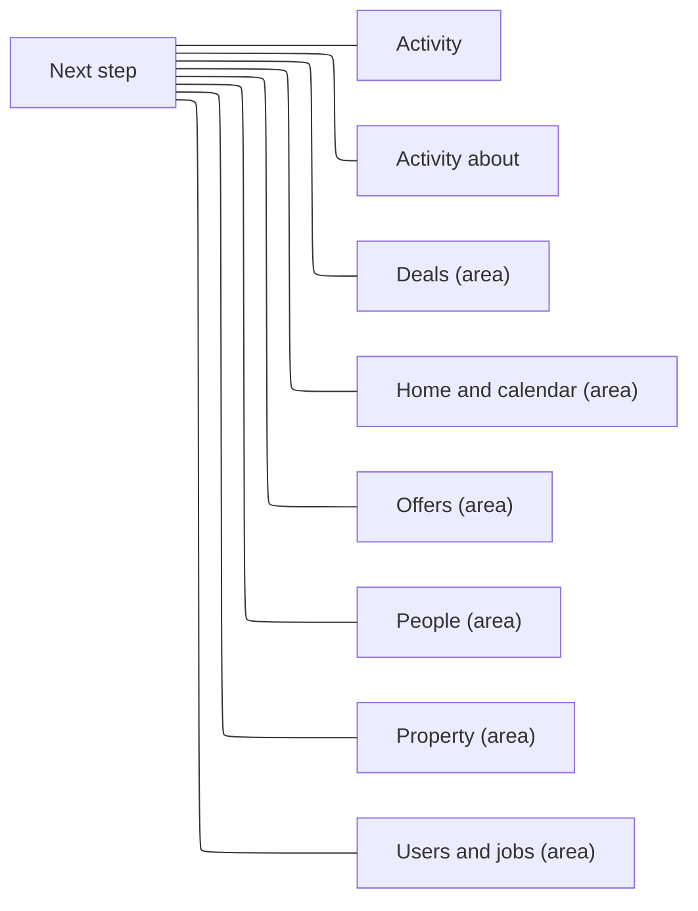

# Activity

Each line shows a connection. The foreign keys below name the exact columns.

### Activity

### Activity about

### Deal attention alert

### Next step

## Foreign keys

| From table and columns                                                              | To table and columns                                                 |
| ----------------------------------------------------------------------------------- | -------------------------------------------------------------------- |
| [activity](next.activity.md) (`calendar_review_user_id`)                            | [app_user](next.app_user.md) (`id`)                                  |
| [activity](next.activity.md) (`call_owner_user_id`)                                 | [app_user](next.app_user.md) (`id`)                                  |
| [activity](next.activity.md) (`changed_by_user_id`)                                 | [app_user](next.app_user.md) (`id`)                                  |
| [activity](next.activity.md) (`changed_for_user_id`)                                | [app_user](next.app_user.md) (`id`)                                  |
| [activity](next.activity.md) (`changed_by_job`)                                     | [job](next.job.md) (`slug`)                                          |
| [activity](next.activity.md) (`from_party_id`)                                      | [party](next.party.md) (`id`)                                        |
| [activity_about](next.activity_about.md) (`activity_id`)                            | [activity](next.activity.md) (`id`)                                  |
| [activity_about](next.activity_about.md) (`changed_by_user_id`)                     | [app_user](next.app_user.md) (`id`)                                  |
| [activity_about](next.activity_about.md) (`changed_for_user_id`)                    | [app_user](next.app_user.md) (`id`)                                  |
| [activity_about](next.activity_about.md) (`deal_id`)                                | [deal](next.deal.md) (`id`)                                          |
| [activity_about](next.activity_about.md) (`changed_by_job`)                         | [job](next.job.md) (`slug`)                                          |
| [activity_about](next.activity_about.md) (`party_id`)                               | [party](next.party.md) (`id`)                                        |
| [activity_about](next.activity_about.md) (`property_id`)                            | [property](next.property.md) (`id`)                                  |
| [deal_attention_alert](next.deal_attention_alert.md) (`owner_user_id`)              | [app_user](next.app_user.md) (`id`)                                  |
| [deal_attention_alert](next.deal_attention_alert.md) (`deal_id`)                    | [deal](next.deal.md) (`id`)                                          |
| [deal_phase_change](next.deal_phase_change.md) (`call_activity_id`, `call_kind`)    | [activity](next.activity.md) (`id`, `kind`)                          |
| [deal_phase_change](next.deal_phase_change.md) (`call_activity_id`, `deal_id`)      | [activity_about](next.activity_about.md) (`activity_id`, `deal_id`)  |
| [email](next.email.md) (`activity_id`, `activity_kind`)                             | [activity](next.activity.md) (`id`, `kind`)                          |
| [home_mark](next.home_mark.md) (`call_follow_up_id`)                                | [next_step](next.next_step.md) (`home_call_follow_up_id`)            |
| [home_mark](next.home_mark.md) (`next_step_id`)                                     | [next_step](next.next_step.md) (`home_step_id`)                      |
| [lead_email_source](next.lead_email_source.md) (`activity_id`, `party_id`)          | [activity_about](next.activity_about.md) (`activity_id`, `party_id`) |
| [lead_stage_move](next.lead_stage_move.md) (`activity_id`)                          | [activity](next.activity.md) (`id`)                                  |
| [lead_stage_move](next.lead_stage_move.md) (`activity_id`, `party_id`)              | [activity_about](next.activity_about.md) (`activity_id`, `party_id`) |
| [next_step](next.next_step.md) (`call_activity_id`, `call_kind`)                    | [activity](next.activity.md) (`id`, `kind`)                          |
| [next_step](next.next_step.md) (`call_activity_id`, `deal_id`)                      | [activity_about](next.activity_about.md) (`activity_id`, `deal_id`)  |
| [next_step](next.next_step.md) (`changed_by_user_id`)                               | [app_user](next.app_user.md) (`id`)                                  |
| [next_step](next.next_step.md) (`changed_for_user_id`)                              | [app_user](next.app_user.md) (`id`)                                  |
| [next_step](next.next_step.md) (`deal_id`)                                          | [deal](next.deal.md) (`id`)                                          |
| [next_step](next.next_step.md) (`changed_by_job`)                                   | [job](next.job.md) (`slug`)                                          |
| [next_step](next.next_step.md) (`call_contact_party_id`)                            | [party](next.party.md) (`id`)                                        |
| [next_step](next.next_step.md) (`owner_party_id`)                                   | [party](next.party.md) (`id`)                                        |
| [next_step](next.next_step.md) (`party_id`)                                         | [party](next.party.md) (`id`)                                        |
| [next_step](next.next_step.md) (`property_id`)                                      | [property](next.property.md) (`id`)                                  |
| [proposal](next.proposal.md) (`activity_id`, `activity_kind`)                       | [activity](next.activity.md) (`id`, `kind`)                          |
| [proposal](next.proposal.md) (`activity_id`, `call_deal_id`)                        | [activity_about](next.activity_about.md) (`activity_id`, `deal_id`)  |
| [proposal](next.proposal.md) (`activity_id`, `held_deal_id`)                        | [activity_about](next.activity_about.md) (`activity_id`, `deal_id`)  |
| [proposal](next.proposal.md) (`activity_id`, `party_id`)                            | [activity_about](next.activity_about.md) (`activity_id`, `party_id`) |
| [proposal](next.proposal.md) (`merged_step_id`)                                     | [next_step](next.next_step.md) (`id`)                                |
| [proposal](next.proposal.md) (`next_step_id`, `deal_id`)                            | [next_step](next.next_step.md) (`id`, `deal_id`)                     |
| [tour_plan](next.tour_plan.md) (`completed_activity_id`, `completed_activity_kind`) | [activity](next.activity.md) (`id`, `kind`)                          |
| [tour_plan](next.tour_plan.md) (`completed_activity_id`, `deal_id`)                 | [activity_about](next.activity_about.md) (`activity_id`, `deal_id`)  |

## Connects to

Numbers count foreign keys between the two areas.

[Deals](viewpoint-deals.md) (5) · [Email](viewpoint-email.md) (1) · [Home and calendar](viewpoint-home-calendar.md) (2) · [Leads](viewpoint-leads.md) (3) · [Offers](viewpoint-offers.md) (6) · [People](viewpoint-people.md) (5) · [Property](viewpoint-property.md) (2) · [Tours](viewpoint-tours.md) (2) · [Users and jobs](viewpoint-users-jobs.md) (12)

## Tables

- [Activity](next.activity.md)
- [Activity about](next.activity_about.md)
- [Deal attention alert](next.deal_attention_alert.md)
- [Next step](next.next_step.md)
