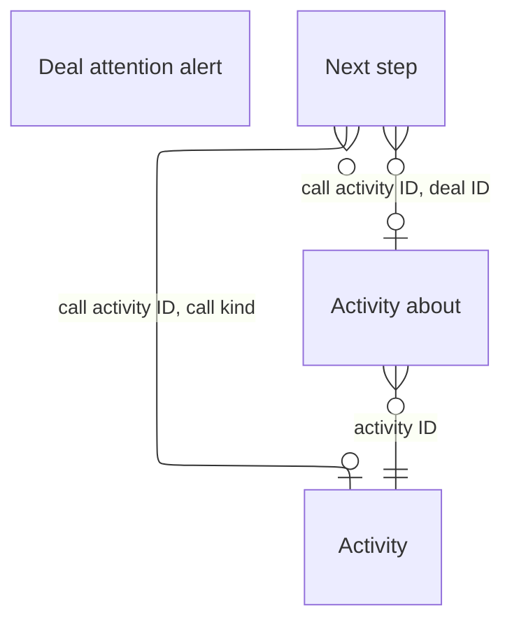

# Activity

## Tables

- [Activity](next.activity.md)
- [Activity about](next.activity_about.md)
- [Deal attention alert](next.deal_attention_alert.md)
- [Next step](next.next_step.md)

See each table for its columns and links to other areas.
