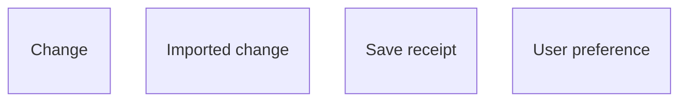

# Changes and preferences

## Tables

- [Change](next.change.md)
- [Imported change](next.imported_change.md)
- [Save receipt](next.save_receipt.md)
- [User preference](next.user_preference.md)

See each table for its columns and links to other areas.
