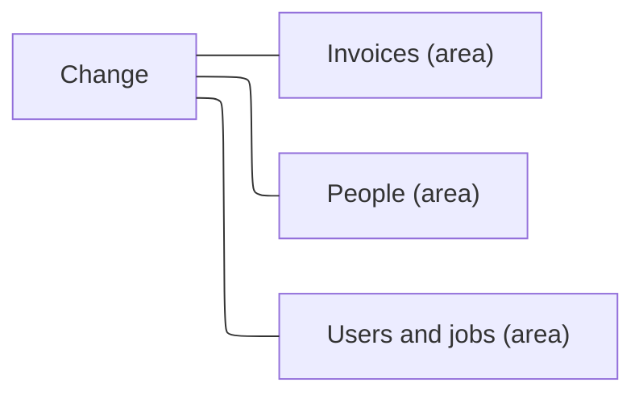
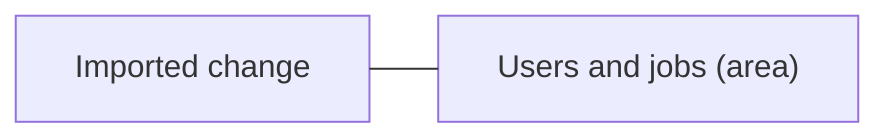
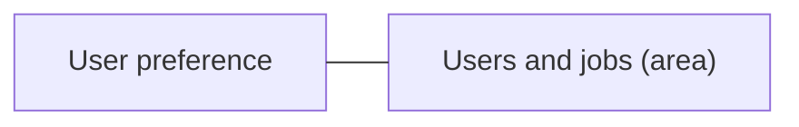

# Changes and preferences

Each line shows a connection. The foreign keys below name the exact columns.

### Change

### Imported change

### Save receipt

### User preference

## Foreign keys

| From table and columns                                             | To table and columns                                     |
| ------------------------------------------------------------------ | -------------------------------------------------------- |
| [change](next.change.md) (`changed_by_user_id`)                    | [app_user](next.app_user.md) (`id`)                      |
| [change](next.change.md) (`changed_for_user_id`)                   | [app_user](next.app_user.md) (`id`)                      |
| [change](next.change.md) (`changed_by_job`)                        | [job](next.job.md) (`slug`)                              |
| [change](next.change.md) (`merge_of`)                              | [merged_party](next.merged_party.md) (`id`)              |
| [doc_turn](next.doc_turn.md) (`confirmation_key`)                  | [save_receipt](next.save_receipt.md) (`idempotency_key`) |
| [imported_change](next.imported_change.md) (`changed_by_user_id`)  | [app_user](next.app_user.md) (`id`)                      |
| [imported_change](next.imported_change.md) (`changed_for_user_id`) | [app_user](next.app_user.md) (`id`)                      |
| [imported_change](next.imported_change.md) (`changed_by_job`)      | [job](next.job.md) (`slug`)                              |
| [invoice_email](next.invoice_email.md) (`payment_change_id`)       | [change](next.change.md) (`id`)                          |
| [user_preference](next.user_preference.md) (`changed_by_user_id`)  | [app_user](next.app_user.md) (`id`)                      |
| [user_preference](next.user_preference.md) (`changed_for_user_id`) | [app_user](next.app_user.md) (`id`)                      |
| [user_preference](next.user_preference.md) (`user_id`)             | [app_user](next.app_user.md) (`id`)                      |
| [user_preference](next.user_preference.md) (`changed_by_job`)      | [job](next.job.md) (`slug`)                              |

## Connects to

Numbers count foreign keys between the two areas.

[Doc](viewpoint-doc.md) (1) · [Invoices](viewpoint-invoices.md) (1) · [People](viewpoint-people.md) (1) · [Users and jobs](viewpoint-users-jobs.md) (10)

## Tables

- [Change](next.change.md)
- [Imported change](next.imported_change.md)
- [Save receipt](next.save_receipt.md)
- [User preference](next.user_preference.md)
