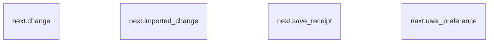

# Changes and preferences

## Description

Tables in this area and the foreign keys between them.

## Tables

| Name                                            | Columns | Comment | Type       |
| ----------------------------------------------- | ------- | ------- | ---------- |
| [next.change](next.change.md)                   | 11      |         | BASE TABLE |
| [next.imported_change](next.imported_change.md) | 12      |         | BASE TABLE |
| [next.save_receipt](next.save_receipt.md)       | 5       |         | BASE TABLE |
| [next.user_preference](next.user_preference.md) | 10      |         | BASE TABLE |

## Relations

---

> Generated by [tbls](https://github.com/k1LoW/tbls)
