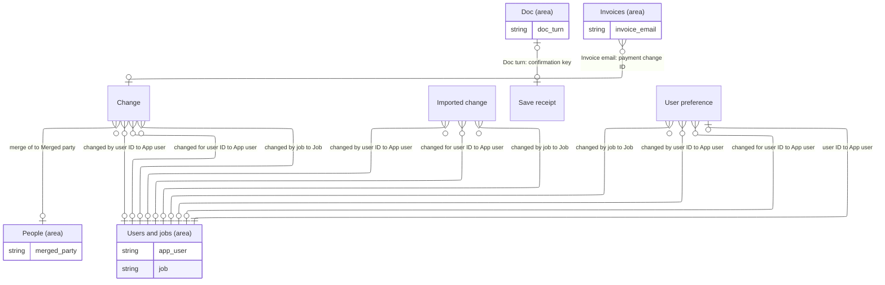

# Changes and preferences

## Connects to

Numbers count foreign keys between the two areas.

[Doc](viewpoint-doc.md) (1) · [Invoices](viewpoint-invoices.md) (1) · [People](viewpoint-people.md) (1) · [Users and jobs](viewpoint-users-jobs.md) (10)

## Tables

- [Change](next.change.md)
- [Imported change](next.imported_change.md)
- [Save receipt](next.save_receipt.md)
- [User preference](next.user_preference.md)

See each table for its columns and links to other areas.
