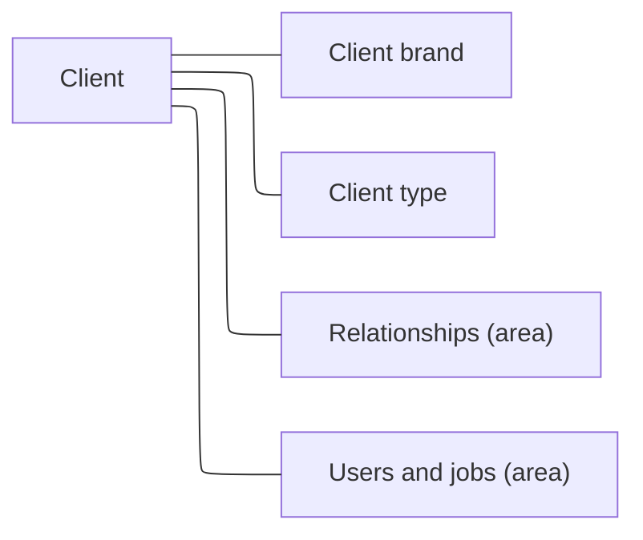
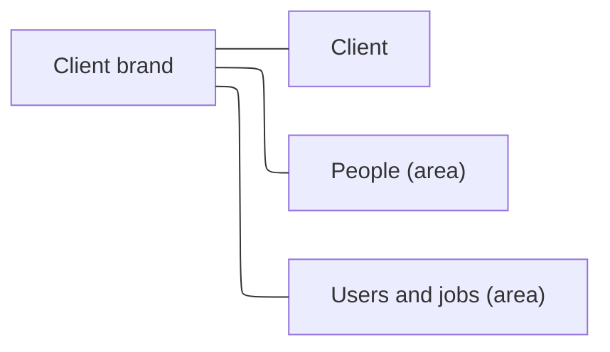
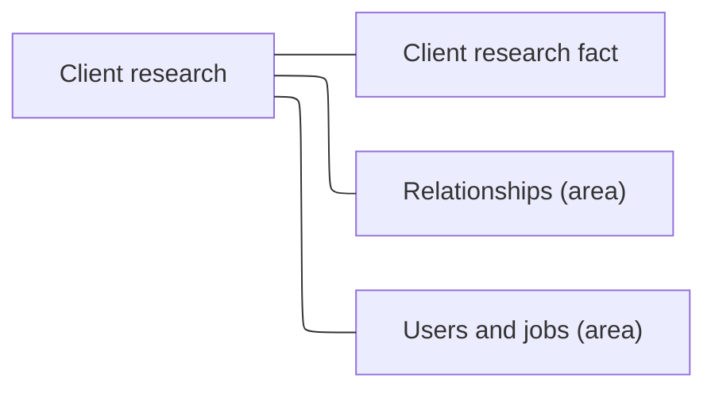
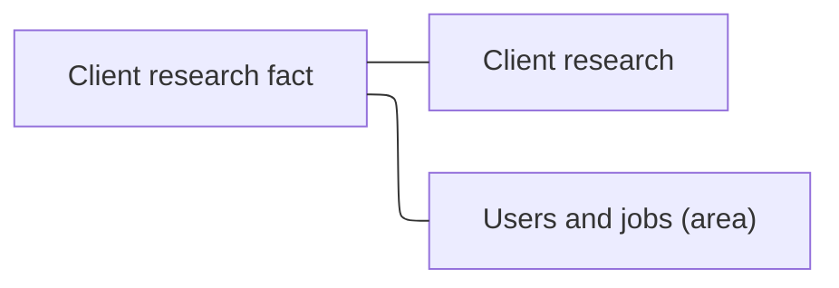
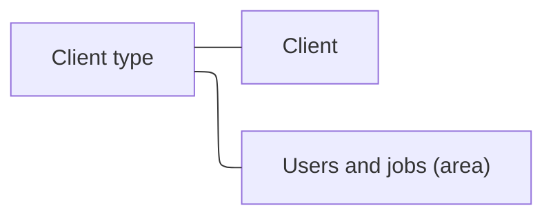
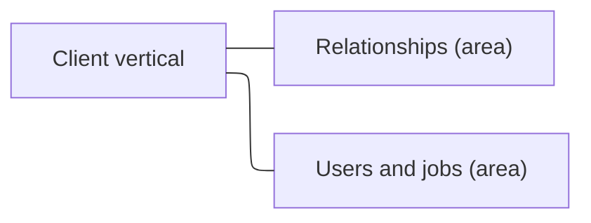
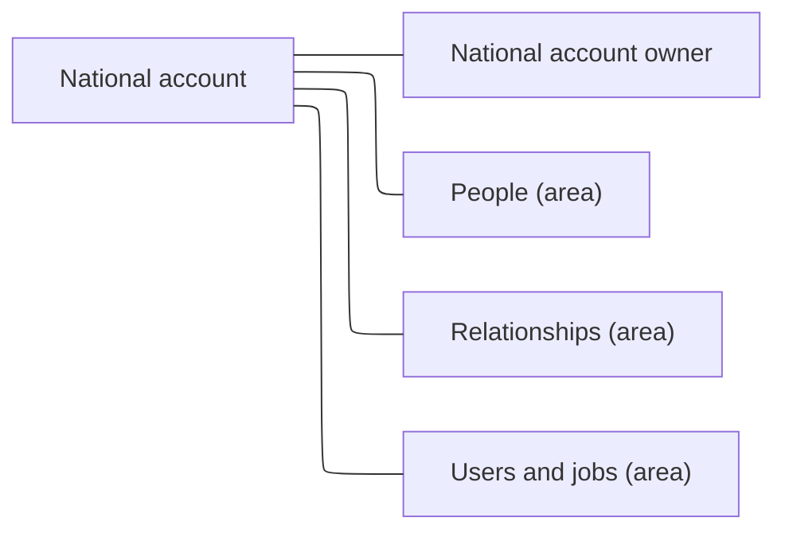
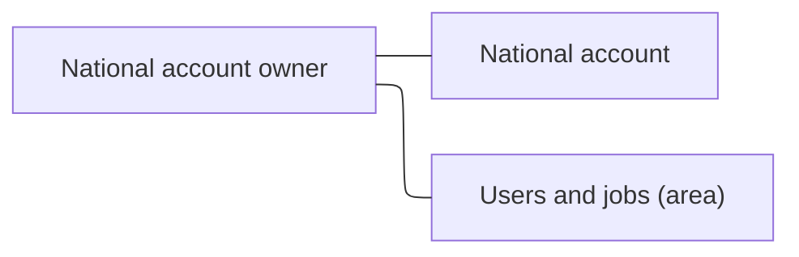

# Clients

Each line shows a connection. The foreign keys below name the exact columns.

### Client

### Client brand

### Client research

### Client research fact

### Client type

### Client vertical

### National account

### National account owner

## Foreign keys

| From table and columns                                                                    | To table and columns                                      |
| ----------------------------------------------------------------------------------------- | --------------------------------------------------------- |
| [client](next.client.md) (`changed_by_user_id`)                                           | [app_user](next.app_user.md) (`id`)                       |
| [client](next.client.md) (`changed_for_user_id`)                                          | [app_user](next.app_user.md) (`id`)                       |
| [client](next.client.md) (`owner_user_id`)                                                | [app_user](next.app_user.md) (`id`)                       |
| [client](next.client.md) (`client_type`)                                                  | [client_type](next.client_type.md) (`slug`)               |
| [client](next.client.md) (`changed_by_job`)                                               | [job](next.job.md) (`slug`)                               |
| [client](next.client.md) (`party_id`, `role`)                                             | [party_role](next.party_role.md) (`party_id`, `role`)     |
| [client_brand](next.client_brand.md) (`changed_by_user_id`)                               | [app_user](next.app_user.md) (`id`)                       |
| [client_brand](next.client_brand.md) (`changed_for_user_id`)                              | [app_user](next.app_user.md) (`id`)                       |
| [client_brand](next.client_brand.md) (`location_id`)                                      | [client](next.client.md) (`party_id`)                     |
| [client_brand](next.client_brand.md) (`changed_by_job`)                                   | [job](next.job.md) (`slug`)                               |
| [client_brand](next.client_brand.md) (`brand_id`, `brand_kind`)                           | [party](next.party.md) (`id`, `kind`)                     |
| [client_research](next.client_research.md) (`changed_by_user_id`)                         | [app_user](next.app_user.md) (`id`)                       |
| [client_research](next.client_research.md) (`changed_for_user_id`)                        | [app_user](next.app_user.md) (`id`)                       |
| [client_research](next.client_research.md) (`changed_by_job`)                             | [job](next.job.md) (`slug`)                               |
| [client_research](next.client_research.md) (`party_id`, `role`)                           | [party_role](next.party_role.md) (`party_id`, `role`)     |
| [client_research_fact](next.client_research_fact.md) (`changed_by_user_id`)               | [app_user](next.app_user.md) (`id`)                       |
| [client_research_fact](next.client_research_fact.md) (`changed_for_user_id`)              | [app_user](next.app_user.md) (`id`)                       |
| [client_research_fact](next.client_research_fact.md) (`research_id`)                      | [client_research](next.client_research.md) (`id`)         |
| [client_research_fact](next.client_research_fact.md) (`changed_by_job`)                   | [job](next.job.md) (`slug`)                               |
| [client_type](next.client_type.md) (`changed_by_user_id`)                                 | [app_user](next.app_user.md) (`id`)                       |
| [client_type](next.client_type.md) (`changed_for_user_id`)                                | [app_user](next.app_user.md) (`id`)                       |
| [client_type](next.client_type.md) (`changed_by_job`)                                     | [job](next.job.md) (`slug`)                               |
| [client_vertical](next.client_vertical.md) (`changed_by_user_id`)                         | [app_user](next.app_user.md) (`id`)                       |
| [client_vertical](next.client_vertical.md) (`changed_for_user_id`)                        | [app_user](next.app_user.md) (`id`)                       |
| [client_vertical](next.client_vertical.md) (`changed_by_job`)                             | [job](next.job.md) (`slug`)                               |
| [client_vertical](next.client_vertical.md) (`party_id`, `role`)                           | [party_role](next.party_role.md) (`party_id`, `role`)     |
| [national_account](next.national_account.md) (`changed_by_user_id`)                       | [app_user](next.app_user.md) (`id`)                       |
| [national_account](next.national_account.md) (`changed_for_user_id`)                      | [app_user](next.app_user.md) (`id`)                       |
| [national_account](next.national_account.md) (`changed_by_job`)                           | [job](next.job.md) (`slug`)                               |
| [national_account](next.national_account.md) (`party_id`, `kind`)                         | [party](next.party.md) (`id`, `kind`)                     |
| [national_account](next.national_account.md) (`party_id`, `role`)                         | [party_role](next.party_role.md) (`party_id`, `role`)     |
| [national_account_owner](next.national_account_owner.md) (`changed_by_user_id`)           | [app_user](next.app_user.md) (`id`)                       |
| [national_account_owner](next.national_account_owner.md) (`changed_for_user_id`)          | [app_user](next.app_user.md) (`id`)                       |
| [national_account_owner](next.national_account_owner.md) (`owner_id`, `owner_is_partner`) | [app_user](next.app_user.md) (`id`, `is_account_partner`) |
| [national_account_owner](next.national_account_owner.md) (`changed_by_job`)               | [job](next.job.md) (`slug`)                               |
| [national_account_owner](next.national_account_owner.md) (`account_id`)                   | [national_account](next.national_account.md) (`party_id`) |
| [party_role](next.party_role.md) (`lead_client_id`)                                       | [client](next.client.md) (`party_id`)                     |

## Connects to

Numbers count foreign keys between the two areas.

[People](viewpoint-people.md) (2) · [Relationships](viewpoint-relationships.md) (5) · [Users and jobs](viewpoint-users-jobs.md) (26)

## Tables

- [Client](next.client.md)
- [Client brand](next.client_brand.md)
- [Client research](next.client_research.md)
- [Client research fact](next.client_research_fact.md)
- [Client type](next.client_type.md)
- [Client vertical](next.client_vertical.md)
- [National account](next.national_account.md)
- [National account owner](next.national_account_owner.md)
