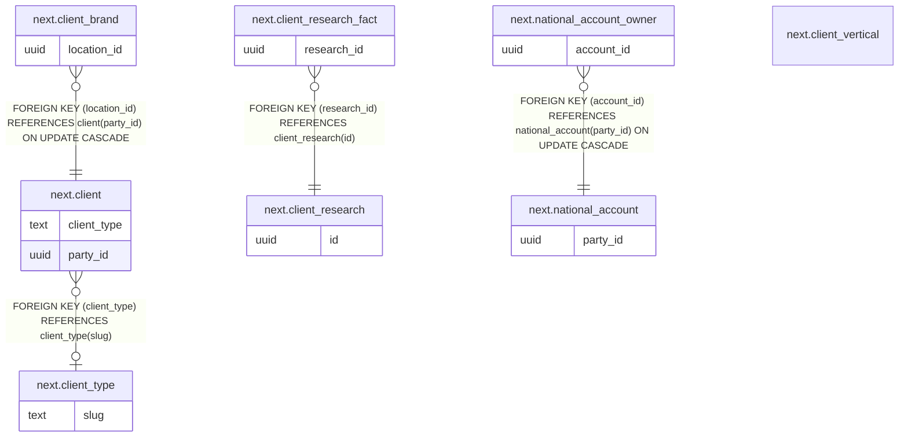

# Clients

## Description

Tables in this area and the foreign keys between them.

## Tables

| Name                                                          | Columns | Comment | Type       |
| ------------------------------------------------------------- | ------- | ------- | ---------- |
| [next.client](next.client.md)                                 | 10      |         | BASE TABLE |
| [next.client_brand](next.client_brand.md)                     | 11      |         | BASE TABLE |
| [next.client_research](next.client_research.md)               | 12      |         | BASE TABLE |
| [next.client_research_fact](next.client_research_fact.md)     | 7       |         | BASE TABLE |
| [next.client_type](next.client_type.md)                       | 6       |         | BASE TABLE |
| [next.client_vertical](next.client_vertical.md)               | 9       |         | BASE TABLE |
| [next.national_account](next.national_account.md)             | 8       |         | BASE TABLE |
| [next.national_account_owner](next.national_account_owner.md) | 11      |         | BASE TABLE |

## Relations

---

> Generated by [tbls](https://github.com/k1LoW/tbls)
