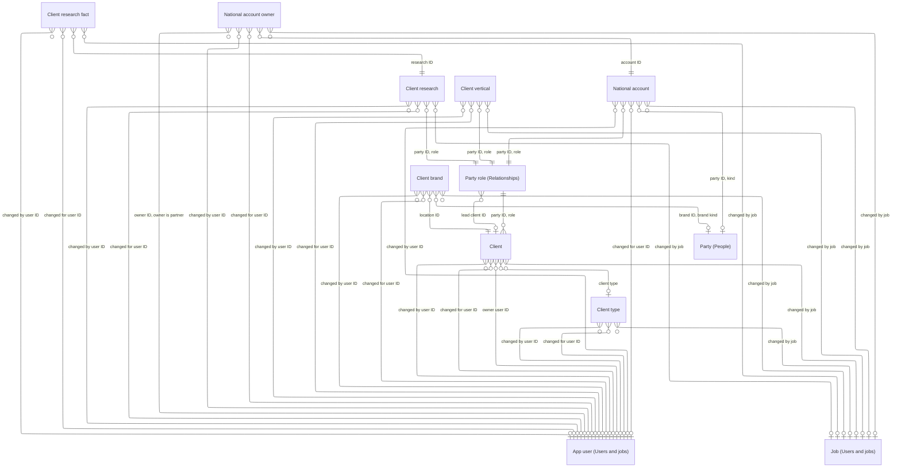

# Clients

## Connects to

Numbers count foreign keys between the two areas.

[People](viewpoint-people.md) (2) · [Relationships](viewpoint-relationships.md) (5) · [Users and jobs](viewpoint-users-jobs.md) (26)

## Tables

- [Client](next.client.md)
- [Client brand](next.client_brand.md)
- [Client research](next.client_research.md)
- [Client research fact](next.client_research_fact.md)
- [Client type](next.client_type.md)
- [Client vertical](next.client_vertical.md)
- [National account](next.national_account.md)
- [National account owner](next.national_account_owner.md)

See each table for its columns and links to other areas.
