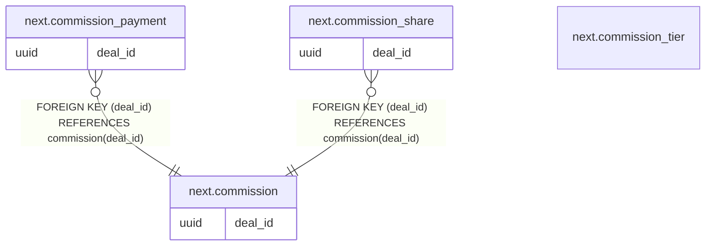

# Commissions

## Description

Tables in this area and the foreign keys between them.

## Tables

| Name                                                  | Columns | Comment | Type       |
| ----------------------------------------------------- | ------- | ------- | ---------- |
| [next.commission](next.commission.md)                 | 9       |         | BASE TABLE |
| [next.commission_payment](next.commission_payment.md) | 11      |         | BASE TABLE |
| [next.commission_share](next.commission_share.md)     | 10      |         | BASE TABLE |
| [next.commission_tier](next.commission_tier.md)       | 8       |         | BASE TABLE |

## Relations

---

> Generated by [tbls](https://github.com/k1LoW/tbls)
