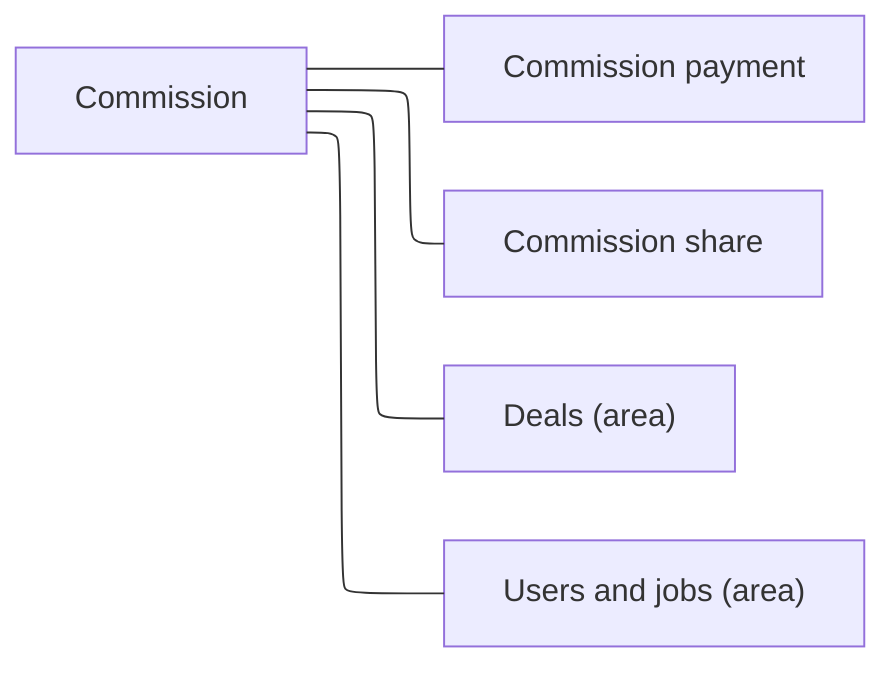
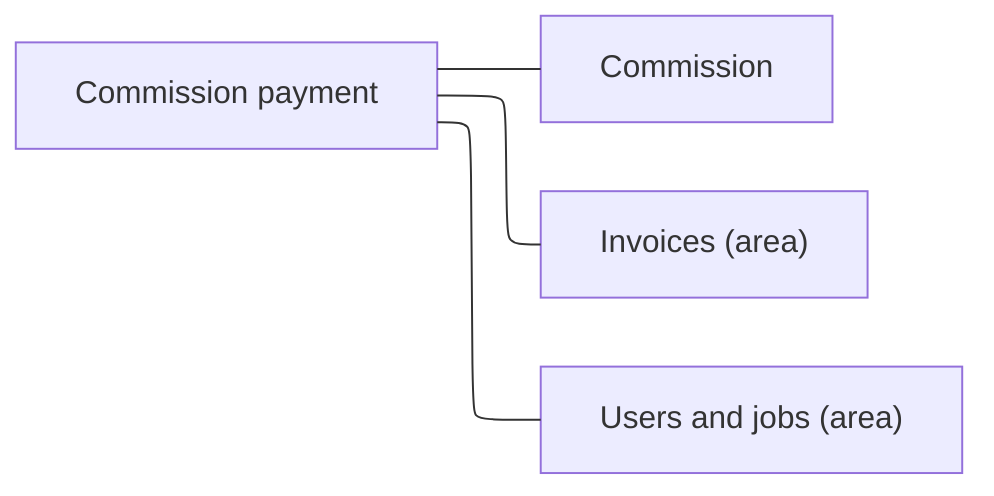
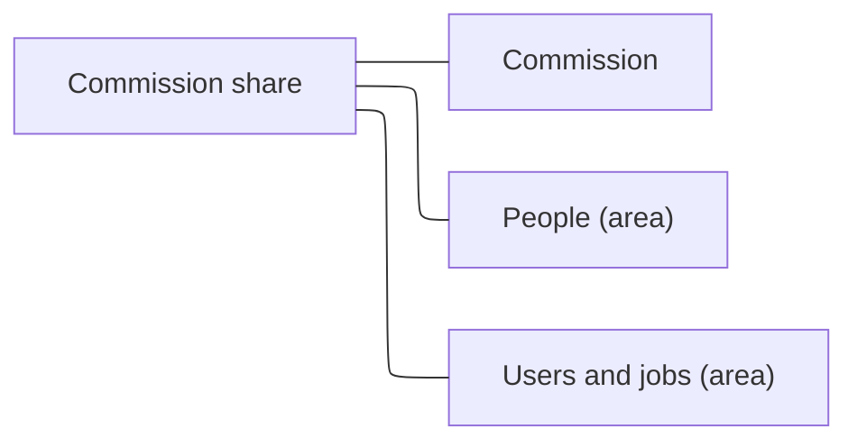

# Commissions

Each line shows a connection. The foreign keys below name the exact columns.

### Commission

### Commission payment

### Commission share

### Commission tier

## Foreign keys

| From table and columns                                                   | To table and columns                                               |
| ------------------------------------------------------------------------ | ------------------------------------------------------------------ |
| [commission](next.commission.md) (`changed_by_user_id`)                  | [app_user](next.app_user.md) (`id`)                                |
| [commission](next.commission.md) (`changed_for_user_id`)                 | [app_user](next.app_user.md) (`id`)                                |
| [commission](next.commission.md) (`deal_id`)                             | [deal](next.deal.md) (`id`)                                        |
| [commission](next.commission.md) (`changed_by_job`)                      | [job](next.job.md) (`slug`)                                        |
| [commission_payment](next.commission_payment.md) (`changed_by_user_id`)  | [app_user](next.app_user.md) (`id`)                                |
| [commission_payment](next.commission_payment.md) (`changed_for_user_id`) | [app_user](next.app_user.md) (`id`)                                |
| [commission_payment](next.commission_payment.md) (`deal_id`)             | [commission](next.commission.md) (`deal_id`)                       |
| [commission_payment](next.commission_payment.md) (`changed_by_job`)      | [job](next.job.md) (`slug`)                                        |
| [commission_share](next.commission_share.md) (`changed_by_user_id`)      | [app_user](next.app_user.md) (`id`)                                |
| [commission_share](next.commission_share.md) (`changed_for_user_id`)     | [app_user](next.app_user.md) (`id`)                                |
| [commission_share](next.commission_share.md) (`deal_id`)                 | [commission](next.commission.md) (`deal_id`)                       |
| [commission_share](next.commission_share.md) (`changed_by_job`)          | [job](next.job.md) (`slug`)                                        |
| [commission_share](next.commission_share.md) (`party_id`)                | [party](next.party.md) (`id`)                                      |
| [commission_tier](next.commission_tier.md) (`changed_by_user_id`)        | [app_user](next.app_user.md) (`id`)                                |
| [commission_tier](next.commission_tier.md) (`changed_for_user_id`)       | [app_user](next.app_user.md) (`id`)                                |
| [commission_tier](next.commission_tier.md) (`partner_user_id`)           | [app_user](next.app_user.md) (`id`)                                |
| [commission_tier](next.commission_tier.md) (`user_id`)                   | [app_user](next.app_user.md) (`id`)                                |
| [commission_tier](next.commission_tier.md) (`changed_by_job`)            | [job](next.job.md) (`slug`)                                        |
| [invoice_email](next.invoice_email.md) (`payment_id`, `deal_id`)         | [commission_payment](next.commission_payment.md) (`id`, `deal_id`) |

## Connects to

Numbers count foreign keys between the two areas.

[Deals](viewpoint-deals.md) (1) · [Invoices](viewpoint-invoices.md) (1) · [People](viewpoint-people.md) (1) · [Users and jobs](viewpoint-users-jobs.md) (14)

## Tables

- [Commission](next.commission.md)
- [Commission payment](next.commission_payment.md)
- [Commission share](next.commission_share.md)
- [Commission tier](next.commission_tier.md)
