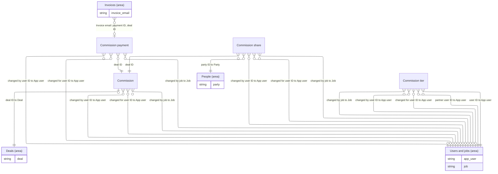

# Commissions

## Connects to

Numbers count foreign keys between the two areas.

[Deals](viewpoint-deals.md) (1) · [Invoices](viewpoint-invoices.md) (1) · [People](viewpoint-people.md) (1) · [Users and jobs](viewpoint-users-jobs.md) (14)

## Tables

- [Commission](next.commission.md)
- [Commission payment](next.commission_payment.md)
- [Commission share](next.commission_share.md)
- [Commission tier](next.commission_tier.md)

See each table for its columns and links to other areas.
