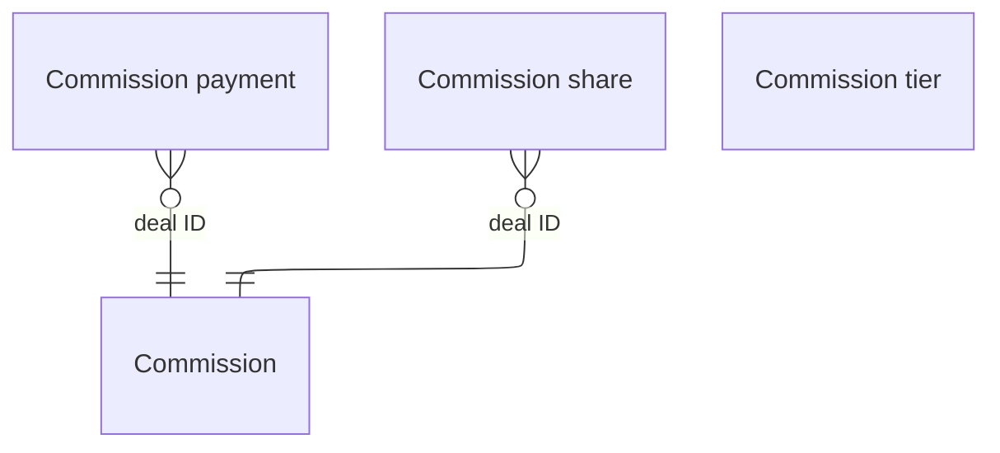

# Commissions

## Tables

- [Commission](next.commission.md)
- [Commission payment](next.commission_payment.md)
- [Commission share](next.commission_share.md)
- [Commission tier](next.commission_tier.md)

See each table for its columns and links to other areas.
