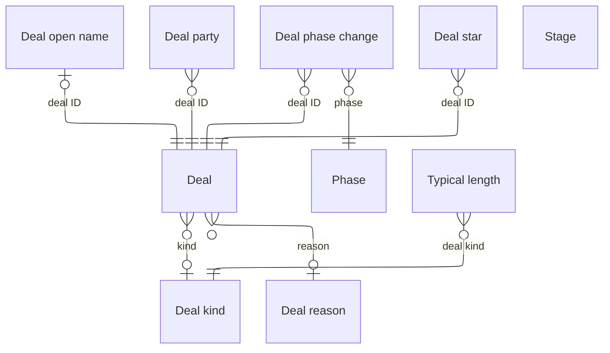

# Deals

## Tables

- [Deal](next.deal.md)
- [Deal kind](next.deal_kind.md)
- [Deal open name](next.deal_open_name.md)
- [Deal party](next.deal_party.md)
- [Deal phase change](next.deal_phase_change.md)
- [Deal reason](next.deal_reason.md)
- [Deal star](next.deal_star.md)
- [Phase](next.phase.md)
- [Stage](next.stage.md)
- [Typical length](next.typical_length.md)

See each table for its columns and links to other areas.
