# Deals

Each line shows a connection. The foreign keys below name the exact columns.

### Deal

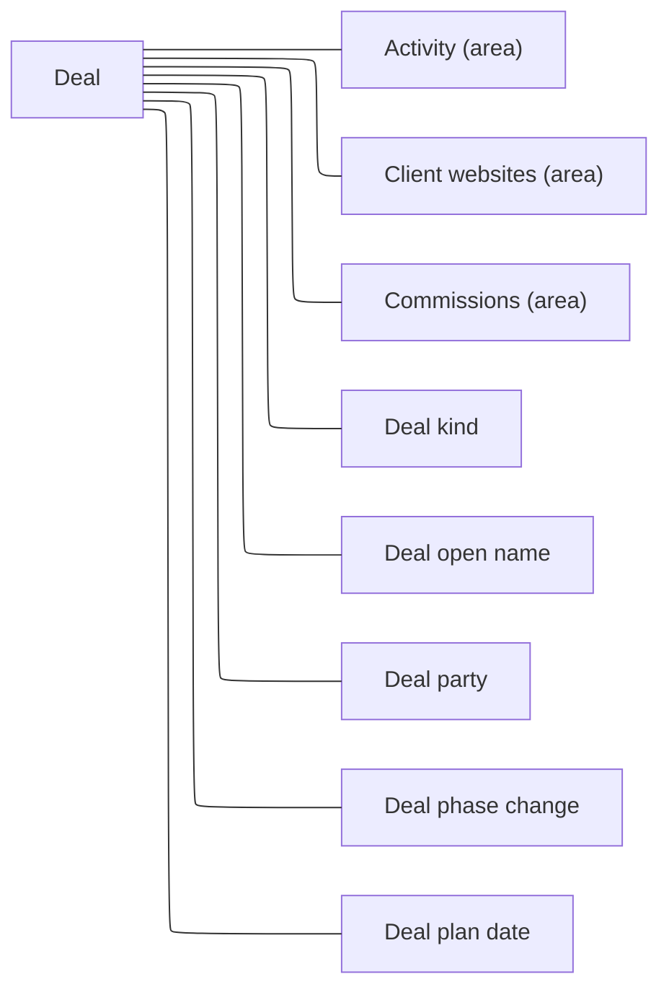

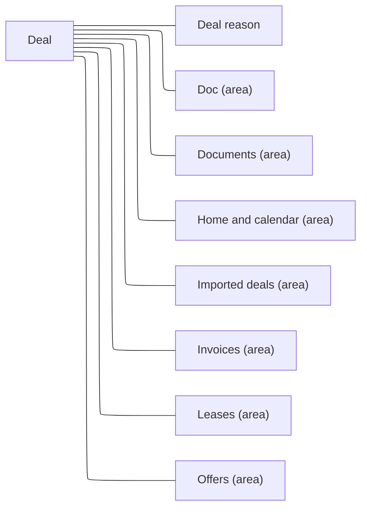

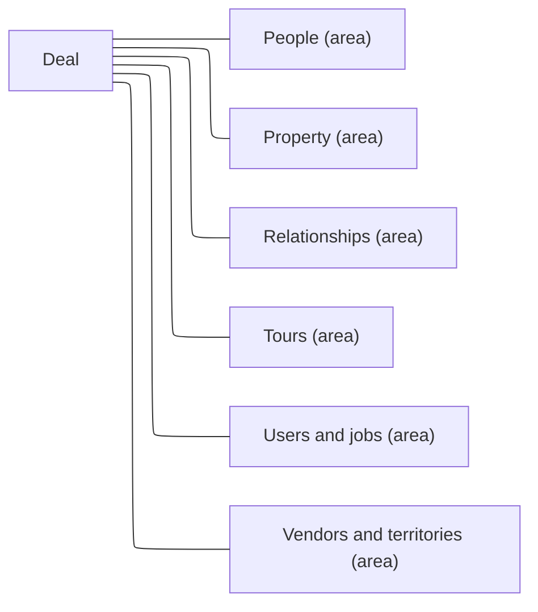

### Deal kind

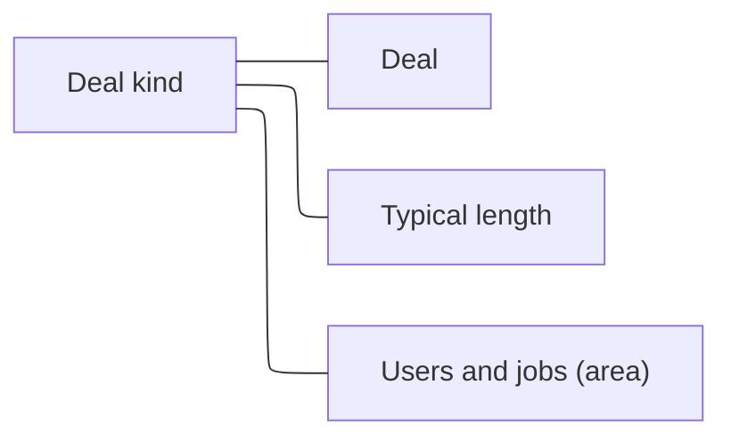

### Deal open name

### Deal party

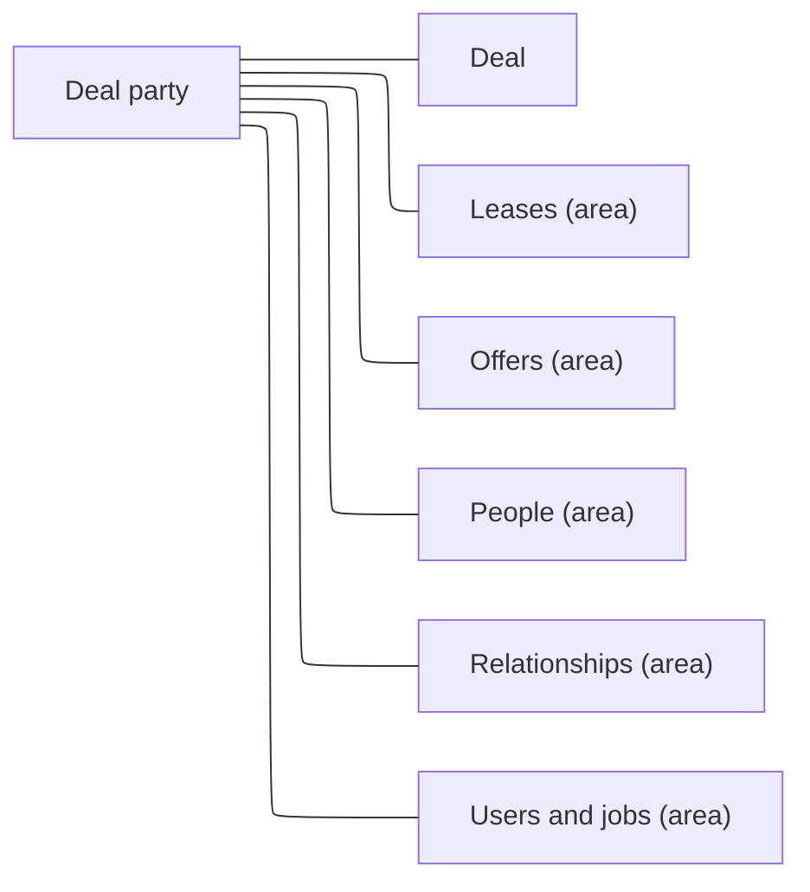

### Deal phase change

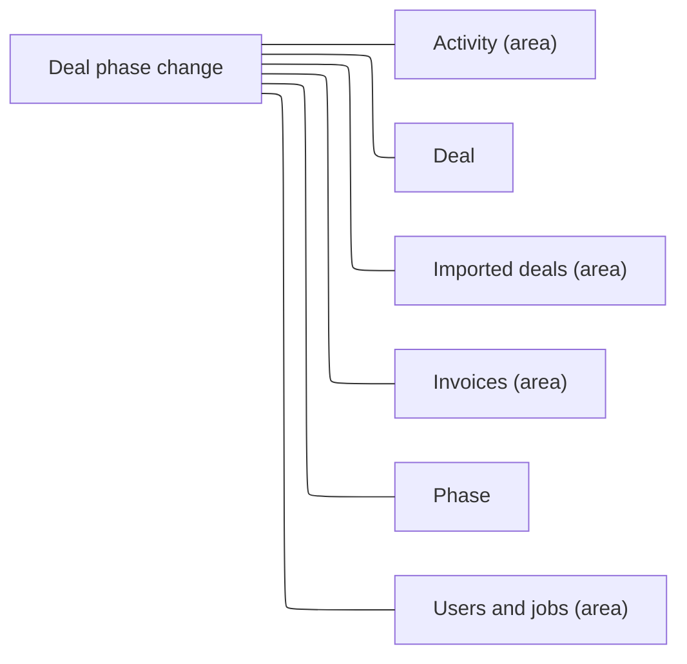

### Deal plan date

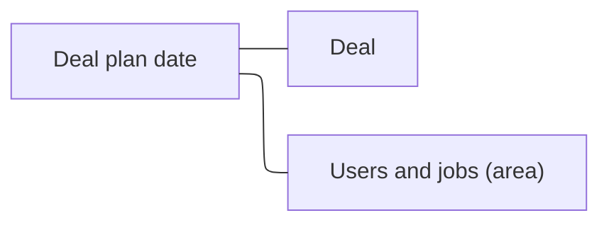

### Deal reason

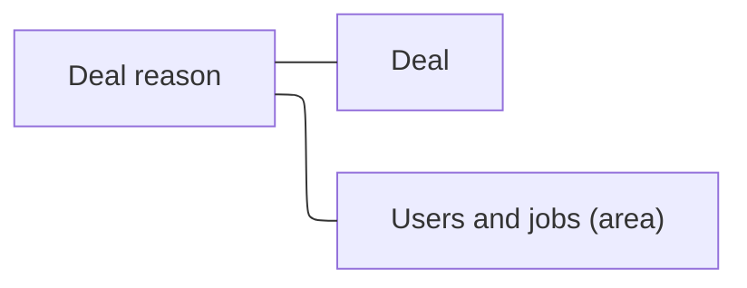

### Phase

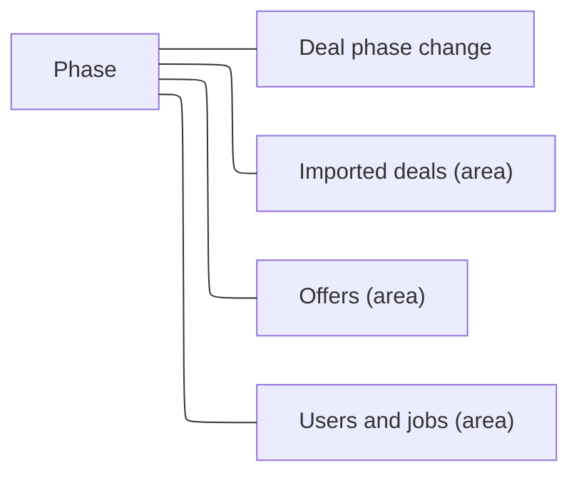

### Stage

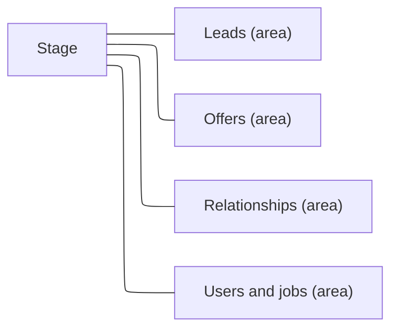

### Typical length

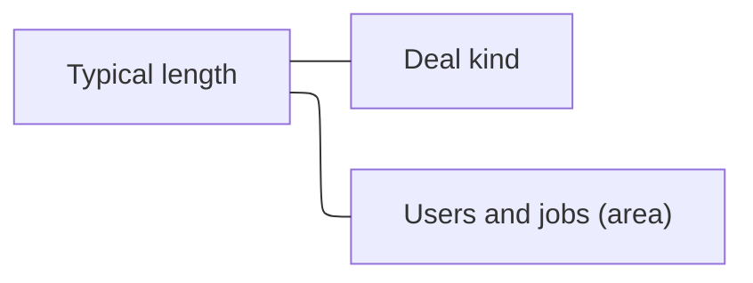

## Foreign keys

| From table and columns                                                                            | To table and columns                                                      |
| ------------------------------------------------------------------------------------------------- | ------------------------------------------------------------------------- |
| [activity_about](next.activity_about.md) (`deal_id`)                                              | [deal](next.deal.md) (`id`)                                               |
| [commission](next.commission.md) (`deal_id`)                                                      | [deal](next.deal.md) (`id`)                                               |
| [critical_date](next.critical_date.md) (`deal_id`)                                                | [deal](next.deal.md) (`id`)                                               |
| [deal](next.deal.md) (`changed_by_user_id`)                                                       | [app_user](next.app_user.md) (`id`)                                       |
| [deal](next.deal.md) (`changed_for_user_id`)                                                      | [app_user](next.app_user.md) (`id`)                                       |
| [deal](next.deal.md) (`owner_user_id`)                                                            | [app_user](next.app_user.md) (`id`)                                       |
| [deal](next.deal.md) (`parked_by_user_id`)                                                        | [app_user](next.app_user.md) (`id`)                                       |
| [deal](next.deal.md) (`kind`)                                                                     | [deal_kind](next.deal_kind.md) (`slug`)                                   |
| [deal](next.deal.md) (`reason`)                                                                   | [deal_reason](next.deal_reason.md) (`slug`)                               |
| [deal](next.deal.md) (`changed_by_job`)                                                           | [job](next.job.md) (`slug`)                                               |
| [deal](next.deal.md) (`renews_lease_id`)                                                          | [lease](next.lease.md) (`id`)                                             |
| [deal](next.deal.md) (`market_id`)                                                                | [market](next.market.md) (`id`)                                           |
| [deal_attention_alert](next.deal_attention_alert.md) (`deal_id`)                                  | [deal](next.deal.md) (`id`)                                               |
| [deal_client_website](next.deal_client_website.md) (`deal_id`)                                    | [deal](next.deal.md) (`id`)                                               |
| [deal_kind](next.deal_kind.md) (`changed_by_user_id`)                                             | [app_user](next.app_user.md) (`id`)                                       |
| [deal_kind](next.deal_kind.md) (`changed_for_user_id`)                                            | [app_user](next.app_user.md) (`id`)                                       |
| [deal_kind](next.deal_kind.md) (`changed_by_job`)                                                 | [job](next.job.md) (`slug`)                                               |
| [deal_open_name](next.deal_open_name.md) (`deal_id`)                                              | [deal](next.deal.md) (`id`)                                               |
| [deal_party](next.deal_party.md) (`changed_by_user_id`)                                           | [app_user](next.app_user.md) (`id`)                                       |
| [deal_party](next.deal_party.md) (`changed_for_user_id`)                                          | [app_user](next.app_user.md) (`id`)                                       |
| [deal_party](next.deal_party.md) (`deal_id`)                                                      | [deal](next.deal.md) (`id`)                                               |
| [deal_party](next.deal_party.md) (`changed_by_job`)                                               | [job](next.job.md) (`slug`)                                               |
| [deal_party](next.deal_party.md) (`party_id`)                                                     | [party](next.party.md) (`id`)                                             |
| [deal_party](next.deal_party.md) (`party_id`, `client_role`)                                      | [party_role](next.party_role.md) (`party_id`, `role`)                     |
| [deal_party](next.deal_party.md) (`role`)                                                         | [role](next.role.md) (`slug`)                                             |
| [deal_phase_change](next.deal_phase_change.md) (`call_activity_id`, `call_kind`)                  | [activity](next.activity.md) (`id`, `kind`)                               |
| [deal_phase_change](next.deal_phase_change.md) (`call_activity_id`, `deal_id`)                    | [activity_about](next.activity_about.md) (`activity_id`, `deal_id`)       |
| [deal_phase_change](next.deal_phase_change.md) (`changed_by_user_id`)                             | [app_user](next.app_user.md) (`id`)                                       |
| [deal_phase_change](next.deal_phase_change.md) (`changed_for_user_id`)                            | [app_user](next.app_user.md) (`id`)                                       |
| [deal_phase_change](next.deal_phase_change.md) (`deal_id`)                                        | [deal](next.deal.md) (`id`)                                               |
| [deal_phase_change](next.deal_phase_change.md) (`changed_by_job`)                                 | [job](next.job.md) (`slug`)                                               |
| [deal_phase_change](next.deal_phase_change.md) (`phase`)                                          | [phase](next.phase.md) (`slug`)                                           |
| [deal_plan_date](next.deal_plan_date.md) (`changed_by_user_id`)                                   | [app_user](next.app_user.md) (`id`)                                       |
| [deal_plan_date](next.deal_plan_date.md) (`changed_for_user_id`)                                  | [app_user](next.app_user.md) (`id`)                                       |
| [deal_plan_date](next.deal_plan_date.md) (`deal_id`)                                              | [deal](next.deal.md) (`id`)                                               |
| [deal_plan_date](next.deal_plan_date.md) (`changed_by_job`)                                       | [job](next.job.md) (`slug`)                                               |
| [deal_property](next.deal_property.md) (`deal_id`)                                                | [deal](next.deal.md) (`id`)                                               |
| [deal_reason](next.deal_reason.md) (`changed_by_user_id`)                                         | [app_user](next.app_user.md) (`id`)                                       |
| [deal_reason](next.deal_reason.md) (`changed_for_user_id`)                                        | [app_user](next.app_user.md) (`id`)                                       |
| [deal_reason](next.deal_reason.md) (`changed_by_job`)                                             | [job](next.job.md) (`slug`)                                               |
| [doc_judgment_destination](next.doc_judgment_destination.md) (`deal_id`)                          | [deal](next.deal.md) (`id`)                                               |
| [document](next.document.md) (`deal_id`)                                                          | [deal](next.deal.md) (`id`)                                               |
| [home_update](next.home_update.md) (`deal_id`)                                                    | [deal](next.deal.md) (`id`)                                               |
| [imported_automatic_phase_move](next.imported_automatic_phase_move.md) (`deal_id`, `happened_at`) | [deal_phase_change](next.deal_phase_change.md) (`deal_id`, `happened_at`) |
| [imported_automatic_phase_move](next.imported_automatic_phase_move.md) (`prior_phase`)            | [phase](next.phase.md) (`slug`)                                           |
| [imported_deal_board](next.imported_deal_board.md) (`deal_id`)                                    | [deal](next.deal.md) (`id`)                                               |
| [imported_deal_board](next.imported_deal_board.md) (`deal_id`, `phase_at`)                        | [deal_phase_change](next.deal_phase_change.md) (`deal_id`, `happened_at`) |
| [imported_deal_board](next.imported_deal_board.md) (`phase`)                                      | [phase](next.phase.md) (`slug`)                                           |
| [imported_deal_history](next.imported_deal_history.md) (`deal_id`)                                | [deal](next.deal.md) (`id`)                                               |
| [imported_deal_invoiced](next.imported_deal_invoiced.md) (`deal_id`)                              | [deal](next.deal.md) (`id`)                                               |
| [imported_deal_owner](next.imported_deal_owner.md) (`deal_id`)                                    | [deal](next.deal.md) (`id`)                                               |
| [imported_deal_party](next.imported_deal_party.md) (`deal_id`)                                    | [deal](next.deal.md) (`id`)                                               |
| [introduction](next.introduction.md) (`deal_id`)                                                  | [deal](next.deal.md) (`id`)                                               |
| [introduction](next.introduction.md) (`deal_id`, `introduced_party_id`, `maker_client_role`)      | [deal_party](next.deal_party.md) (`deal_id`, `party_id`, `role`)          |
| [invoice_email](next.invoice_email.md) (`deal_id`)                                                | [deal](next.deal.md) (`id`)                                               |
| [invoice_email](next.invoice_email.md) (`deal_id`, `applied_phase_at`)                            | [deal_phase_change](next.deal_phase_change.md) (`deal_id`, `happened_at`) |
| [invoice_email](next.invoice_email.md) (`deal_id`, `prior_phase_at`)                              | [deal_phase_change](next.deal_phase_change.md) (`deal_id`, `happened_at`) |
| [lead_stage_move](next.lead_stage_move.md) (`role`, `from_stage`)                                 | [stage](next.stage.md) (`role`, `slug`)                                   |
| [lead_stage_move](next.lead_stage_move.md) (`role`, `to_stage`)                                   | [stage](next.stage.md) (`role`, `slug`)                                   |
| [lease](next.lease.md) (`deal_id`)                                                                | [deal](next.deal.md) (`id`)                                               |
| [lease](next.lease.md) (`deal_id`, `party_id`, `client_role`)                                     | [deal_party](next.deal_party.md) (`deal_id`, `party_id`, `role`)          |
| [next_step](next.next_step.md) (`deal_id`)                                                        | [deal](next.deal.md) (`id`)                                               |
| [offer](next.offer.md) (`deal_id`, `from_party_id`, `from_role`)                                  | [deal_party](next.deal_party.md) (`deal_id`, `party_id`, `role`)          |
| [outside_id](next.outside_id.md) (`deal_id`)                                                      | [deal](next.deal.md) (`id`)                                               |
| [party_role](next.party_role.md) (`role`, `stage`)                                                | [stage](next.stage.md) (`role`, `slug`)                                   |
| [phase](next.phase.md) (`changed_by_user_id`)                                                     | [app_user](next.app_user.md) (`id`)                                       |
| [phase](next.phase.md) (`changed_for_user_id`)                                                    | [app_user](next.app_user.md) (`id`)                                       |
| [phase](next.phase.md) (`changed_by_job`)                                                         | [job](next.job.md) (`slug`)                                               |
| [proposal](next.proposal.md) (`deal_id`)                                                          | [deal](next.deal.md) (`id`)                                               |
| [proposal](next.proposal.md) (`filed_deal_id`)                                                    | [deal](next.deal.md) (`id`)                                               |
| [proposal](next.proposal.md) (`from_phase`)                                                       | [phase](next.phase.md) (`slug`)                                           |
| [proposal](next.proposal.md) (`to_phase`)                                                         | [phase](next.phase.md) (`slug`)                                           |
| [proposal](next.proposal.md) (`lead_role`, `from_stage`)                                          | [stage](next.stage.md) (`role`, `slug`)                                   |
| [proposal](next.proposal.md) (`lead_role`, `to_stage`)                                            | [stage](next.stage.md) (`role`, `slug`)                                   |
| [space_need](next.space_need.md) (`deal_id`)                                                      | [deal](next.deal.md) (`id`)                                               |
| [stage](next.stage.md) (`changed_by_user_id`)                                                     | [app_user](next.app_user.md) (`id`)                                       |
| [stage](next.stage.md) (`changed_for_user_id`)                                                    | [app_user](next.app_user.md) (`id`)                                       |
| [stage](next.stage.md) (`changed_by_job`)                                                         | [job](next.job.md) (`slug`)                                               |
| [stage](next.stage.md) (`role`)                                                                   | [role](next.role.md) (`slug`)                                             |
| [tour_plan](next.tour_plan.md) (`deal_id`)                                                        | [deal](next.deal.md) (`id`)                                               |
| [typical_length](next.typical_length.md) (`changed_by_user_id`)                                   | [app_user](next.app_user.md) (`id`)                                       |
| [typical_length](next.typical_length.md) (`changed_for_user_id`)                                  | [app_user](next.app_user.md) (`id`)                                       |
| [typical_length](next.typical_length.md) (`deal_kind`)                                            | [deal_kind](next.deal_kind.md) (`slug`)                                   |
| [typical_length](next.typical_length.md) (`changed_by_job`)                                       | [job](next.job.md) (`slug`)                                               |
| [weekly_review](next.weekly_review.md) (`deal_id`)                                                | [deal](next.deal.md) (`id`)                                               |

## Connects to

Numbers count foreign keys between the two areas.

[Activity](viewpoint-activity.md) (5) · [Client websites](viewpoint-website.md) (1) · [Commissions](viewpoint-commissions.md) (1) · [Doc](viewpoint-doc.md) (1) · [Documents](viewpoint-documents.md) (1) · [Home and calendar](viewpoint-home-calendar.md) (2) · [Imported deals](viewpoint-imported-deals.md) (9) · [Invoices](viewpoint-invoices.md) (3) · [Leads](viewpoint-leads.md) (2) · [Leases](viewpoint-leases.md) (4) · [Offers](viewpoint-offers.md) (7) · [People](viewpoint-people.md) (2) · [Property](viewpoint-property.md) (2) · [Relationships](viewpoint-relationships.md) (6) · [Tours](viewpoint-tours.md) (1) · [Users and jobs](viewpoint-users-jobs.md) (29) · [Vendors and territories](viewpoint-vendors-territories.md) (1)

## Tables

- [Deal](next.deal.md)
- [Deal kind](next.deal_kind.md)
- [Deal open name](next.deal_open_name.md)
- [Deal party](next.deal_party.md)
- [Deal phase change](next.deal_phase_change.md)
- [Deal plan date](next.deal_plan_date.md)
- [Deal reason](next.deal_reason.md)
- [Phase](next.phase.md)
- [Stage](next.stage.md)
- [Typical length](next.typical_length.md)
