# Deals

```mermaid
---
config:
  layout: elk
  er:
    nodeSpacing: 22
    rankSpacing: 44
---
erDiagram
  "Deal"
  "Deal kind"
  "Deal open name"
  "Deal party"
  "Deal phase change"
  "Deal reason"
  "Phase"
  "Stage"
  "Typical length"
  "Activity (area)" {
    string activity
    string activity_about
    string deal_attention_alert
    string next_step
  }
  "Client websites (area)" {
    string deal_client_website
  }
  "Commissions (area)" {
    string commission
  }
  "Doc (area)" {
    string doc_judgment_destination
  }
  "Documents (area)" {
    string document
  }
  "Home and calendar (area)" {
    string home_update
    string weekly_review
  }
  "Imported deals (area)" {
    string imported_automatic_phase_move
    string imported_deal_board
    string imported_deal_history
    string imported_deal_invoiced
    string imported_deal_owner
    string imported_deal_party
  }
  "Invoices (area)" {
    string invoice_email
  }
  "Leads (area)" {
    string lead_stage_move
  }
  "Leases (area)" {
    string critical_date
    string lease
  }
  "Offers (area)" {
    string offer
    string proposal
  }
  "People (area)" {
    string outside_id
    string party
  }
  "Property (area)" {
    string deal_property
    string space_need
  }
  "Relationships (area)" {
    string introduction
    string party_role
    string role
  }
  "Tours (area)" {
    string tour_plan
  }
  "Users and jobs (area)" {
    string app_user
    string job
  }
  "Vendors and territories (area)" {
    string market
  }
  "Activity (area)" }o--o| "Deal" : "Activity about: deal ID"
  "Commissions (area)" |o--|| "Deal" : "Commission: deal ID"
  "Leases (area)" }o--|| "Deal" : "Critical date: deal ID"
  "Deal" }o--o| "Users and jobs (area)" : "changed by user ID to App user"
  "Deal" }o--o| "Users and jobs (area)" : "changed for user ID to App user"
  "Deal" }o--|| "Users and jobs (area)" : "owner user ID to App user"
  "Deal" }o--o| "Users and jobs (area)" : "parked by user ID to App user"
  "Deal" }o--o| "Deal kind" : "kind"
  "Deal" }o--o| "Deal reason" : "reason"
  "Deal" }o--o| "Users and jobs (area)" : "changed by job to Job"
  "Deal" }o--o| "Leases (area)" : "renews lease ID to Lease"
  "Deal" }o--o| "Vendors and territories (area)" : "market ID to Market"
  "Activity (area)" |o--|| "Deal" : "Deal attention alert: deal ID"
  "Client websites (area)" }o--|| "Deal" : "Deal client website: deal ID"
  "Deal kind" }o--o| "Users and jobs (area)" : "changed by user ID to App user"
  "Deal kind" }o--o| "Users and jobs (area)" : "changed for user ID to App user"
  "Deal kind" }o--o| "Users and jobs (area)" : "changed by job to Job"
  "Deal open name" |o--|| "Deal" : "deal ID"
  "Deal party" }o--o| "Users and jobs (area)" : "changed by user ID to App user"
  "Deal party" }o--o| "Users and jobs (area)" : "changed for user ID to App user"
  "Deal party" }o--|| "Deal" : "deal ID"
  "Deal party" }o--o| "Users and jobs (area)" : "changed by job to Job"
  "Deal party" }o--|| "People (area)" : "party ID to Party"
  "Deal party" }o--o| "Relationships (area)" : "party ID, client role to Party role"
  "Deal party" }o--|| "Relationships (area)" : "role to Role"
  "Deal phase change" }o--o| "Activity (area)" : "call activity ID, call kind to Activity"
  "Deal phase change" }o--o| "Activity (area)" : "call activity ID, deal ID to Activity about"
  "Deal phase change" }o--o| "Users and jobs (area)" : "changed by user ID to App user"
  "Deal phase change" }o--o| "Users and jobs (area)" : "changed for user ID to App user"
  "Deal phase change" }o--|| "Deal" : "deal ID"
  "Deal phase change" }o--o| "Users and jobs (area)" : "changed by job to Job"
  "Deal phase change" }o--|| "Phase" : "phase"
  "Property (area)" }o--|| "Deal" : "Deal property: deal ID"
  "Deal reason" }o--o| "Users and jobs (area)" : "changed by user ID to App user"
  "Deal reason" }o--o| "Users and jobs (area)" : "changed for user ID to App user"
  "Deal reason" }o--o| "Users and jobs (area)" : "changed by job to Job"
  "Doc (area)" }o--o| "Deal" : "Doc judgment destination: deal ID"
  "Documents (area)" }o--o| "Deal" : "Document: deal ID"
  "Home and calendar (area)" }o--|| "Deal" : "Home update: deal ID"
  "Imported deals (area)" |o--|| "Deal phase change" : "Imported automatic phase move: deal ID, happened at"
  "Imported deals (area)" }o--|| "Phase" : "Imported automatic phase move: prior phase"
  "Imported deals (area)" |o--|| "Deal" : "Imported deal board: deal ID"
  "Imported deals (area)" }o--o| "Deal phase change" : "Imported deal board: deal ID, phase at"
  "Imported deals (area)" }o--o| "Phase" : "Imported deal board: phase"
  "Imported deals (area)" }o--|| "Deal" : "Imported deal history: deal ID"
  "Imported deals (area)" |o--|| "Deal" : "Imported deal invoiced: deal ID"
  "Imported deals (area)" }o--|| "Deal" : "Imported deal owner: deal ID"
  "Imported deals (area)" }o--|| "Deal" : "Imported deal party: deal ID"
  "Relationships (area)" }o--o| "Deal" : "Introduction: deal ID"
  "Relationships (area)" }o--o| "Deal party" : "Introduction: deal ID, introduced party ID, maker client role"
  "Invoices (area)" }o--o| "Deal" : "Invoice email: deal ID"
  "Invoices (area)" }o--o| "Deal phase change" : "Invoice email: deal ID, applied phase at"
  "Invoices (area)" }o--o| "Deal phase change" : "Invoice email: deal ID, prior phase at"
  "Leads (area)" }o--|| "Stage" : "Lead stage move: role, from stage"
  "Leads (area)" }o--|| "Stage" : "Lead stage move: role, to stage"
  "Leases (area)" |o--o| "Deal" : "Lease: deal ID"
  "Leases (area)" }o--o| "Deal party" : "Lease: deal ID, party ID, client role"
  "Activity (area)" }o--o| "Deal" : "Next step: deal ID"
  "Offers (area)" }o--|| "Deal party" : "Offer: deal ID, from party ID, from role"
  "People (area)" }o--o| "Deal" : "Outside ID: deal ID"
  "Relationships (area)" }o--o| "Stage" : "Party role: role, stage"
  "Phase" }o--o| "Users and jobs (area)" : "changed by user ID to App user"
  "Phase" }o--o| "Users and jobs (area)" : "changed for user ID to App user"
  "Phase" }o--o| "Users and jobs (area)" : "changed by job to Job"
  "Offers (area)" }o--o| "Deal" : "Proposal: deal ID"
  "Offers (area)" }o--o| "Deal" : "Proposal: filed deal ID"
  "Offers (area)" }o--o| "Phase" : "Proposal: from phase"
  "Offers (area)" }o--o| "Phase" : "Proposal: to phase"
  "Offers (area)" }o--o| "Stage" : "Proposal: lead role, from stage"
  "Offers (area)" }o--o| "Stage" : "Proposal: lead role, to stage"
  "Property (area)" }o--|| "Deal" : "Space need: deal ID"
  "Stage" }o--o| "Users and jobs (area)" : "changed by user ID to App user"
  "Stage" }o--o| "Users and jobs (area)" : "changed for user ID to App user"
  "Stage" }o--o| "Users and jobs (area)" : "changed by job to Job"
  "Stage" }o--|| "Relationships (area)" : "role to Role"
  "Tours (area)" }o--|| "Deal" : "Tour plan: deal ID"
  "Typical length" }o--o| "Users and jobs (area)" : "changed by user ID to App user"
  "Typical length" }o--o| "Users and jobs (area)" : "changed for user ID to App user"
  "Typical length" }o--|| "Deal kind" : "deal kind"
  "Typical length" }o--o| "Users and jobs (area)" : "changed by job to Job"
  "Home and calendar (area)" }o--o| "Deal" : "Weekly review: deal ID"
```

## Connects to

Numbers count foreign keys between the two areas.

[Activity](viewpoint-activity.md) (5) · [Client websites](viewpoint-website.md) (1) · [Commissions](viewpoint-commissions.md) (1) · [Doc](viewpoint-doc.md) (1) · [Documents](viewpoint-documents.md) (1) · [Home and calendar](viewpoint-home-calendar.md) (2) · [Imported deals](viewpoint-imported-deals.md) (9) · [Invoices](viewpoint-invoices.md) (3) · [Leads](viewpoint-leads.md) (2) · [Leases](viewpoint-leases.md) (4) · [Offers](viewpoint-offers.md) (7) · [People](viewpoint-people.md) (2) · [Property](viewpoint-property.md) (2) · [Relationships](viewpoint-relationships.md) (6) · [Tours](viewpoint-tours.md) (1) · [Users and jobs](viewpoint-users-jobs.md) (26) · [Vendors and territories](viewpoint-vendors-territories.md) (1)

## Tables

- [Deal](next.deal.md)
- [Deal kind](next.deal_kind.md)
- [Deal open name](next.deal_open_name.md)
- [Deal party](next.deal_party.md)
- [Deal phase change](next.deal_phase_change.md)
- [Deal reason](next.deal_reason.md)
- [Phase](next.phase.md)
- [Stage](next.stage.md)
- [Typical length](next.typical_length.md)

See each table for its columns and links to other areas.
