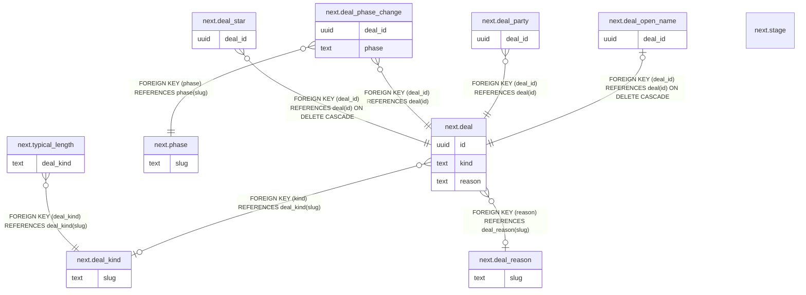

# Deals

## Description

Tables in this area and the foreign keys between them.

## Tables

| Name                                                | Columns | Comment | Type       |
| --------------------------------------------------- | ------- | ------- | ---------- |
| [next.deal](next.deal.md)                           | 19      |         | BASE TABLE |
| [next.deal_kind](next.deal_kind.md)                 | 6       |         | BASE TABLE |
| [next.deal_open_name](next.deal_open_name.md)       | 2       |         | BASE TABLE |
| [next.deal_party](next.deal_party.md)               | 9       |         | BASE TABLE |
| [next.deal_phase_change](next.deal_phase_change.md) | 11      |         | BASE TABLE |
| [next.deal_reason](next.deal_reason.md)             | 6       |         | BASE TABLE |
| [next.deal_star](next.deal_star.md)                 | 7       |         | BASE TABLE |
| [next.phase](next.phase.md)                         | 6       |         | BASE TABLE |
| [next.stage](next.stage.md)                         | 7       |         | BASE TABLE |
| [next.typical_length](next.typical_length.md)       | 7       |         | BASE TABLE |

## Relations

---

> Generated by [tbls](https://github.com/k1LoW/tbls)
