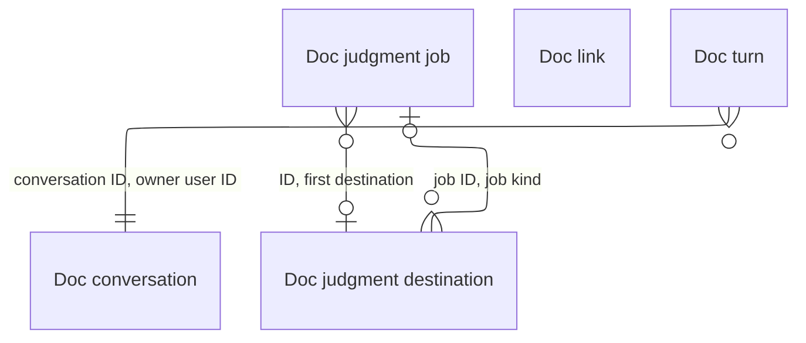

# Doc

## Tables

- [Doc conversation](next.doc_conversation.md)
- [Doc judgment destination](next.doc_judgment_destination.md)
- [Doc judgment job](next.doc_judgment_job.md)
- [Doc link](next.doc_link.md)
- [Doc turn](next.doc_turn.md)

See each table for its columns and links to other areas.
