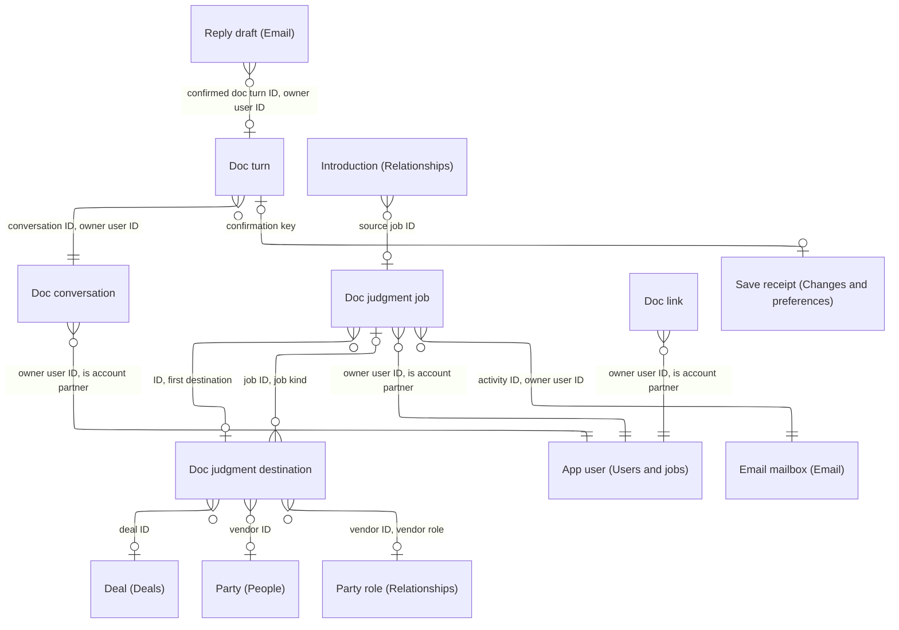

# Doc

## Connects to

Numbers count foreign keys between the two areas.

[Changes and preferences](viewpoint-changes-preferences.md) (1) · [Deals](viewpoint-deals.md) (1) · [Email](viewpoint-email.md) (2) · [People](viewpoint-people.md) (1) · [Relationships](viewpoint-relationships.md) (2) · [Users and jobs](viewpoint-users-jobs.md) (3)

## Tables

- [Doc conversation](next.doc_conversation.md)
- [Doc judgment destination](next.doc_judgment_destination.md)
- [Doc judgment job](next.doc_judgment_job.md)
- [Doc link](next.doc_link.md)
- [Doc turn](next.doc_turn.md)

See each table for its columns and links to other areas.
