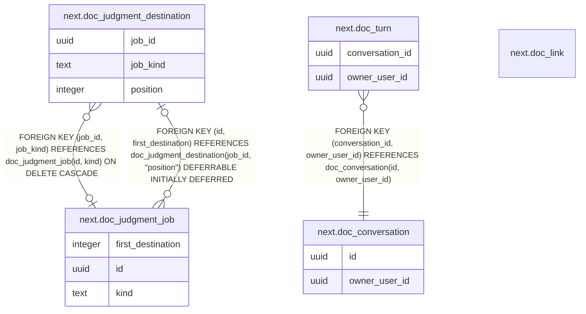

# Doc

## Description

Tables in this area and the foreign keys between them.

## Tables

| Name                                                              | Columns | Comment | Type       |
| ----------------------------------------------------------------- | ------- | ------- | ---------- |
| [next.doc_conversation](next.doc_conversation.md)                 | 4       |         | BASE TABLE |
| [next.doc_judgment_destination](next.doc_judgment_destination.md) | 6       |         | BASE TABLE |
| [next.doc_judgment_job](next.doc_judgment_job.md)                 | 13      |         | BASE TABLE |
| [next.doc_link](next.doc_link.md)                                 | 6       |         | BASE TABLE |
| [next.doc_turn](next.doc_turn.md)                                 | 17      |         | BASE TABLE |

## Relations

---

> Generated by [tbls](https://github.com/k1LoW/tbls)
