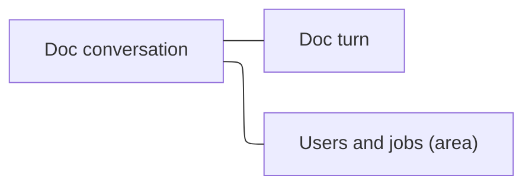
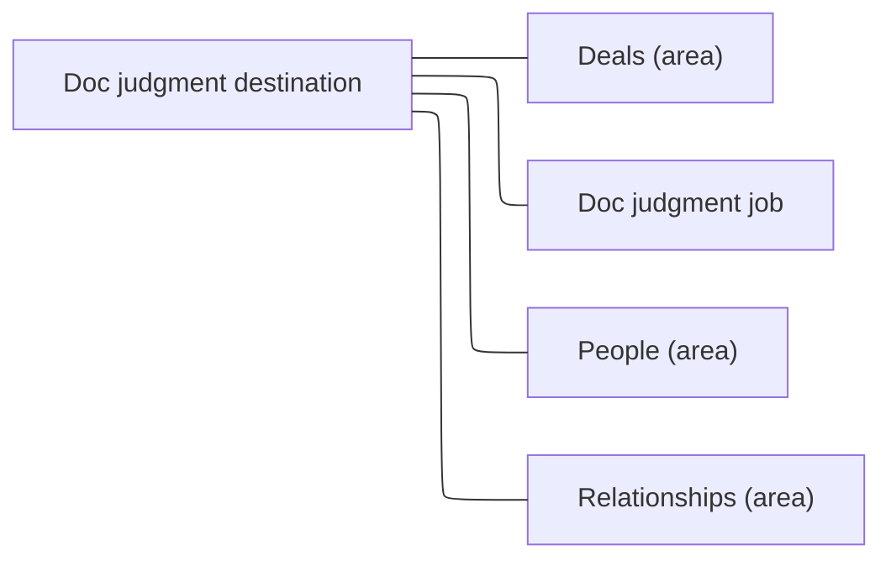
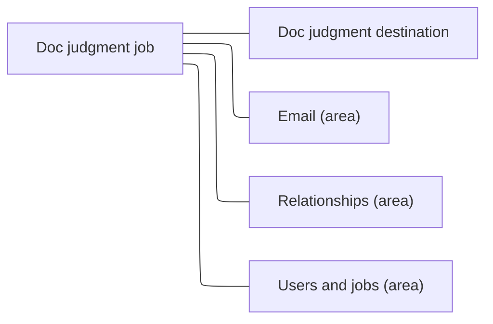
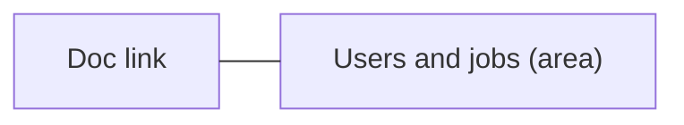
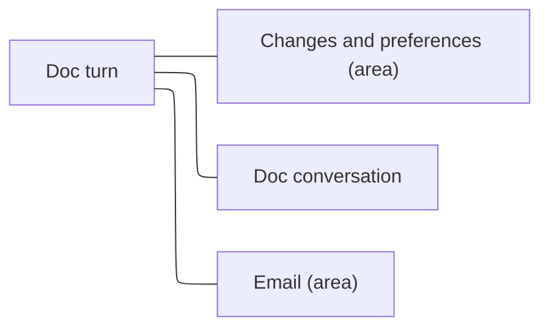

# Doc

Each line shows a connection. The foreign keys below name the exact columns.

### Doc conversation

### Doc judgment destination

### Doc judgment job

### Doc link

### Doc turn

## Foreign keys

| From table and columns                                                                    | To table and columns                                                                |
| ----------------------------------------------------------------------------------------- | ----------------------------------------------------------------------------------- |
| [doc_conversation](next.doc_conversation.md) (`owner_user_id`, `is_account_partner`)      | [app_user](next.app_user.md) (`id`, `is_account_partner`)                           |
| [doc_judgment_destination](next.doc_judgment_destination.md) (`deal_id`)                  | [deal](next.deal.md) (`id`)                                                         |
| [doc_judgment_destination](next.doc_judgment_destination.md) (`job_id`, `job_kind`)       | [doc_judgment_job](next.doc_judgment_job.md) (`id`, `kind`)                         |
| [doc_judgment_destination](next.doc_judgment_destination.md) (`vendor_id`)                | [party](next.party.md) (`id`)                                                       |
| [doc_judgment_destination](next.doc_judgment_destination.md) (`vendor_id`, `vendor_role`) | [party_role](next.party_role.md) (`party_id`, `role`)                               |
| [doc_judgment_job](next.doc_judgment_job.md) (`owner_user_id`, `is_account_partner`)      | [app_user](next.app_user.md) (`id`, `is_account_partner`)                           |
| [doc_judgment_job](next.doc_judgment_job.md) (`id`, `first_destination`)                  | [doc_judgment_destination](next.doc_judgment_destination.md) (`job_id`, `position`) |
| [doc_judgment_job](next.doc_judgment_job.md) (`activity_id`, `owner_user_id`)             | [email_mailbox](next.email_mailbox.md) (`activity_id`, `user_id`)                   |
| [doc_link](next.doc_link.md) (`owner_user_id`, `is_account_partner`)                      | [app_user](next.app_user.md) (`id`, `is_account_partner`)                           |
| [doc_turn](next.doc_turn.md) (`conversation_id`, `owner_user_id`)                         | [doc_conversation](next.doc_conversation.md) (`id`, `owner_user_id`)                |
| [doc_turn](next.doc_turn.md) (`confirmation_key`)                                         | [save_receipt](next.save_receipt.md) (`idempotency_key`)                            |
| [introduction](next.introduction.md) (`source_job_id`)                                    | [doc_judgment_job](next.doc_judgment_job.md) (`id`)                                 |
| [reply_draft](next.reply_draft.md) (`confirmed_doc_turn_id`, `owner_user_id`)             | [doc_turn](next.doc_turn.md) (`id`, `owner_user_id`)                                |

## Connects to

Numbers count foreign keys between the two areas.

[Changes and preferences](viewpoint-changes-preferences.md) (1) · [Deals](viewpoint-deals.md) (1) · [Email](viewpoint-email.md) (2) · [People](viewpoint-people.md) (1) · [Relationships](viewpoint-relationships.md) (2) · [Users and jobs](viewpoint-users-jobs.md) (3)

## Tables

- [Doc conversation](next.doc_conversation.md)
- [Doc judgment destination](next.doc_judgment_destination.md)
- [Doc judgment job](next.doc_judgment_job.md)
- [Doc link](next.doc_link.md)
- [Doc turn](next.doc_turn.md)
