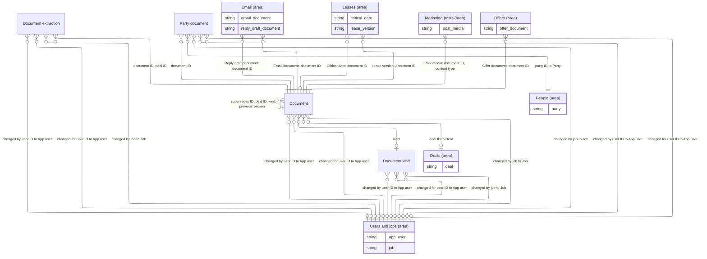

# Documents

## Connects to

Numbers count foreign keys between the two areas.

[Deals](viewpoint-deals.md) (1) · [Email](viewpoint-email.md) (2) · [Leases](viewpoint-leases.md) (2) · [Marketing posts](viewpoint-marketing-posts.md) (1) · [Offers](viewpoint-offers.md) (1) · [People](viewpoint-people.md) (1) · [Users and jobs](viewpoint-users-jobs.md) (12)

## Tables

- [Document](next.document.md)
- [Document extraction](next.document_extraction.md)
- [Document kind](next.document_kind.md)
- [Party document](next.party_document.md)

See each table for its columns and links to other areas.
