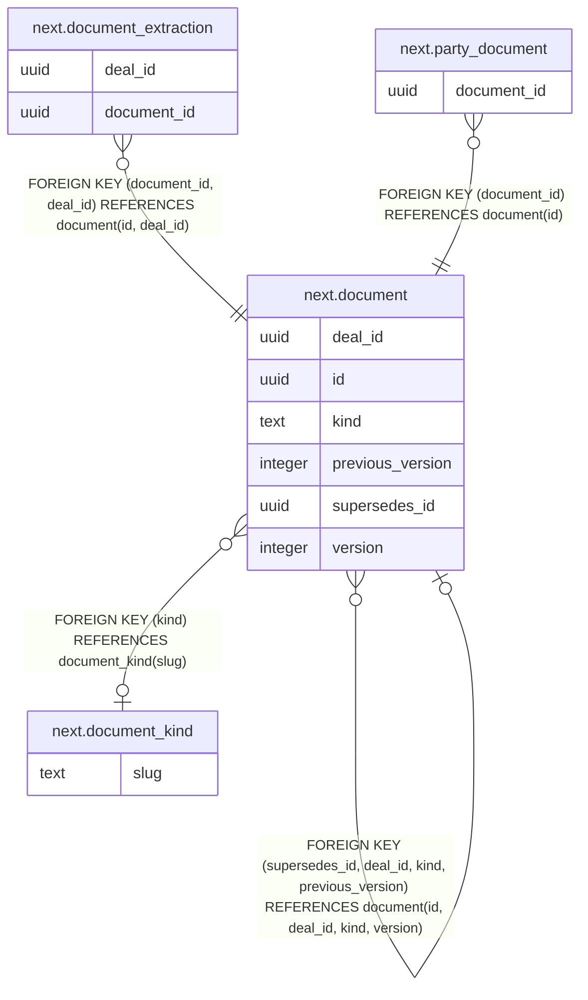

# Documents

## Description

Tables in this area and the foreign keys between them.

## Tables

| Name                                                    | Columns | Comment | Type       |
| ------------------------------------------------------- | ------- | ------- | ---------- |
| [next.document](next.document.md)                       | 18      |         | BASE TABLE |
| [next.document_extraction](next.document_extraction.md) | 16      |         | BASE TABLE |
| [next.document_kind](next.document_kind.md)             | 6       |         | BASE TABLE |
| [next.party_document](next.party_document.md)           | 7       |         | BASE TABLE |

## Relations

---

> Generated by [tbls](https://github.com/k1LoW/tbls)
