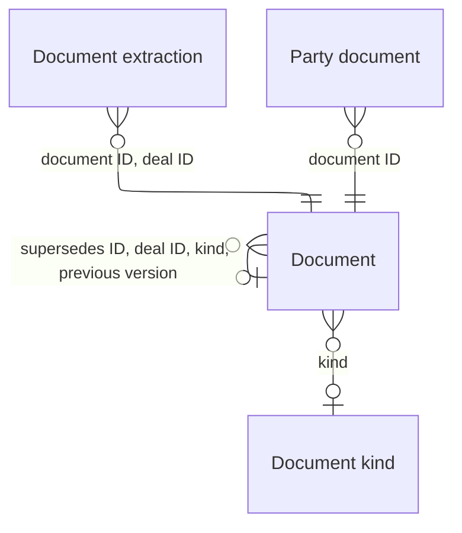

# Documents

## Tables

- [Document](next.document.md)
- [Document extraction](next.document_extraction.md)
- [Document kind](next.document_kind.md)
- [Party document](next.party_document.md)

See each table for its columns and links to other areas.
