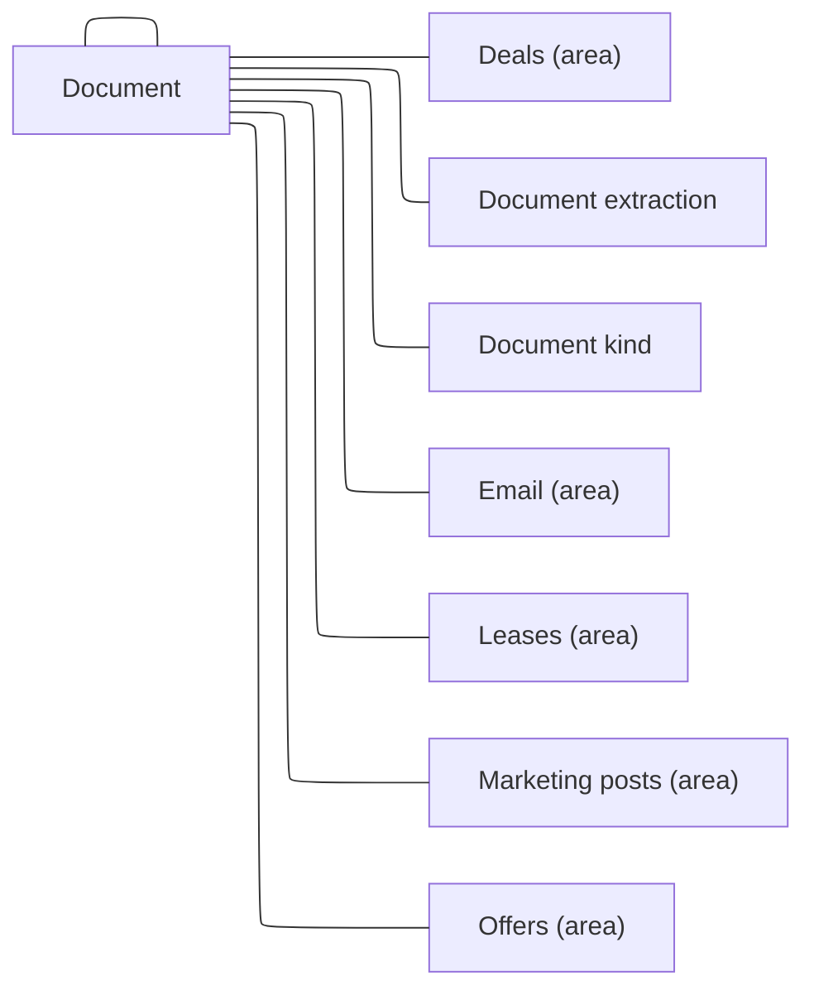
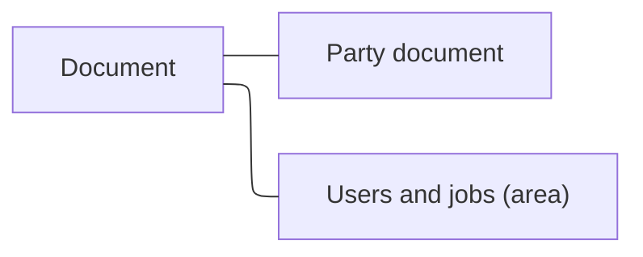
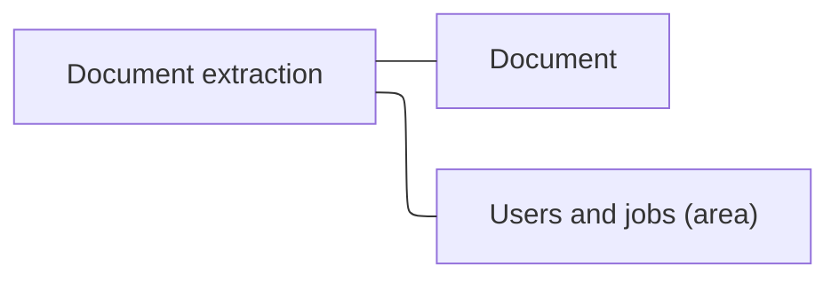
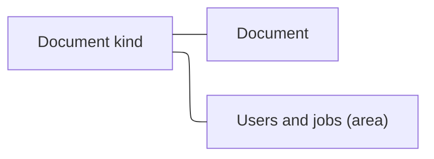
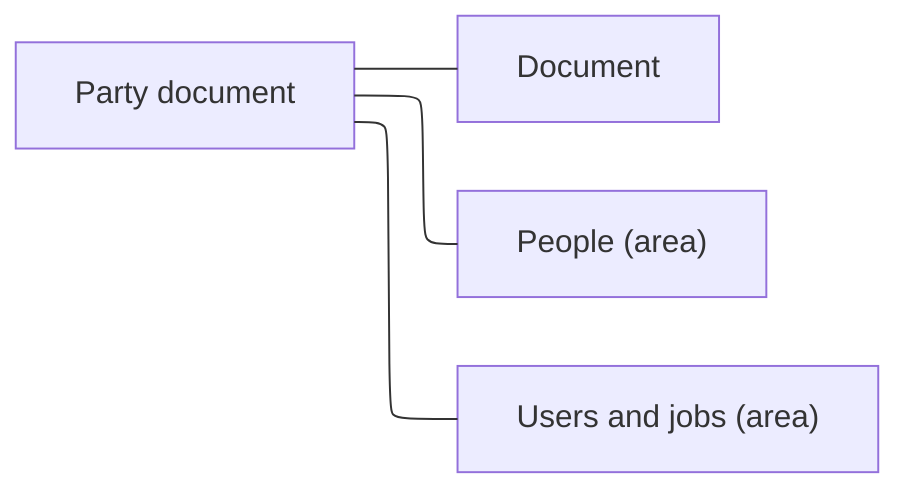

# Documents

Each line shows a connection. The foreign keys below name the exact columns.

### Document

### Document extraction

### Document kind

### Party document

## Foreign keys

| From table and columns                                                                | To table and columns                                              |
| ------------------------------------------------------------------------------------- | ----------------------------------------------------------------- |
| [critical_date](next.critical_date.md) (`document_id`)                                | [document](next.document.md) (`id`)                               |
| [document](next.document.md) (`changed_by_user_id`)                                   | [app_user](next.app_user.md) (`id`)                               |
| [document](next.document.md) (`changed_for_user_id`)                                  | [app_user](next.app_user.md) (`id`)                               |
| [document](next.document.md) (`deal_id`)                                              | [deal](next.deal.md) (`id`)                                       |
| [document](next.document.md) (`supersedes_id`, `deal_id`, `kind`, `previous_version`) | [document](next.document.md) (`id`, `deal_id`, `kind`, `version`) |
| [document](next.document.md) (`kind`)                                                 | [document_kind](next.document_kind.md) (`slug`)                   |
| [document](next.document.md) (`changed_by_job`)                                       | [job](next.job.md) (`slug`)                                       |
| [document_extraction](next.document_extraction.md) (`changed_by_user_id`)             | [app_user](next.app_user.md) (`id`)                               |
| [document_extraction](next.document_extraction.md) (`changed_for_user_id`)            | [app_user](next.app_user.md) (`id`)                               |
| [document_extraction](next.document_extraction.md) (`document_id`, `deal_id`)         | [document](next.document.md) (`id`, `deal_id`)                    |
| [document_extraction](next.document_extraction.md) (`changed_by_job`)                 | [job](next.job.md) (`slug`)                                       |
| [document_kind](next.document_kind.md) (`changed_by_user_id`)                         | [app_user](next.app_user.md) (`id`)                               |
| [document_kind](next.document_kind.md) (`changed_for_user_id`)                        | [app_user](next.app_user.md) (`id`)                               |
| [document_kind](next.document_kind.md) (`changed_by_job`)                             | [job](next.job.md) (`slug`)                                       |
| [email_document](next.email_document.md) (`document_id`)                              | [document](next.document.md) (`id`)                               |
| [lease_version](next.lease_version.md) (`document_id`)                                | [document](next.document.md) (`id`)                               |
| [offer_document](next.offer_document.md) (`document_id`)                              | [document](next.document.md) (`id`)                               |
| [party_document](next.party_document.md) (`changed_by_user_id`)                       | [app_user](next.app_user.md) (`id`)                               |
| [party_document](next.party_document.md) (`changed_for_user_id`)                      | [app_user](next.app_user.md) (`id`)                               |
| [party_document](next.party_document.md) (`document_id`)                              | [document](next.document.md) (`id`)                               |
| [party_document](next.party_document.md) (`changed_by_job`)                           | [job](next.job.md) (`slug`)                                       |
| [party_document](next.party_document.md) (`party_id`)                                 | [party](next.party.md) (`id`)                                     |
| [post_media](next.post_media.md) (`document_id`, `content_type`)                      | [document](next.document.md) (`id`, `content_type`)               |
| [reply_draft_document](next.reply_draft_document.md) (`document_id`)                  | [document](next.document.md) (`id`)                               |

## Connects to

Numbers count foreign keys between the two areas.

[Deals](viewpoint-deals.md) (1) · [Email](viewpoint-email.md) (2) · [Leases](viewpoint-leases.md) (2) · [Marketing posts](viewpoint-marketing-posts.md) (1) · [Offers](viewpoint-offers.md) (1) · [People](viewpoint-people.md) (1) · [Users and jobs](viewpoint-users-jobs.md) (12)

## Tables

- [Document](next.document.md)
- [Document extraction](next.document_extraction.md)
- [Document kind](next.document_kind.md)
- [Party document](next.party_document.md)
