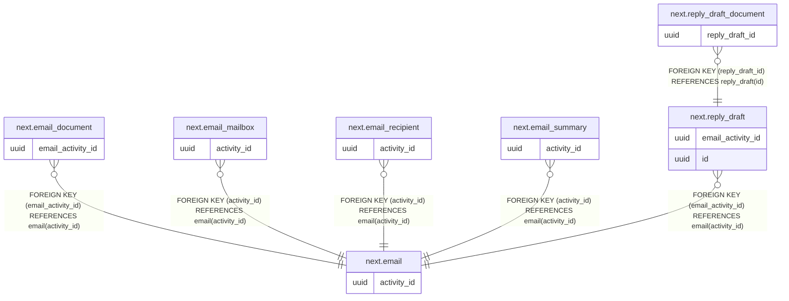

# Email

## Description

Tables in this area and the foreign keys between them.

## Tables

| Name                                                      | Columns | Comment | Type       |
| --------------------------------------------------------- | ------- | ------- | ---------- |
| [next.email](next.email.md)                               | 15      |         | BASE TABLE |
| [next.email_document](next.email_document.md)             | 7       |         | BASE TABLE |
| [next.email_mailbox](next.email_mailbox.md)               | 6       |         | BASE TABLE |
| [next.email_recipient](next.email_recipient.md)           | 8       |         | BASE TABLE |
| [next.email_summary](next.email_summary.md)               | 8       |         | BASE TABLE |
| [next.reply_draft](next.reply_draft.md)                   | 22      |         | BASE TABLE |
| [next.reply_draft_document](next.reply_draft_document.md) | 7       |         | BASE TABLE |

## Relations

---

> Generated by [tbls](https://github.com/k1LoW/tbls)
