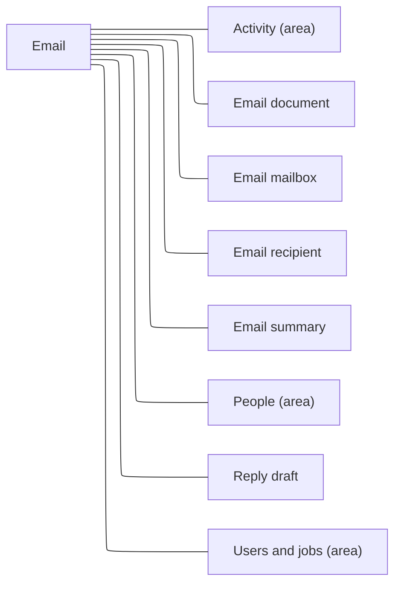
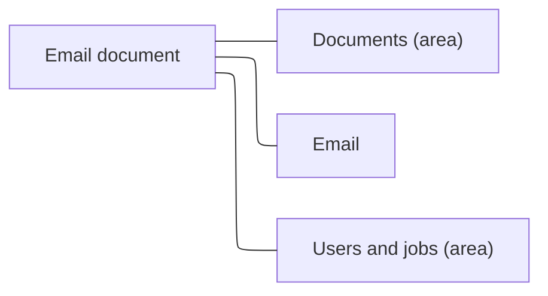
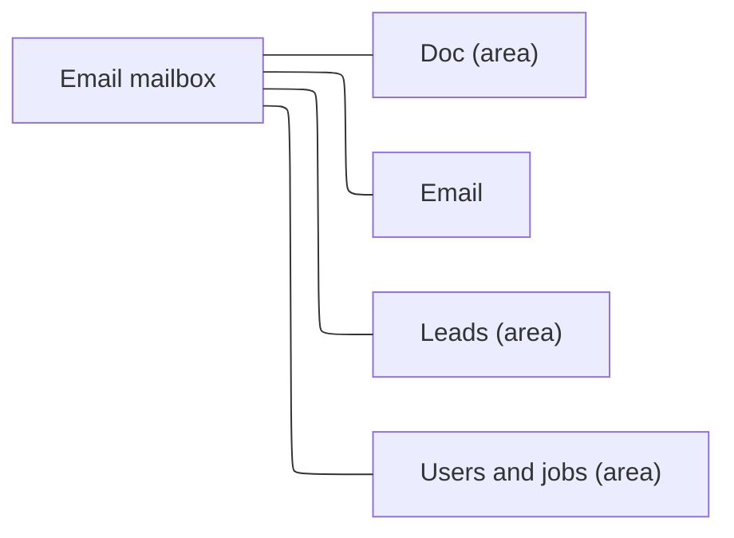
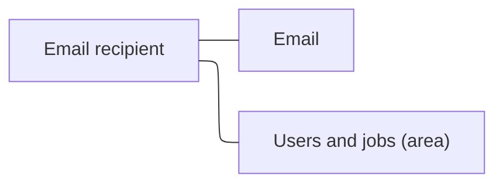
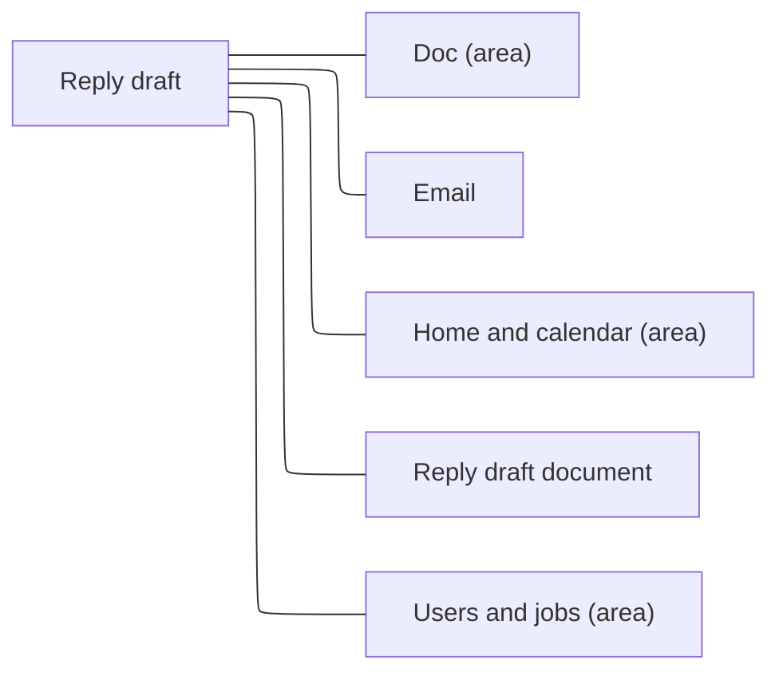
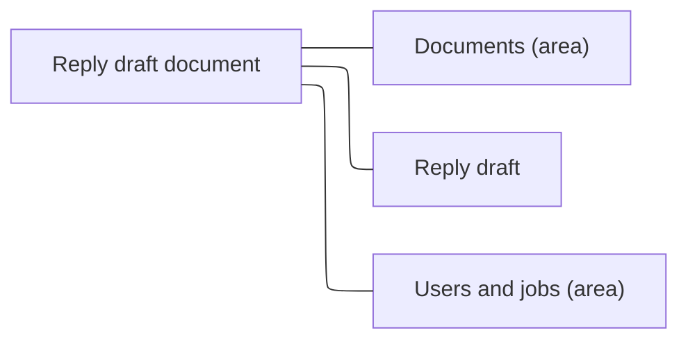

# Email

Each line shows a connection. The foreign keys below name the exact columns.

### Email

### Email document

### Email mailbox

### Email recipient

### Email summary

### Reply draft

### Reply draft document

## Foreign keys

| From table and columns                                                            | To table and columns                                              |
| --------------------------------------------------------------------------------- | ----------------------------------------------------------------- |
| [doc_judgment_job](next.doc_judgment_job.md) (`activity_id`, `owner_user_id`)     | [email_mailbox](next.email_mailbox.md) (`activity_id`, `user_id`) |
| [email](next.email.md) (`activity_id`, `activity_kind`)                           | [activity](next.activity.md) (`id`, `kind`)                       |
| [email](next.email.md) (`changed_by_user_id`)                                     | [app_user](next.app_user.md) (`id`)                               |
| [email](next.email.md) (`changed_for_user_id`)                                    | [app_user](next.app_user.md) (`id`)                               |
| [email](next.email.md) (`changed_by_job`)                                         | [job](next.job.md) (`slug`)                                       |
| [email_document](next.email_document.md) (`changed_by_user_id`)                   | [app_user](next.app_user.md) (`id`)                               |
| [email_document](next.email_document.md) (`changed_for_user_id`)                  | [app_user](next.app_user.md) (`id`)                               |
| [email_document](next.email_document.md) (`document_id`)                          | [document](next.document.md) (`id`)                               |
| [email_document](next.email_document.md) (`email_activity_id`)                    | [email](next.email.md) (`activity_id`)                            |
| [email_document](next.email_document.md) (`changed_by_job`)                       | [job](next.job.md) (`slug`)                                       |
| [email_mailbox](next.email_mailbox.md) (`changed_by_user_id`)                     | [app_user](next.app_user.md) (`id`)                               |
| [email_mailbox](next.email_mailbox.md) (`changed_for_user_id`)                    | [app_user](next.app_user.md) (`id`)                               |
| [email_mailbox](next.email_mailbox.md) (`user_id`)                                | [app_user](next.app_user.md) (`id`)                               |
| [email_mailbox](next.email_mailbox.md) (`activity_id`)                            | [email](next.email.md) (`activity_id`)                            |
| [email_mailbox](next.email_mailbox.md) (`changed_by_job`)                         | [job](next.job.md) (`slug`)                                       |
| [email_recipient](next.email_recipient.md) (`changed_by_user_id`)                 | [app_user](next.app_user.md) (`id`)                               |
| [email_recipient](next.email_recipient.md) (`changed_for_user_id`)                | [app_user](next.app_user.md) (`id`)                               |
| [email_recipient](next.email_recipient.md) (`activity_id`)                        | [email](next.email.md) (`activity_id`)                            |
| [email_recipient](next.email_recipient.md) (`changed_by_job`)                     | [job](next.job.md) (`slug`)                                       |
| [email_summary](next.email_summary.md) (`activity_id`)                            | [email](next.email.md) (`activity_id`)                            |
| [home_mark](next.home_mark.md) (`reply_draft_id`, `user_id`)                      | [reply_draft](next.reply_draft.md) (`id`, `owner_user_id`)        |
| [lead_email_source](next.lead_email_source.md) (`activity_id`, `mailbox_user_id`) | [email_mailbox](next.email_mailbox.md) (`activity_id`, `user_id`) |
| [outside_id](next.outside_id.md) (`email_activity_id`)                            | [email](next.email.md) (`activity_id`)                            |
| [reply_draft](next.reply_draft.md) (`changed_by_user_id`)                         | [app_user](next.app_user.md) (`id`)                               |
| [reply_draft](next.reply_draft.md) (`changed_for_user_id`)                        | [app_user](next.app_user.md) (`id`)                               |
| [reply_draft](next.reply_draft.md) (`owner_user_id`)                              | [app_user](next.app_user.md) (`id`)                               |
| [reply_draft](next.reply_draft.md) (`confirmed_doc_turn_id`, `owner_user_id`)     | [doc_turn](next.doc_turn.md) (`id`, `owner_user_id`)              |
| [reply_draft](next.reply_draft.md) (`email_activity_id`)                          | [email](next.email.md) (`activity_id`)                            |
| [reply_draft](next.reply_draft.md) (`changed_by_job`)                             | [job](next.job.md) (`slug`)                                       |
| [reply_draft](next.reply_draft.md) (`proposed_by_job`)                            | [job](next.job.md) (`slug`)                                       |
| [reply_draft_document](next.reply_draft_document.md) (`changed_by_user_id`)       | [app_user](next.app_user.md) (`id`)                               |
| [reply_draft_document](next.reply_draft_document.md) (`changed_for_user_id`)      | [app_user](next.app_user.md) (`id`)                               |
| [reply_draft_document](next.reply_draft_document.md) (`document_id`)              | [document](next.document.md) (`id`)                               |
| [reply_draft_document](next.reply_draft_document.md) (`changed_by_job`)           | [job](next.job.md) (`slug`)                                       |
| [reply_draft_document](next.reply_draft_document.md) (`reply_draft_id`)           | [reply_draft](next.reply_draft.md) (`id`)                         |

## Connects to

Numbers count foreign keys between the two areas.

[Activity](viewpoint-activity.md) (1) · [Doc](viewpoint-doc.md) (2) · [Documents](viewpoint-documents.md) (2) · [Home and calendar](viewpoint-home-calendar.md) (1) · [Leads](viewpoint-leads.md) (1) · [People](viewpoint-people.md) (1) · [Users and jobs](viewpoint-users-jobs.md) (21)

## Tables

- [Email](next.email.md)
- [Email document](next.email_document.md)
- [Email mailbox](next.email_mailbox.md)
- [Email recipient](next.email_recipient.md)
- [Email summary](next.email_summary.md)
- [Reply draft](next.reply_draft.md)
- [Reply draft document](next.reply_draft_document.md)
