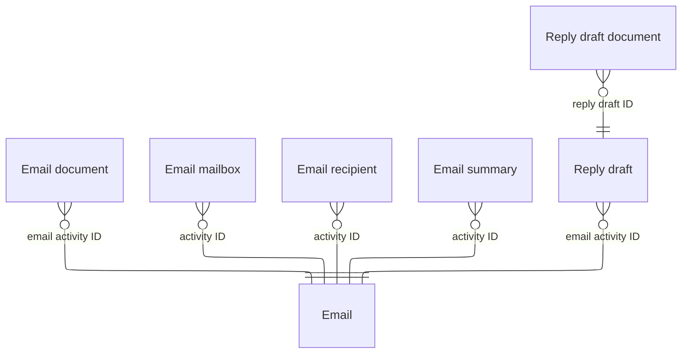

# Email

## Tables

- [Email](next.email.md)
- [Email document](next.email_document.md)
- [Email mailbox](next.email_mailbox.md)
- [Email recipient](next.email_recipient.md)
- [Email summary](next.email_summary.md)
- [Reply draft](next.reply_draft.md)
- [Reply draft document](next.reply_draft_document.md)

See each table for its columns and links to other areas.
