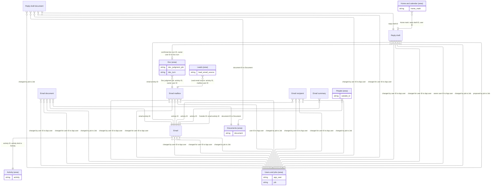

# Email

## Connects to

Numbers count foreign keys between the two areas.

[Activity](viewpoint-activity.md) (1) · [Doc](viewpoint-doc.md) (2) · [Documents](viewpoint-documents.md) (2) · [Home and calendar](viewpoint-home-calendar.md) (1) · [Leads](viewpoint-leads.md) (1) · [People](viewpoint-people.md) (1) · [Users and jobs](viewpoint-users-jobs.md) (21)

## Tables

- [Email](next.email.md)
- [Email document](next.email_document.md)
- [Email mailbox](next.email_mailbox.md)
- [Email recipient](next.email_recipient.md)
- [Email summary](next.email_summary.md)
- [Reply draft](next.reply_draft.md)
- [Reply draft document](next.reply_draft_document.md)

See each table for its columns and links to other areas.
