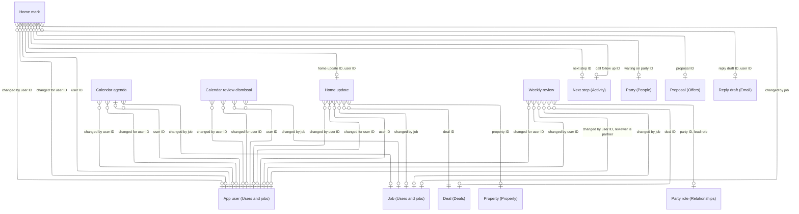

# Home and calendar

## Connects to

Numbers count foreign keys between the two areas.

[Activity](viewpoint-activity.md) (2) · [Deals](viewpoint-deals.md) (2) · [Email](viewpoint-email.md) (1) · [Offers](viewpoint-offers.md) (1) · [People](viewpoint-people.md) (1) · [Property](viewpoint-property.md) (1) · [Relationships](viewpoint-relationships.md) (1) · [Users and jobs](viewpoint-users-jobs.md) (20)

## Tables

- [Calendar agenda](next.calendar_agenda.md)
- [Calendar review dismissal](next.calendar_review_dismissal.md)
- [Home mark](next.home_mark.md)
- [Home update](next.home_update.md)
- [Weekly review](next.weekly_review.md)

See each table for its columns and links to other areas.
