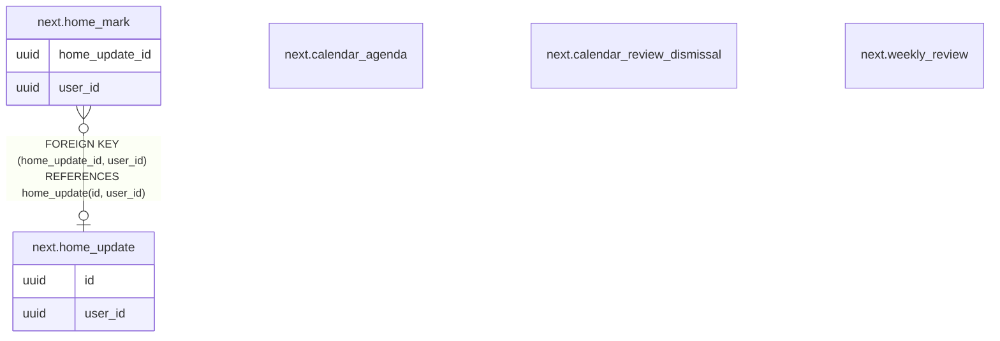

# Home and calendar

## Description

Tables in this area and the foreign keys between them.

## Tables

| Name                                                                | Columns | Comment | Type       |
| ------------------------------------------------------------------- | ------- | ------- | ---------- |
| [next.calendar_agenda](next.calendar_agenda.md)                     | 7       |         | BASE TABLE |
| [next.calendar_review_dismissal](next.calendar_review_dismissal.md) | 7       |         | BASE TABLE |
| [next.home_mark](next.home_mark.md)                                 | 18      |         | BASE TABLE |
| [next.home_update](next.home_update.md)                             | 15      |         | BASE TABLE |
| [next.weekly_review](next.weekly_review.md)                         | 10      |         | BASE TABLE |

## Relations

---

> Generated by [tbls](https://github.com/k1LoW/tbls)
